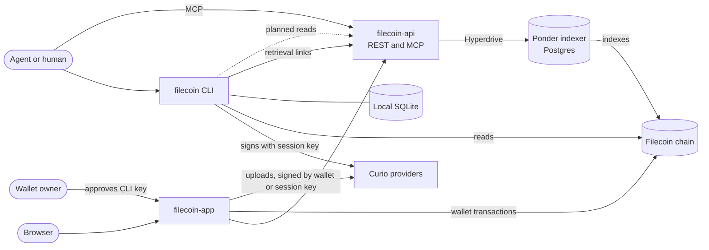

# Filecoin for Agents

`filecoin` began as a proof of concept for a [Filecoin](https://docs.filecoin.cloud/) command-line interface built for agents. It now has four parts: a CLI, a REST API, an MCP server, and a web app. This page is the entry point to the proof of concept. It summarizes the four parts and records the assumptions, compromises, open questions, and follow-up work.

## What the project includes

The table lists the four parts, the agent skill, and the agent plugin.

| Part | What it does | Code | Where it runs |
| --- | --- | --- | --- |
| CLI | `filecoin` stores a file or folder as one copy on one Curio provider and returns retrieval URLs. It resumes an interrupted put or delete without paying twice. | [`packages/filecoin-cli`](../../packages/filecoin-cli/README.md) | Locally or in a cloud sandbox, from npm as `filecoin`, or after a build from source |
| Agent skill | Teaches an agent to use `filecoin` | [`plugins/filecoin/skills/filecoin/SKILL.md`](../../plugins/filecoin/skills/filecoin/SKILL.md) | In the agent, after installing the plugin, or after `npx skills add https://poc.filecoin.cloud`, `npx skills add filecoin-project/agents`, or `filecoin skills install`. The site serves it at https://poc.filecoin.cloud/.well-known/agent-skills/index.json |
| REST API | Serves read-only data on providers, data sets, pieces, Filecoin Pay rails, and session keys. `/get/{cid}` redirects to where a CID can be retrieved. | [`apps/filecoin-api`](../../apps/filecoin-api/README.md) | https://api.filecoin.io, with a reference at [`/docs`](https://api.filecoin.io/docs) |
| MCP server | Offers one read-only tool for each REST API data route, over stateless Streamable HTTP | [`apps/filecoin-api/src/mcp`](../../apps/filecoin-api/src/mcp/server.ts) | `POST https://mcp.filecoin.io`, also at `https://api.filecoin.io/mcp` |
| Web app | Serves the landing page, the docs, and the Agents page. Every page also has a Markdown version, and `llms.txt`, a sitemap, and well-known paths describe the API, the MCP server, and the skill to agents. It shows the REST API's data in an explorer, which a Worker renders on the server. Its wallet dashboard manages Filecoin Pay, the Warm Storage approval, data sets, uploads, rails, and session keys. Its setup page approves `filecoin login` keys and funding requests. Browser agents can fill it and read the account, data sets, pieces, and session keys through WebMCP. | [`apps/filecoin-app`](../../apps/filecoin-app/README.md) | https://poc.filecoin.cloud |
| Agent plugin | Bundles the agent skill and the MCP server, in the portable [Agent Plugins](https://agent-plugins.org/specification) format with a Claude Code manifest. The skill runs the CLI from npm. | [`plugins/filecoin`](../../plugins/filecoin/README.md) | Claude Code and Codex, from this repository's marketplaces, and other Agent Plugins clients |

## How the parts connect

All parts use the same chain and the same providers, but each part keeps its own state:

- **The CLI does not read from filecoin-api yet.** It reads the chain through synapse-core. It keeps its resources and operations in a local SQLite database. Its retrieval links point to filecoin-api's `/get/{cid}` route, which redirects to a provider or to inbrowser.link.
- **The app reads through filecoin-api.** It writes with the connected wallet or with a session key made in the dashboard. The app stores those session keys in the browser's `localStorage`.
- **`filecoin login` sends the owner to filecoin-app.** The CLI keeps its session key on the machine and sends only the key's address, name, scopes, and expiry in a [setup link](../../apps/filecoin-app/README.md#setup-links). The owner reviews the prefilled page and signs the approval with their wallet. `filecoin status` and `put` send funding requests to the same page.

## How agents find and use Filecoin for Agents

Each kind of agent has one way in, and each step of discovery shows only enough to choose the next one:

| Layer | Question it answers | Where it lives |
| --- | --- | --- |
| Signal | Is Filecoin for Agents relevant? | The skill's `description`, the MCP server card, the summary at the top of `llms.txt`, and each page's `<meta name="description">` |
| Router | Which way in fits this agent? | The three bullets in `llms.txt`, expanded on the site's [Agents page](https://poc.filecoin.cloud/agents) |
| Playbook | How do I do the task safely? | The [agent skill](../../plugins/filecoin/skills/filecoin/SKILL.md) for agents with a shell, the WebMCP tool descriptions for browser agents, and the MCP `tools/list` for agents that only call remote tools |
| Reference | Exact flags, fields, and errors | `filecoin --help`, `filecoin <command> --help`, and `filecoin schema <command>` for the installed CLI, filecoin-api's OpenAPI document, and each tool's input schema |
| Concepts | Why it works this way | The site's docs pages, which link to the reference instead of copying it |

| Agent | Can it | Way in |
| --- | --- | --- |
| Local, such as Claude Code or Codex | Run a shell, keep files, and open pages for the user | The agent plugin, or the agent skill alone, and the CLI |
| Cloud, such as a coding agent in a hosted sandbox | Run a shell, but its files are gone when the session ends | The agent skill and the CLI, with a session key from the environment's secrets |
| Browser | Use web pages in the browser that holds the wallet | filecoin-app's WebMCP tools, setup links, and the upload page |
| Chat app with connectors | Call remote tools | The read-only MCP server |

Each fact has one owner, and the others link to it. The skill owns the agent's workflow and rules. The CLI owns its flags, outputs, and error codes. The Agents page owns the ways in and the approval flow. The [Retrieve and verify](https://poc.filecoin.cloud/docs/retrieve) page owns what each retrieval link checks. The skill stays one file: it links to those two site pages for the cloud and retrieval details, so it carries no copies of them. filecoin-app's tests check that every link from the docs pages and the skill to a docs page and heading resolves.

## Related documents

| Document | Contents |
| --- | --- |
| [CLI architecture](architecture.md) | How the CLI works: modules, login, put, get, delete, local state, recovery, and how the CLI differs from the research |
| [CLI interface research](interface-research.md) | The historical design research from 2026-09-28 that came before the CLI. The [differences table](architecture.md#differences-from-the-research-design) lists where the CLI differs from it. |
| [API and MCP domains](mcp-domains.md) | The `filecoin.io` and `filecoin.cloud` hostnames that serve filecoin-api and its MCP server, and the Cloudflare for SaaS setup behind `filecoin.io` |
| [filecoin-api README](../../apps/filecoin-api/README.md) | Routes, retrieval redirects, MCP tools, deploys, and limits |
| [filecoin-app README](../../apps/filecoin-app/README.md) | The explorer, the dashboard, the stack, and deploys |
| [hooks-synapse README](../../apps/filecoin-app/src/hooks-synapse/README.md) | React hooks that synapse-react lacks, and the synapse-core and synapse-react bugs found while writing them |

## Assumptions behind the proof of concept

- **We test with our own app and website.** For testing, the CLI uses filecoin-app instead of pay.filecoin.cloud. For the same reason, filecoin-app's landing page and docs take the place of filecoin.cloud and filecoin.io. The results of this prototype will inform improvements to pay.filecoin.cloud, filecoin.cloud, and filecoin.io.
- **Two kinds of user.** An agent runs `filecoin` in a shell, uses filecoin-app in a browser, or calls the MCP server. A human owns the wallet, approves the agent's session key, and funds the account. The agent never holds the wallet key.
- **Claude and ChatGPT first.** The [agent plugin](../../plugins/filecoin/README.md) is the main way to add `filecoin` to Claude Code and Codex. It uses the portable Agent Plugins format, so other clients that support it can load it too. Other agents get a manual fallback. The user runs `filecoin skills install` to copy the skill into `.agents/skills` and `.claude/skills`, or installs it with the [`skills` CLI](https://github.com/vercel-labs/skills) from the repository or the site. The user can also add the MCP server URL to the agent's settings.
- **A session key is enough for storage.** A key with the `createDataSet`, `addPieces`, and `schedulePieceRemovals` scopes can store and delete data. Only the owner can deposit, approve operators, or terminate service.
- **synapse-core is enough.** The CLI and the app call synapse-core directly. Neither uses synapse-sdk.
- **Content fits in one piece.** A file, or the CAR of a folder, must be between 127 and 1,065,353,216 bytes.
- **Browsers render files from Curio and folders through a gateway.** Curio's `/piece` endpoint serves a file inline with a detected content type, so a browser renders it. Its `/ipfs` endpoint returns only blocks and CARs, so browser links to folders go to [inbrowser.link](https://inbrowser.link), a public gateway that runs in a service worker.
- **filecoin-api serves most reads.** The CLI will read most data from filecoin-api. It will fall back to chain reads through synapse-core only where filecoin-api cannot serve a read. Today the CLI reads all chain data through synapse-core.
- **The indexer runs outside this repository.** filecoin-api reads the `early-repair` and `foc-observer` schemas of a Ponder Postgres database. It never writes to the database. The databases run in Helsinki, and filecoin-api runs in Frankfurt, next to Hyperdrive's connection pool ([placement](../../apps/filecoin-api/README.md#placement)).
- **Calibration first.** The CLI defaults to calibration. Every part also supports mainnet, but the only recorded end-to-end run of the CLI was on calibration, on 2026-09-29.

## Compromises in the proof of concept

### CLI

- **Flat commands.** The research proposed separate `files` and `artifacts` groups. Instead, `put`, `get`, `ls`, `inspect`, and `delete` handle both and pick the handling from the input.
- **Plain-text session key.** `filecoin` stores the key in `config.json` with mode `0600`, not in an OS keychain.
- **`logout` leaves the key valid on chain.** It deletes the key on this machine but does not revoke it.
- **Local view only.** `filecoin ls` lists only the resources in this machine's state database. It cannot see content stored from another machine, from a cloud sandbox that was reset, or from the app. [Retrieve and verify](https://poc.filecoin.cloud/docs/retrieve#find-stored-content) shows how to find that content by wallet.
- **Piece removal stops at `removal_pending`.** Nothing tracks when the provider removes the piece.
- **Slow hashing.** PieceCID hashing takes about 70 seconds per GiB. `put`, `operations resume`, and `get` each hash the whole content ([#5](https://github.com/filecoin-project/agents/issues/5)).
- **Shallow folder check.** `inspect --check` probes only the piece URL, not each file of a folder.
- **Result links wait for the indexer.** The piece link and a file's browser link in the `put` result return 404 until filecoin-api's indexer has the new piece. Before that, `put` reports an early link on stderr. A file's early link carries a provider hint and works once the provider has parked the piece. A folder's link goes through inbrowser.link, which works only after Curio indexes the CAR and announces it to IPNI. Curio starts that when it receives the commit, before the transaction confirms. `filecoin get` downloads from the provider directly.
- **No `--events`, `--fields`, or `operations inspect --refresh`.** The research proposed all three.

### REST API and MCP server

- **Agents cannot store data through MCP.** Neither the REST API nor the MCP server can store, delete, or sign. A remote MCP server cannot read files from the agent's machine, so uploads need a different design.
- **No authentication.** The only control is a per-IP rate limit of 120 requests a minute for the REST API and 60 for MCP.
- **Data trails the chain.** The REST API and the MCP server return what the indexer has stored so far. `/health` reports the latest indexed block.
- **Unindexed owner queries.** An `owner` filter scans every data set until the indexer adds an index ([#6](https://github.com/filecoin-project/agents/issues/6)).
- **Best-effort browser links for folders.** For a folder, `/get/{cid}?browser=true` redirects to inbrowser.link, which this project does not operate. For a file, it redirects to the provider's `/piece` URL.

### App

- **Session keys in `localStorage`.** The app scopes them by chain and wallet, but any script on the origin can read them.
- **WebMCP is an early preview.** The app's WebMCP tools work in Chrome 149 and later on poc.filecoin.cloud through an origin-trial token that expires on 2027-03-30. Elsewhere they need Chromium's `#enable-webmcp-testing` flag. The ChatGPT Chrome extension finds the tools, and OpenAI documents WebMCP support, under the name site tools, in the ChatGPT desktop app's built-in browser. Other browsers ignore the tools, and agents use the setup link instead. Testing with real agents is tracked in [#8](https://github.com/filecoin-project/agents/issues/8).
- **Explorer lists load in the browser.** The server renders each page, but only detail pages, such as a rail or a data set, include their data. Lists and tables still fetch their rows after the page loads, so an agent that fetches a list page gets no rows.
- **Server rendering hides the visitor from filecoin-api.** When the Worker fetches from filecoin-api during server rendering, filecoin-api's per-IP rate limit counts the Worker, not the visitor.
- **Site content is a copy.** The site's pages in `apps/filecoin-app/src/content` are edited copies of the READMEs. Nothing keeps them in sync, so they can fall behind the code. They point to `filecoin --help`, `filecoin schema`, and the OpenAPI document instead of copying command, error code, and route tables.
- **Browser agents can't verify files or store folders.** A file's browser link serves the bytes without checking them, and inbrowser.link checks only folders. The dashboard's upload page stores files, not folders, and needs the wallet owner to sign.
- **Draft discovery formats.** The MCP server card (SEP-2127) and agent skills discovery are drafts. The site serves the server card at both `/.well-known/mcp/server-card.json` and `/.well-known/mcp-server-card`, because clients check one or the other. integrations.sh reads the older card format's top-level `url` and skips ours, so the API catalog also lists the MCP server as an `item`, and `/.well-known/integrations.json` declares it. filecoin-api's own origin serves none of the discovery files.
- **Upstream hooks kept in the app.** `hooks-synapse` adds hooks that synapse-react 0.5.0 lacks. It also works around the bugs listed in [its README](../../apps/filecoin-app/src/hooks-synapse/README.md).

### Project

- **One copy, for simplicity.** synapse-sdk stores two copies by default. The CLI and the app's upload store one copy on one provider to keep the prototype simple.
- **Hosts.** The REST API and the app deploy to FilOz's Cloudflare account. The API and the MCP server are advertised at `api.filecoin.io` and `mcp.filecoin.io`, whose DNS stays on DNSimple and reaches the `filecoin.cloud` zone through Cloudflare for SaaS ([API and MCP domains](mcp-domains.md)). `api.filecoin.cloud` and `mcp.filecoin.cloud` serve the same Worker, because `filecoin` 0.5.0 and the plugin 0.2.0 and later use them until the next releases. The app is at `poc.filecoin.cloud`. The earlier deployments at `fil-api.hugomrdias.dev` and `fil-app.hugomrdias.dev`, in a personal Cloudflare account, still run but no longer get deploys, so CLIs and plugins released before the move keep working.
- **npm is the only channel.** release-please versions the CLI, the apps, and the plugin, and the Release workflow publishes `filecoin` to npm ([release](../../.github/CONTRIBUTING.md#release)). `clipact` and `@hugomrdias/vite-plugin-agent-skills` moved to [hugomrdias/agents](https://github.com/hugomrdias/agents), which releases them, and `filecoin` installs them from npm. The apps stay private.
- **The skill does not bundle the CLI.** It runs `filecoin` from the PATH, or `npx -y filecoin`. The bundle is 1.3 MB of JavaScript in 42 files. It would turn the skill into an archive whose digest changes on every CLI build, be copied into every skills directory, and be harder to review than text. It would still need Node.js 24 and network access to the RPC and providers, so it would run nowhere that `npx` can't.
- **Agent details live on the site.** The skill links to the site's [Agents](https://poc.filecoin.cloud/agents.md#cloud-agents) and [Retrieve and verify](https://poc.filecoin.cloud/docs/retrieve.md) pages instead of carrying reference files. An agent needs network access to read them, and they describe `main`, which can be newer than an installed CLI.
- **One skills directory, many copies.** The plugin's [`skills/`](../../plugins/filecoin/skills) directory is the only source of the agent skills. The plugin installs it, the filecoin-cli build copies it into the package for `filecoin skills install`, filecoin-app's build publishes it as static files, and `npx skills add filecoin-project/agents` finds it on GitHub through the skills that the Claude Code marketplace entry declares. The copies can differ: the site and GitHub serve `main`, an installed plugin carries the skill from its last release, and an installed CLI carries it from its build. The skill points agents to `filecoin schema` instead of listing flags, so it tolerates the gap. filecoin-app publishes them with [`@hugomrdias/vite-plugin-agent-skills`](https://github.com/hugomrdias/agents/blob/main/packages/vite-plugin-agent-skills/README.md), which writes them into the client build as static files and packs a skill with more than `SKILL.md` as a `.tar.gz` archive. `pnpm check:skills` runs the Vite plugin's validation on the skills, and checks that every development skill directory in `.agents/skills` and `.claude/skills` is in `skills-lock.json`, because `npx skills add` would publish an unlocked one. The archive digest depends on Node's zlib output, so a Node upgrade that changes it makes clients see an update.
- **Old infrastructure names.** The rename from `fil` to `filecoin` kept the `fil-` names of the Workers, the GitHub environments, the Hyperdrive configuration, and the app's browser storage keys. That way it redeployed nothing and kept wallet connections and session keys saved in browsers.
- **Two plugin manifests.** Claude Code does not read the Agent Plugins manifest, so `.claude-plugin/plugin.json` repeats its metadata and its MCP server, in Claude Code's format. `pnpm check:plugin` checks that the two agree, and release-please writes the version into both.
- **No plugin on the web.** Claude and ChatGPT on the web install no local plugins. There, users add the MCP server as a custom connector and get no skill. A ChatGPT plugin would need the MCP server registered as a connector first.
- **No agent evaluation yet.** No one has run the [agent evaluations](https://github.com/hugomrdias/agents/blob/main/docs/agent-cli/guidelines.md#evaluate-with-agents) in Claude or ChatGPT.

## Open questions

- With two copies, how does a put report a partial result when only one copy succeeds?
- For browser links, should we rely on inbrowser.link, run our own gateway with an origin per publication, or wait for Beam to serve IPFS content?
- Should the remote MCP server get upload and delete tools? If so, what authentication and upload transport does it use? Or should a local MCP server wrap the CLI instead?
- What do we need before we recommend mainnet to agents? Candidates are spending limits and keychain storage.
- Who runs the indexer, and what availability do we promise? The Cloudflare deployment is in FilOz's account.
- Do mutable names, custom domains, private content, or content over 1 GiB belong in the first release? The research deferred all four.

## Follow-up work

- **Brand.** Apply the Filecoin for Agents brand to the site.
- **Evaluation.** Run the [acceptance scenarios](interface-research.md#first-release-and-validation) with Claude and ChatGPT. Count duplicate paid mutations, and check that each share link works.
- **Explorer for agents.** Render explorer lists on the server, and serve explorer pages as Markdown, so agents can read them like the docs.
- **Plugin directories.** Test the plugin in the Claude and ChatGPT desktop apps. Then submit it to Anthropic's plugin directory and to OpenAI's, which needs the MCP server registered as a ChatGPT connector.
- **MCP catalogs.** Publish filecoin-api to the [MCP registry](https://registry.modelcontextprotocol.io) from the release workflow. After filecoin-app deploys its API catalog `item` and `/.well-known/integrations.json`, map poc.filecoin.cloud on [integrations.sh](https://integrations.sh), which feeds `npx add-mcp find` ([#10](https://github.com/filecoin-project/agents/issues/10)).
- **Browser verification.** Add a WebMCP tool that checks a file against its PieceCID in the page, and let the upload page store folders.
- **Two copies.** Store two copies by default in the CLI and the app's upload, as synapse-sdk does.
- **CLI reads.** Move most CLI reads to filecoin-api. Keep synapse-core chain reads as the fallback.
- **CLI performance.** Hash PieceCIDs with `@hugomrdias/commp-wasm` ([#5](https://github.com/filecoin-project/agents/issues/5)).
- **CLI keys.** Store the session key in the OS keychain. Revoke the key on chain from `logout`.
- **CLI cancellation.** Pass the abort signal to viem once its actions and `fallback` transport accept one. Then remove `withSignal()` and `abortable()` ([#12](https://github.com/filecoin-project/agents/issues/12)).
- **CLI state.** Track a removal until the provider deletes the piece. Check every file of a folder in `inspect --check`.
- **Old hosts.** Delete the `fil-api` and `fil-app` Workers and their `hugomrdias.dev` domains from the personal Cloudflare account. Released CLIs and plugins point at `filecoin.cloud` since `filecoin` 0.5.0 and the plugin 0.2.0; only earlier releases still call the old hosts.
- **MCP servers.** Review the [foc-observer](https://github.com/FilOzone/foc-observer) MCP server. Merge its tools into the filecoin-api MCP server.
- **Indexer.** Index `data_sets(payer)` in the early-repair schema ([#6](https://github.com/filecoin-project/agents/issues/6)). Consider moving the databases near Frankfurt, where Hyperdrive pools their connections, to cut each query from about 30 ms to an estimated 5–10 ms ([placement](../../apps/filecoin-api/README.md#placement)).
- **Upstream.** Move `hooks-synapse` into synapse-react. Report the synapse-core and synapse-react bugs listed in its README.
