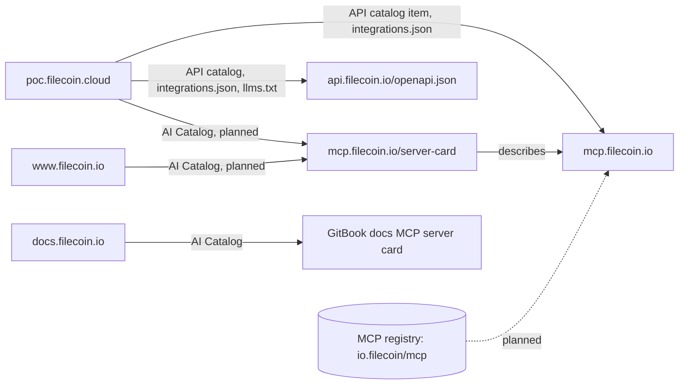

# Agent discovery

This document lists every agent discovery spec that applies to Filecoin for Agents. For each spec, it says what the spec is, what we serve today, what is missing, and which host should serve it. It also lists the specs that don't apply.

We checked each host with `curl` on 2026-10-21, after [#76](https://github.com/filecoin-project/agents/pull/76) deployed filecoin-api's MCP server card. [Reproduce the checks](#reproduce-the-checks) has the commands. For details on the hosts that other teams run, see [Agent discovery on filecoin.io](filecoin-io-agent-support.md) and [Agent support on docs.filecoin.io](filecoin-docs-agent-support.md).

## The hosts

| Host | What it is | Who runs it |
| --- | --- | --- |
| `poc.filecoin.cloud` | The Filecoin for Agents site, with the landing page, docs, Agents page, explorer, and dashboard ([`apps/filecoin-app`](../../apps/filecoin-app/README.md)) | Us |
| `api.filecoin.io` | The REST API, and the MCP server at `/mcp` ([`apps/filecoin-api`](../../apps/filecoin-api/README.md)) | Us |
| `mcp.filecoin.io` | The MCP server only, from the same Worker as `api.filecoin.io` | Us |
| `www.filecoin.io` | The Filecoin website, a Next.js site on Vercel. `filecoin.io` redirects to it with a `308`, and its owners plan to remove that redirect | The filecoin.io web team |
| `docs.filecoin.io` | The Filecoin docs, on GitBook, with GitBook's docs MCP server | The Filecoin docs team, through GitBook |

In this document, "the sites" means `poc.filecoin.cloud`, `www.filecoin.io`, and `docs.filecoin.io`. "filecoin-api's hosts" means `api.filecoin.io` and `mcp.filecoin.io`. `api.filecoin.cloud` and `mcp.filecoin.cloud` run the same Worker as their `filecoin.io` twins, so they serve the same files ([API and MCP domains](mcp-domains.md)).

## What goes where



- **The MCP server card lives on filecoin-api, next to its endpoint.** [SEP-2127](https://github.com/modelcontextprotocol/modelcontextprotocol/blob/main/seps/2127-mcp-server-cards.md) reserves `<streamable-http-url>/server-card`, so the card is at `https://mcp.filecoin.io/server-card` and `https://api.filecoin.io/mcp/server-card`. Every other file that describes the MCP server should link to this card, not copy it.
- **Domain-level files live on the sites and point to filecoin-api.** The AI Catalog, `llms.txt`, the API catalog, `integrations.json`, the agent skills index, the sitemap, and `robots.txt` describe what a domain offers. poc.filecoin.cloud serves them for Filecoin for Agents. The filecoin.io web team chooses which ones www.filecoin.io serves.
- **filecoin-api serves no `ai-catalog.json`.** An AI Catalog lists the servers on a domain, so that a client can find them from the domain name. A client that already has `mcp.filecoin.io` can fetch the card directly. filecoin-api's hosts serve only the API and MCP, so they also serve no `llms.txt`, sitemap, or `robots.txt`.
- **filecoin-api serves the files that describe the API and the MCP server.** These are the OpenAPI document, the server card, and the `RateLimit-Policy` header. They describe filecoin-api itself, not a domain.
- **www.filecoin.io lists the card but doesn't copy it.** It should serve a one-entry AI Catalog that points to `https://mcp.filecoin.io/server-card`. The entry is the same as poc.filecoin.cloud's.
- **docs.filecoin.io describes only its own docs MCP server.** GitBook serves its files, and nobody can add a file there without a proxy.

## What each host serves

Each cell has one of these values:

| Value | Meaning |
| --- | --- |
| Served | The host serves the file or header today |
| Missing | The host should serve it and doesn't. [What's missing](#whats-missing) lists the issues |
| Not applicable | The spec doesn't apply to this host |
| Theirs | Another team runs the host. The rest of the cell says what the host serves today |

| Spec | Spec status | poc.filecoin.cloud | api.filecoin.io | mcp.filecoin.io | www.filecoin.io | docs.filecoin.io |
| --- | --- | --- | --- | --- | --- | --- |
| [`llms.txt`, `llms-full.txt`](#llmstxt-and-llms-fulltxt) | Proposal | Served | Not applicable | Not applicable | Theirs, missing | Theirs, served |
| [Markdown versions of pages](#markdown-versions-of-pages) | Convention | Served | Not applicable | Not applicable | Theirs, missing | Theirs, served in part |
| [API catalog](#api-catalog) | Final (RFC 9727) | Served | Not applicable | Not applicable | Theirs, missing | Not applicable |
| [`integrations.json`](#integrationsjson) | Vendor format | Served | Not applicable | Not applicable | Theirs, missing | Not applicable |
| [MCP server card](#mcp-server-card) | Final (SEP-2127) | Served, an outdated copy | Served | Served | Not applicable | Theirs, served for its own server |
| [AI Catalog](#ai-catalog) | Draft | Missing | Not applicable | Not applicable | Theirs, missing | Theirs, served for its own server |
| [MCP registry `server.json`](#mcp-registry-serverjson) | Preview | Not applicable | Not applicable | Not applicable | Theirs, for the HTTP ownership proof | Not applicable |
| [Agent skills discovery](#agent-skills-discovery) | Draft | Served | Not applicable | Not applicable | Theirs, missing | Not applicable |
| [WebMCP](#webmcp) | Draft | Served | Not applicable | Not applicable | Theirs, not served | Theirs, not checked |
| [OpenAPI document](#openapi-document) | Final (3.1) | Not applicable | Served | Not applicable | Not applicable | Not applicable |
| [`service-desc` link](#service-desc-link) | Final (RFC 8631) | Missing | Missing | Not applicable | Not applicable | Not applicable |
| [`robots.txt`](#robotstxt-and-content-signal) | Final (RFC 9309) | Served | Not applicable | Not applicable | Theirs, served | Theirs, served |
| [Content-Signal](#robotstxt-and-content-signal) | Vendor policy | Missing | Not applicable | Not applicable | Theirs, missing | Theirs, served |
| [Sitemap](#sitemap-json-ld-and-open-graph) | Final (0.9) | Served | Not applicable | Not applicable | Theirs, served | Theirs, served |
| [JSON-LD](#sitemap-json-ld-and-open-graph) | Final | Served in part | Not applicable | Not applicable | Theirs, served | Theirs, missing |
| [Open Graph and canonical URLs](#sitemap-json-ld-and-open-graph) | Stable | Served | Not applicable | Not applicable | Theirs, served | Theirs, served |
| [`RateLimit-Policy`](#ratelimit-policy) | Draft | Not applicable | Served | Served | Not applicable | Not applicable |
| [`Deprecation` and `Sunset`](#deprecation-and-sunset) | Final (RFC 9745, RFC 8594) | Not applicable | Missing | Not applicable | Not applicable | Not applicable |

No host serves the MCP registry's `server.json`. We publish it to the registry, and that entry is missing ([#75](https://github.com/filecoin-project/agents/issues/75)). The row shows only where the ownership proof would go.

## Spec by spec

### `llms.txt` and `llms-full.txt`

**What it is.** [llms.txt](https://llmstxt.org) is a proposal, not a standard. `/llms.txt` is a Markdown index of a site for language models. `/llms-full.txt` holds the site's content in one file.

**What we serve.** poc.filecoin.cloud serves both files. Its `llms.txt` has a summary and the way in for each kind of agent. It links each page's Markdown version, the OpenAPI document, the MCP server, the server card, and the agent skill. docs.filecoin.io serves both files through GitBook. www.filecoin.io serves neither.

**What's missing.** `llms.txt` doesn't link the `filecoin` CLI on npm ([#63](https://github.com/filecoin-project/agents/issues/63)). It links the site's copy of the server card. When the site stops building that copy, the link should point to `https://mcp.filecoin.io/server-card` instead ([#61](https://github.com/filecoin-project/agents/issues/61)).

**Where it belongs.** The sites serve `llms.txt`, and it links to filecoin-api. filecoin-api's hosts don't serve one.

### Markdown versions of pages

**What it is.** No single spec defines it. The parts are final: the `text/markdown` media type ([RFC 7763](https://www.rfc-editor.org/rfc/rfc7763)), the `Vary` header ([RFC 9110](https://www.rfc-editor.org/rfc/rfc9110#name-vary)), and the `Link` header ([RFC 8288](https://www.rfc-editor.org/rfc/rfc8288)). The llms.txt proposal suggests a `.md` URL for each page. An answer to `Accept: text/markdown` is a convention that scanners such as [Is Agentic](https://is-agentic.com) check.

**What we serve.** poc.filecoin.cloud serves each site page at a `.md` URL and for `Accept: text/markdown`, with `Vary: Accept`. Each HTML page links its Markdown version in a `Link` header and a `<link>` tag. A missing page gets a Markdown `404` ([filecoin-app README](../../apps/filecoin-app/README.md#website)).

docs.filecoin.io serves `.md` URLs, answers `Accept: text/markdown`, and has the `<link>` tag. It sends `Vary: Accept` on the Markdown response but not on the HTML response, and it sends no `Link` header. A missing page in Markdown gets a `200`. www.filecoin.io serves no Markdown.

**What's missing.** Explorer pages have no Markdown version. The "Explorer for agents" follow-up in the [README](README.md#follow-up-work) covers them.

**Where it belongs.** Each site serves its own pages as Markdown. filecoin-api's hosts serve JSON, and the OpenAPI document describes that JSON.

### API catalog

**What it is.** [RFC 9727](https://www.rfc-editor.org/rfc/rfc9727) is final. `/.well-known/api-catalog` is a linkset that points to a publisher's APIs. Its media type is `application/linkset+json`.

**What we serve.** poc.filecoin.cloud serves a linkset with `https://api.filecoin.io/` as its anchor. It links the OpenAPI document as `service-desc`, the reference at `/docs` as `service-doc`, and `/health` as `status`. It lists `https://mcp.filecoin.io` as an `item`, because integrations.sh reads MCP endpoints from `item` links. integrations.sh skips our server card, because it reads the top-level `url` of an older card format. A `HEAD` request returns `Link: </.well-known/api-catalog>; rel="api-catalog"`.

**What's missing.** Nothing is missing on our hosts. [#56](https://github.com/filecoin-project/agents/issues/56) tracks why Is Agentic found the OpenAPI document from poc.filecoin.cloud but no API.

**Where it belongs.** The sites serve the catalog, because it describes what a domain publishes. www.filecoin.io could serve the same linkset ([recommendation](filecoin-io-agent-support.md#things-to-add-to-filecoinio)). filecoin-api's hosts don't serve one.

### `integrations.json`

**What it is.** [integrations.sh](https://integrations.sh/publishing/) defines this owner declaration, at version 3. `npx add-mcp find` searches integrations.sh.

**What we serve.** poc.filecoin.cloud declares three surfaces. The REST API and the MCP server need no credentials. The `filecoin` CLI needs a session key. integrations.sh hasn't stored a listing for poc.filecoin.cloud yet.

**What's missing.** We still have to map poc.filecoin.cloud on integrations.sh ([#10](https://github.com/filecoin-project/agents/issues/10)). The MCP server's slug changes from `filecoin-api-mcp` to `filecoin-mcp`, because a slug can't contain `/` or `.` ([#61](https://github.com/filecoin-project/agents/issues/61)).

**Where it belongs.** The sites serve it.

### MCP server card

**What it is.** [SEP-2127](https://github.com/modelcontextprotocol/modelcontextprotocol/blob/main/seps/2127-mcp-server-cards.md) is final. A card describes an MCP server before a client connects. The SEP reserves `<streamable-http-url>/server-card` for it. The server card extension's [discovery doc](https://github.com/modelcontextprotocol/experimental-ext-server-card/blob/main/docs/discovery.md) sets the media type, `application/mcp-server-card+json`. Older drafts used `/.well-known/mcp/server-card.json` and `/.well-known/mcp-server-card`.

**What we serve.** filecoin-api serves the card at `https://mcp.filecoin.io/server-card` and `https://api.filecoin.io/mcp/server-card`. It also serves the card at both older paths on each of its hosts, because scanners still check them. The response is `application/mcp-server-card+json`, with `max-age=3600` and an `ETag`. The card's `name` and the server's `serverInfo.name` are both `io.filecoin/mcp`, which is `mcp.filecoin.io` in reverse. Every production card advertises `https://mcp.filecoin.io`, from the `MCP_PUBLIC_URL` variable ([filecoin-api README](../../apps/filecoin-api/README.md#server-card)).

poc.filecoin.cloud still serves its own copy at the two older paths. The copy has the old name `dev.hugomrdias/filecoin-api` and version `0.0.0`, and the site sends it as `application/json`. docs.filecoin.io serves the card of GitBook's docs MCP server at `/~gitbook/mcp/server-card` and `/.well-known/mcp/server-card.json`.

**What's missing.** poc.filecoin.cloud should `308`-redirect its two paths to `https://mcp.filecoin.io/server-card` and stop building its copy ([#61](https://github.com/filecoin-project/agents/issues/61)).

**Where it belongs.** filecoin-api serves the card next to the endpoint. The sites list the card in an AI Catalog instead of copying it, so the card always matches what the server reports.

### AI Catalog

**What it is.** [AI Catalog](https://github.com/Agent-Card/ai-catalog) is a draft, at `specVersion` 1.0. Members from MCP and A2A write it in a Linux Foundation working repository. `/.well-known/ai-catalog.json` lists a domain's agent artifacts, such as MCP server cards and A2A agent cards, as `application/ai-catalog+json`. Each entry has an `identifier`, a `type`, and a `url`. The identifier is a URN in the form `urn:air:{publisher}:{namespace}:{name}`. SEP-2127 points to the AI Catalog for discovery by domain.

**What we serve.** None of our hosts serve an AI Catalog. docs.filecoin.io serves one from GitBook, with one entry for its docs MCP server.

**What's missing.** poc.filecoin.cloud needs a catalog with one entry: `identifier` `urn:air:filecoin.io:mcp:mcp`, `type` `application/mcp-server-card+json`, and `url` `https://mcp.filecoin.io/server-card` ([#61](https://github.com/filecoin-project/agents/issues/61)). www.filecoin.io should serve the same one-entry catalog ([recommendation](filecoin-io-agent-support.md#things-to-add-to-filecoinio)).

**Where it belongs.** The sites serve it. filecoin-api serves none, because a client that already has `mcp.filecoin.io` can fetch the card directly.

### MCP registry `server.json`

**What it is.** The [MCP registry](https://registry.modelcontextprotocol.io) is in preview, and its v0.1 API is frozen. A publisher sends a `server.json` for each server version. The registry checks that the publisher controls the namespace in the server's `name`. It doesn't check the remote URL.

**What we serve.** The registry has no Filecoin server.

**What's missing.** The release workflow should publish `io.filecoin/mcp`, with a remote-only `server.json` that comes from the same source as the server card ([#75](https://github.com/filecoin-project/agents/issues/75)). The registry needs proof that we control `filecoin.io`. The proof is a DNS TXT record on the apex, or a file at `https://filecoin.io/.well-known/mcp-registry-auth`. The registry's HTTP check doesn't follow redirects, so the file works only after `filecoin.io` stops redirecting to `www`.

**Where it belongs.** The entry is on the registry, not on a host we run. The ownership proof is on `filecoin.io`, which its owners control.

### Agent skills discovery

**What it is.** [Agent skills discovery](https://github.com/cloudflare/agent-skills-discovery-rfc) is a draft, at version 0.2.0. `/.well-known/agent-skills/index.json` lists a site's agent skills, so that `npx skills add <site>` can install them. Version 0.2.0 renamed the older `/.well-known/skills/` path.

**What we serve.** poc.filecoin.cloud serves the index and the `filecoin` skill. [`@hugomrdias/vite-plugin-agent-skills`](https://github.com/hugomrdias/agents/blob/main/packages/vite-plugin-agent-skills/README.md) builds them from the plugin's `skills/` directory.

**What's missing.** Nothing is missing on our hosts. www.filecoin.io could publish an index of the Filecoin skills ([recommendation](filecoin-io-agent-support.md#things-to-add-to-filecoinio)).

**Where it belongs.** The sites serve it. GitBook can't serve custom files on docs.filecoin.io.

### WebMCP

**What it is.** [WebMCP](https://webmachinelearning.github.io/webmcp/) is a draft report of the W3C Web Machine Learning Community Group. A page registers tools that a browser agent can call.

**What we serve.** poc.filecoin.cloud registers seven tools from its script bundle, six of them on every page ([filecoin-app README](../../apps/filecoin-app/README.md#webmcp)). They work in Chrome 149 and later through an origin trial, whose token expires on 2027-03-30. GitBook's page bundle has a WebMCP component, but we haven't checked which tools it registers on docs.filecoin.io.

**What's missing.** Nobody has tested the tools with real browser agents yet ([#8](https://github.com/filecoin-project/agents/issues/8)). No tool verifies a file in the page yet. The "Browser verification" follow-up in the [README](README.md#follow-up-work) covers that tool.

**Where it belongs.** The pages that a browser agent uses register the tools. Those pages are on poc.filecoin.cloud. filecoin-api's hosts serve no pages.

### OpenAPI document

**What it is.** [OpenAPI 3.1](https://spec.openapis.org/oas/v3.1.0) is final.

**What we serve.** filecoin-api serves the document at `https://api.filecoin.io/openapi.json`, with a reference at `/docs`. The API root, `https://api.filecoin.io/`, returns JSON that names `/openapi.json`, `/docs`, and `/mcp`. poc.filecoin.cloud links the document from its API catalog, `integrations.json`, and `llms.txt`.

**What's missing.** The routes have no version ([#60](https://github.com/filecoin-project/agents/issues/60)).

**Where it belongs.** filecoin-api serves it.

### `service-desc` link

**What it is.** The `service-desc` link relation ([RFC 8631](https://www.rfc-editor.org/rfc/rfc8631)) is final. It points from an API, or from a page, to the API's machine-readable description.

**What we serve.** The API catalog uses `service-desc`. No response header or HTML `<link>` tag uses it.

**What's missing.** `https://api.filecoin.io/` should send `Link: </openapi.json>; rel="service-desc"`, and no issue tracks that yet. A `<link rel="service-desc">` tag on poc.filecoin.cloud is one possible outcome of [#56](https://github.com/filecoin-project/agents/issues/56).

**Where it belongs.** filecoin-api sends the header. The site adds the `<link>` tag.

### `robots.txt` and Content-Signal

**What it is.** `robots.txt` ([RFC 9309](https://www.rfc-editor.org/rfc/rfc9309)) is final. Content-Signal is a line in `robots.txt` from Cloudflare's [Content Signals Policy](https://contentsignals.org), and it isn't a standard. The line states whether a crawler may use the content for search, AI input, and AI training. The IETF [AI Preferences](https://datatracker.ietf.org/wg/aipref/about/) working group is writing a standard vocabulary for the same purpose.

**What we serve.** All three sites allow every crawler and link their sitemap. docs.filecoin.io also sends `Content-Signal: ai-train=yes, search=yes, ai-input=yes`. www.filecoin.io's `robots.txt` links `https://filecoin.io/sitemap.xml`, which redirects to `www`.

**What's missing.** poc.filecoin.cloud has no Content-Signal line, and no issue tracks one. Someone has to choose the policy before anyone writes the line.

**Where it belongs.** The sites serve it. filecoin-api's hosts return a JSON `404` for `/robots.txt`, and RFC 9309 lets a crawler treat a `404` as no restrictions.

### Sitemap, JSON-LD, and Open Graph

**What it is.** The [sitemap protocol](https://www.sitemaps.org/protocol.html) 0.9 is final. [JSON-LD](https://www.w3.org/TR/json-ld11/) is a W3C Recommendation, used with the [schema.org](https://schema.org) vocabulary. The [Open Graph protocol](https://ogp.me) is stable, and so are canonical URLs ([RFC 6596](https://www.rfc-editor.org/rfc/rfc6596)).

**What we serve.** poc.filecoin.cloud's sitemap lists 9 URLs, for the site pages and each network's explorer. Every site page has a canonical URL and Open Graph tags. The landing page also has a schema.org `SoftwareApplication`.

www.filecoin.io's sitemap lists 751 URLs. It has `Organization`, `WebSite`, `WebPage`, and `BreadcrumbList` JSON-LD. Its canonical URLs and sitemap use `https://filecoin.io`, which redirects. docs.filecoin.io has a sitemap, canonical URLs, and Open Graph tags, but no JSON-LD.

**What's missing.** poc.filecoin.cloud's JSON-LD has no `Organization`. The site has no About, Contact, Privacy, or Pricing page, and the release needs them ([#62](https://github.com/filecoin-project/agents/issues/62)).

**Where it belongs.** The sites serve them.

### `RateLimit-Policy`

**What it is.** The [IETF RateLimit header fields](https://datatracker.ietf.org/doc/draft-ietf-httpapi-ratelimit-headers/) are an Internet-Draft.

**What we serve.** Each rate-limited response from filecoin-api sends its policy ([#59](https://github.com/filecoin-project/agents/issues/59), closed). The REST API, `/health`, and the server card send `"api";q=120;w=60`. MCP sends `"mcp";q=60;w=60`. Workers Rate Limiting doesn't report the remaining requests, so filecoin-api sends no `RateLimit` header.

**What's missing.** Nothing is missing.

**Where it belongs.** filecoin-api sends it. The sites have no rate limit.

### `Deprecation` and `Sunset`

**What it is.** The `Deprecation` header ([RFC 9745](https://www.rfc-editor.org/rfc/rfc9745)) and the `Sunset` header ([RFC 8594](https://www.rfc-editor.org/rfc/rfc8594)) are final. They tell a client that a route is deprecated and when it stops working.

**What we serve.** filecoin-api has no versioned routes and no deprecation policy.

**What's missing.** filecoin-api needs a versioning scheme and a deprecation policy ([#60](https://github.com/filecoin-project/agents/issues/60)).

**Where it belongs.** filecoin-api sends them.

## Specs that don't apply

| Spec | Why it doesn't apply |
| --- | --- |
| [OAuth 2.0 protected resource metadata](https://www.rfc-editor.org/rfc/rfc9728) (RFC 9728), `/.well-known/oauth-protected-resource` | Nothing needs authentication. The REST API and the MCP server are public and read-only. The MCP authorization spec uses this file only for a server that needs a token |
| [OAuth 2.0 authorization server metadata](https://www.rfc-editor.org/rfc/rfc8414) (RFC 8414), [OpenID Connect discovery](https://openid.net/specs/openid-connect-discovery-1_0.html) | We run no authorization server. The wallet owner approves the CLI's session key on chain, not through OAuth |
| [A2A agent card](https://a2a-protocol.org/latest/specification/), `/.well-known/agent-card.json` | We have no A2A agent. An A2A agent would get its own AI Catalog entry |
| [Web Bot Auth](https://datatracker.ietf.org/doc/draft-meunier-web-bot-auth-architecture/), `/.well-known/http-message-signatures-directory` | A bot signs its requests with it, so that sites can identify the bot. We run no crawler, and no agent of ours visits other sites |
| OpenAI's plugin manifest, `/.well-known/ai-plugin.json` | OpenAI retired ChatGPT plugins. ChatGPT connects to MCP servers instead |

## What's missing

These pieces are ours:

- On poc.filecoin.cloud, serve the AI Catalog, `308`-redirect the two `.well-known` card paths to `https://mcp.filecoin.io/server-card`, stop building the site's copy of the card, and rename the MCP server's slug in `integrations.json` to `filecoin-mcp` ([#61](https://github.com/filecoin-project/agents/issues/61))
- Publish `io.filecoin/mcp` to the MCP registry, with a DNS TXT record or an HTTP file on `filecoin.io` ([#75](https://github.com/filecoin-project/agents/issues/75))
- Map poc.filecoin.cloud on integrations.sh, so that `npx add-mcp find` lists the MCP server ([#10](https://github.com/filecoin-project/agents/issues/10))
- Find out why Is Agentic finds no API from poc.filecoin.cloud ([#56](https://github.com/filecoin-project/agents/issues/56))
- Version the REST API, and send `Deprecation` and `Sunset` ([#60](https://github.com/filecoin-project/agents/issues/60))
- Add `Organization` JSON-LD and the About, Contact, Privacy, and Pricing pages ([#62](https://github.com/filecoin-project/agents/issues/62))
- Link the `filecoin` CLI and the API client on npm from the site and `llms.txt` ([#63](https://github.com/filecoin-project/agents/issues/63))
- Test the WebMCP tools with real browser agents ([#8](https://github.com/filecoin-project/agents/issues/8))
- Send `Link: </openapi.json>; rel="service-desc"` from `https://api.filecoin.io/` (no issue yet)
- Choose a Content-Signal policy for poc.filecoin.cloud's `robots.txt` (no issue yet)

These pieces belong to other teams:

- www.filecoin.io needs a one-entry AI Catalog that points to `https://mcp.filecoin.io/server-card`. It also needs `llms.txt`, Markdown versions of pages, the API catalog, `integrations.json`, an agent skills index, and one canonical hostname. [Agent discovery on filecoin.io](filecoin-io-agent-support.md) has the full list for the filecoin.io web team.
- docs.filecoin.io needs `Vary: Accept` and a `Link` header on HTML responses, and a `404` for a missing page in Markdown. [Agent support on docs.filecoin.io](filecoin-docs-agent-support.md) has the questions for GitBook.

## Reproduce the checks

```bash
# Discovery files on every host
for h in poc.filecoin.cloud api.filecoin.io mcp.filecoin.io www.filecoin.io docs.filecoin.io; do
	for p in /llms.txt /llms-full.txt /index.md /robots.txt /sitemap.xml /openapi.json /server-card /mcp/server-card \
		/.well-known/api-catalog /.well-known/integrations.json /.well-known/mcp/server-card.json \
		/.well-known/mcp-server-card /.well-known/ai-catalog.json /.well-known/agent-skills/index.json \
		/.well-known/oauth-protected-resource /.well-known/agent-card.json; do
		curl -s -o /dev/null -w "$h$p %{http_code} %{content_type}\n" "https://$h$p"
	done
done

# The MCP server card and its headers
curl -sI https://mcp.filecoin.io/server-card | grep -iE "^(content-type|cache-control|etag|ratelimit-policy):"
curl -s https://mcp.filecoin.io/server-card

# The name the MCP server reports after a client connects
curl -s -X POST https://mcp.filecoin.io \
	-H "Content-Type: application/json" -H "Accept: application/json, text/event-stream" \
	-d '{"jsonrpc":"2.0","id":1,"method":"initialize","params":{"protocolVersion":"2025-06-18","capabilities":{},"clientInfo":{"name":"curl","version":"0"}}}'

# Markdown negotiation, Vary, and Link headers
for u in https://poc.filecoin.cloud/ https://www.filecoin.io/ https://docs.filecoin.io/getting-started/what-is-filecoin; do
	curl -sI -H "Accept: text/markdown" "$u" | grep -iE "^(content-type|vary|link):"
done

# Rate-limit policy
curl -sI https://api.filecoin.io/health | grep -i ratelimit-policy

# MCP registry and integrations.sh listings
curl -s "https://registry.modelcontextprotocol.io/v0/servers?search=io.filecoin"
curl -s https://integrations.sh/api/poc.filecoin.cloud/discovery
```
