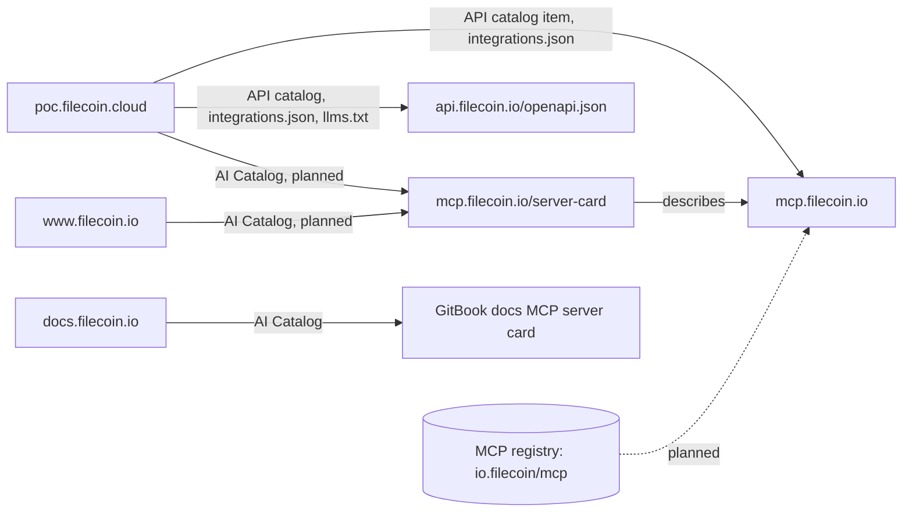

# Agent discovery

This document lists every agent discovery spec that applies to Filecoin for Agents. For each spec, it says what the spec is, what we serve today, what is missing, and which host should serve it. It also lists the specs that don't apply.

We checked each host with `curl` on 2026-10-21, after [#76](https://github.com/filecoin-project/agents/pull/76) deployed filecoin-api's MCP server card. [How to reproduce](#how-to-reproduce) has the commands. For details on the hosts we don't run, see [Agent discovery on filecoin.io](filecoin-io-agent-support.md) and [Agent support on docs.filecoin.io](filecoin-docs-agent-support.md).

## Hosts

| Host | What it is | Who runs it |
| --- | --- | --- |
| `poc.filecoin.cloud` | The site: landing page, docs, Agents page, explorer, and dashboard ([`apps/filecoin-app`](../../apps/filecoin-app/README.md)) | Us |
| `api.filecoin.io` | The REST API, plus the MCP server at `/mcp` ([`apps/filecoin-api`](../../apps/filecoin-api/README.md)) | Us |
| `mcp.filecoin.io` | The MCP server only, from the same Worker as `api.filecoin.io` | Us |
| `www.filecoin.io` | The Filecoin website, a Next.js site on Vercel. `filecoin.io` redirects to it with a `308`, and its owners plan to remove that redirect | The filecoin.io web team |
| `docs.filecoin.io` | The Filecoin docs, on GitBook, with GitBook's docs MCP server | The Filecoin docs team, through GitBook |

`api.filecoin.cloud` and `mcp.filecoin.cloud` serve the same Worker as their `filecoin.io` twins, so they serve the same files ([API and MCP domains](mcp-domains.md)).

## What goes where



- **The MCP server card lives on filecoin-api, next to its endpoint.** [SEP-2127](https://github.com/modelcontextprotocol/modelcontextprotocol/blob/main/seps/2127-mcp-server-cards.md) reserves `<streamable-http-url>/server-card`, so the card is at `https://mcp.filecoin.io/server-card` and `https://api.filecoin.io/mcp/server-card`. Every other place that describes the MCP server links to this card instead of copying it.
- **Domain-level files live on the sites and point to filecoin-api.** The AI Catalog, `llms.txt`, the API catalog, `integrations.json`, the agent skills index, the sitemap, and `robots.txt` describe what a domain offers. poc.filecoin.cloud serves them for Filecoin for Agents, and www.filecoin.io should serve the ones its team chooses for filecoin.io.
- **filecoin-api serves no `ai-catalog.json`.** The AI Catalog is for discovering the servers on a domain. A client that already has `mcp.filecoin.io` can fetch the card directly. filecoin-api's hosts also serve no `llms.txt`, sitemap, or `robots.txt`, because they serve only the API and MCP.
- **filecoin-api describes itself on the wire.** It serves the OpenAPI document, the server card, and the `RateLimit-Policy` header, because those describe the API and the MCP server themselves, not a domain.
- **www.filecoin.io lists the card but doesn't copy it.** It should serve a one-entry AI Catalog that points to `https://mcp.filecoin.io/server-card`, the same entry as poc.filecoin.cloud's.
- **docs.filecoin.io describes only its own docs MCP server.** GitBook serves its files, and nobody can add files there without a proxy.

## Matrix

Each cell says whether the host serves the file or header:

- **Served:** the host serves it today.
- **Missing:** the host should serve it and doesn't. The [missing pieces](#missing-pieces) list the issues.
- **n/a:** the spec doesn't apply to this host.
- **Theirs:** another team runs the host. The cell says what it serves today.

| Spec | Spec status | poc.filecoin.cloud | api.filecoin.io | mcp.filecoin.io | www.filecoin.io | docs.filecoin.io |
| --- | --- | --- | --- | --- | --- | --- |
| [`llms.txt`, `llms-full.txt`](#llmstxt-and-llms-fulltxt) | Proposal | Served | n/a | n/a | Theirs: missing | Theirs: served |
| [Markdown versions of pages](#markdown-versions-of-pages) | Convention | Served | n/a | n/a | Theirs: missing | Theirs: partly |
| [API catalog](#api-catalog) | Final (RFC 9727) | Served | n/a | n/a | Theirs: missing | n/a |
| [`integrations.json`](#integrationsjson) | Vendor format | Served | n/a | n/a | Theirs: missing | n/a |
| [MCP server card](#mcp-server-card) | Final (SEP-2127) | Served, an outdated copy | Served | Served | n/a | Theirs: served, for its own server |
| [AI Catalog](#ai-catalog) | Draft | Missing | n/a | n/a | Theirs: missing | Theirs: served, for its own server |
| [MCP registry `server.json`](#mcp-registry-serverjson) | Preview | n/a | Missing | Missing | Theirs: ownership proof, if HTTP | n/a |
| [Agent skills discovery](#agent-skills-discovery) | Draft | Served | n/a | n/a | Theirs: missing | n/a |
| [WebMCP](#webmcp) | Draft | Served | n/a | n/a | Theirs: none | Theirs: not verified |
| [OpenAPI document](#openapi-document) | Final (3.1) | Linked | Served | n/a | n/a | n/a |
| [`service-desc` link](#service-desc-link) | Final (RFC 8631) | Missing | Missing | n/a | n/a | n/a |
| [`robots.txt`](#robotstxt-and-content-signal) | Final (RFC 9309) | Served | n/a | n/a | Theirs: served | Theirs: served |
| [Content-Signal](#robotstxt-and-content-signal) | Vendor policy | Missing | n/a | n/a | Theirs: missing | Theirs: served |
| [Sitemap](#sitemap-json-ld-and-open-graph) | Final (0.9) | Served | n/a | n/a | Theirs: served | Theirs: served |
| [JSON-LD](#sitemap-json-ld-and-open-graph) | Final | Served, partly | n/a | n/a | Theirs: served | Theirs: missing |
| [Open Graph and canonical URLs](#sitemap-json-ld-and-open-graph) | Stable | Served | n/a | n/a | Theirs: served | Theirs: served |
| [`RateLimit-Policy`](#ratelimit-policy) | Draft | n/a | Served | Served | n/a | n/a |
| [`Deprecation` and `Sunset`](#deprecation-and-sunset) | Final (RFC 9745, RFC 8594) | n/a | Missing | n/a | n/a | n/a |

## Specs

### `llms.txt` and `llms-full.txt`

- **Spec:** [llms.txt](https://llmstxt.org), a proposal, not a standard. `/llms.txt` is a Markdown index of a site for language models, and `/llms-full.txt` holds the content in one file.
- **Today:** poc.filecoin.cloud serves both. `llms.txt` has a summary, the way in for each kind of agent, and links to each page's Markdown version, the OpenAPI document, the MCP server, its server card, and the agent skills. docs.filecoin.io serves both through GitBook. www.filecoin.io serves neither.
- **Missing:** `llms.txt` doesn't link the `filecoin` CLI on npm ([#63](https://github.com/filecoin-project/agents/issues/63)). It links the site's copy of the server card, which should become a link to `https://mcp.filecoin.io/server-card` when the site stops building its copy ([#61](https://github.com/filecoin-project/agents/issues/61)).
- **Where:** the sites. filecoin-api's hosts don't serve `llms.txt`, because the sites' `llms.txt` link to the API and MCP server.

### Markdown versions of pages

- **Spec:** no single spec. The parts are final: the `text/markdown` media type ([RFC 7763](https://www.rfc-editor.org/rfc/rfc7763)), `Vary` ([RFC 9110](https://www.rfc-editor.org/rfc/rfc9110#name-vary)), and the `Link` header ([RFC 8288](https://www.rfc-editor.org/rfc/rfc8288)). Serving a page at `<path>.md` comes from the llms.txt proposal, and answering `Accept: text/markdown` is a convention that scanners such as [Is Agentic](https://is-agentic.com) check.
- **Today:** poc.filecoin.cloud serves each site page at a `.md` URL and for `Accept: text/markdown`, sends `Vary: Accept`, links the Markdown version with `Link: <...>; rel="alternate"; type="text/markdown"` and a `<link>` tag, and answers a missing page with a Markdown `404` ([filecoin-app README](../../apps/filecoin-app/README.md#website)). docs.filecoin.io serves `.md` URLs, answers `Accept: text/markdown`, and has the `<link>` tag. It sends `Vary: Accept` only on the Markdown response, sends no `Link` header, and answers a missing page in Markdown with a `200`. www.filecoin.io serves no Markdown.
- **Missing:** explorer pages have no Markdown version, which the "Explorer for agents" follow-up in the [README](README.md#follow-up-work) covers.
- **Where:** each site, for its own pages. The API hosts serve JSON, and the OpenAPI document is their machine-readable description.

### API catalog

- **Spec:** [RFC 9727](https://www.rfc-editor.org/rfc/rfc9727), final. `/.well-known/api-catalog` is a linkset, served as `application/linkset+json`, that points to a publisher's APIs.
- **Today:** poc.filecoin.cloud serves a linkset whose anchor is `https://api.filecoin.io/`, with the OpenAPI document as `service-desc`, the reference at `/docs` as `service-doc`, `/health` as `status`, and `https://mcp.filecoin.io` as an `item`. `HEAD` returns `Link: </.well-known/api-catalog>; rel="api-catalog"`. integrations.sh reads the older server card format's top-level `url` and skips ours, so the `item` is how it finds the MCP server.
- **Missing:** nothing on our hosts. [#56](https://github.com/filecoin-project/agents/issues/56) tracks why Is Agentic found the OpenAPI document from poc.filecoin.cloud but no API.
- **Where:** the sites. www.filecoin.io could serve the same linkset ([recommendation](filecoin-io-agent-support.md#things-to-add-to-filecoinio)). The API hosts don't serve one, because the catalog describes what a domain publishes.

### `integrations.json`

- **Spec:** the [integrations.sh](https://integrations.sh/publishing/) owner declaration, version 3, a format that integrations.sh defines. integrations.sh feeds `npx add-mcp find`.
- **Today:** poc.filecoin.cloud declares the REST API and the MCP server, which need no credentials, and the `filecoin` CLI with its session key. integrations.sh hasn't stored a listing for poc.filecoin.cloud yet.
- **Missing:** map poc.filecoin.cloud on integrations.sh ([#10](https://github.com/filecoin-project/agents/issues/10)). Rename the MCP surface's slug from `filecoin-api-mcp` to `filecoin-mcp`, because slugs can't contain `/` or `.` ([#61](https://github.com/filecoin-project/agents/issues/61)).
- **Where:** the sites.

### MCP server card

- **Spec:** [SEP-2127](https://github.com/modelcontextprotocol/modelcontextprotocol/blob/main/seps/2127-mcp-server-cards.md), final. A card describes an MCP server before a client connects. The SEP reserves `<streamable-http-url>/server-card`, and the server card extension's [discovery doc](https://github.com/modelcontextprotocol/experimental-ext-server-card/blob/main/docs/discovery.md) sets the media type `application/mcp-server-card+json`. Older drafts used `/.well-known/mcp/server-card.json` and `/.well-known/mcp-server-card`.
- **Today:** filecoin-api serves the card at `https://mcp.filecoin.io/server-card` and `https://api.filecoin.io/mcp/server-card`, and at both older paths on every filecoin-api host, because scanners still check them. It sends `application/mcp-server-card+json`, `max-age=3600`, and an `ETag`. The card's `name` and `serverInfo.name` are both `io.filecoin/mcp`, which is `mcp.filecoin.io` in reverse, and every production card advertises `https://mcp.filecoin.io` from the `MCP_PUBLIC_URL` var ([filecoin-api README](../../apps/filecoin-api/README.md#server-card)). poc.filecoin.cloud still serves its own copy at the two older paths, as `application/json`, with the old name `dev.hugomrdias/filecoin-api` and version `0.0.0`. docs.filecoin.io serves the card of GitBook's docs MCP server at `/~gitbook/mcp/server-card` and `/.well-known/mcp/server-card.json`.
- **Missing:** poc.filecoin.cloud should `308`-redirect its two paths to `https://mcp.filecoin.io/server-card` and stop building its copy ([#61](https://github.com/filecoin-project/agents/issues/61)).
- **Where:** filecoin-api, next to the endpoint. The sites list the card in an AI Catalog instead of copying it, so the card can't drift from what the server reports.

### AI Catalog

- **Spec:** [AI Catalog](https://github.com/Agent-Card/ai-catalog), a draft in a Linux Foundation working repository with members from MCP and A2A, at `specVersion` 1.0. `/.well-known/ai-catalog.json`, served as `application/ai-catalog+json`, lists a domain's agent artifacts, such as MCP server cards and A2A agent cards. Each entry has an `identifier`, a URN in the form `urn:air:{publisher}:{namespace}:{name}`, a `type`, and a `url`. SEP-2127 points to it for domain-level discovery.
- **Today:** none of our hosts serve one. docs.filecoin.io serves one, from GitBook, with one entry for its docs MCP server.
- **Missing:** poc.filecoin.cloud's catalog, with one entry: `identifier` `urn:air:filecoin.io:mcp:mcp`, `type` `application/mcp-server-card+json`, and `url` `https://mcp.filecoin.io/server-card` ([#61](https://github.com/filecoin-project/agents/issues/61)). www.filecoin.io should serve the same one-entry catalog ([recommendation](filecoin-io-agent-support.md#things-to-add-to-filecoinio)).
- **Where:** the sites. filecoin-api serves none, because a client that already has `mcp.filecoin.io` can fetch the card directly.

### MCP registry `server.json`

- **Spec:** the [MCP registry](https://registry.modelcontextprotocol.io), in preview, with a frozen v0.1 API. A publisher sends a `server.json` for each server version. The registry checks that the publisher controls the namespace in the server's `name`, but not the remote URL.
- **Today:** the registry has no Filecoin server.
- **Missing:** publish `io.filecoin/mcp` from the release workflow, with a remote-only `server.json` built from the same source as the server card ([#75](https://github.com/filecoin-project/agents/issues/75)). The registry needs proof that we control `filecoin.io`: a DNS TXT record on the apex, or a file at `https://filecoin.io/.well-known/mcp-registry-auth`. The registry's HTTP check doesn't follow redirects, so the file works only after `filecoin.io` stops redirecting to `www`.
- **Where:** the registry, not a host we run. The ownership proof is on `filecoin.io`, which its owners control.

### Agent skills discovery

- **Spec:** [Agent skills discovery](https://github.com/cloudflare/agent-skills-discovery-rfc), a draft at version 0.2.0. `/.well-known/agent-skills/index.json` lists a site's agent skills, so `npx skills add <site>` can install them. Version 0.2.0 renamed the older `/.well-known/skills/` path.
- **Today:** poc.filecoin.cloud serves the index and the `filecoin` skill, which [`@hugomrdias/vite-plugin-agent-skills`](https://github.com/hugomrdias/agents/blob/main/packages/vite-plugin-agent-skills/README.md) builds from the plugin's `skills/` directory.
- **Missing:** nothing on our hosts. www.filecoin.io could publish an index of the Filecoin skills ([recommendation](filecoin-io-agent-support.md#things-to-add-to-filecoinio)).
- **Where:** the sites. GitBook can't serve custom files on docs.filecoin.io.

### WebMCP

- **Spec:** [WebMCP](https://webmachinelearning.github.io/webmcp/), a draft report of the W3C Web Machine Learning Community Group. A page registers tools that a browser agent can call.
- **Today:** poc.filecoin.cloud registers up to seven tools from its script bundle, six of them on every page, in Chrome 149 and later through an origin trial whose token expires on 2027-03-30 ([filecoin-app README](../../apps/filecoin-app/README.md#webmcp)). GitBook's page bundle has a WebMCP component, but which tools it registers on docs.filecoin.io is not verified.
- **Missing:** testing with real browser agents ([#8](https://github.com/filecoin-project/agents/issues/8)), and a tool that verifies a file in the page (the "Browser verification" follow-up in the [README](README.md#follow-up-work)).
- **Where:** the pages a browser agent uses, which are on poc.filecoin.cloud. The API hosts serve no pages.

### OpenAPI document

- **Spec:** [OpenAPI 3.1](https://spec.openapis.org/oas/v3.1.0), final.
- **Today:** `https://api.filecoin.io/openapi.json`, with a reference at `/docs`. The API root, `https://api.filecoin.io/`, returns JSON that names `/openapi.json`, `/docs`, and `/mcp`. poc.filecoin.cloud links the document from its API catalog, `integrations.json`, and `llms.txt`.
- **Missing:** the routes have no version ([#60](https://github.com/filecoin-project/agents/issues/60)).
- **Where:** filecoin-api.

### `service-desc` link

- **Spec:** the `service-desc` link relation ([RFC 8631](https://www.rfc-editor.org/rfc/rfc8631)), final. It points from an API, or a page, to its machine-readable description.
- **Today:** the API catalog uses it, but no response header or HTML `<link>` does.
- **Missing:** a `Link: </openapi.json>; rel="service-desc"` header on `https://api.filecoin.io/` has no issue yet. A `<link rel="service-desc">` on poc.filecoin.cloud is one possible outcome of [#56](https://github.com/filecoin-project/agents/issues/56).
- **Where:** filecoin-api for the header, and the site for the `<link>` tag.

### `robots.txt` and Content-Signal

- **Spec:** `robots.txt` ([RFC 9309](https://www.rfc-editor.org/rfc/rfc9309)), final. Content-Signal is a `robots.txt` line from Cloudflare's [Content Signals Policy](https://contentsignals.org), not a standard, that states whether content may be used for search, AI input, and AI training. The IETF [AI Preferences](https://datatracker.ietf.org/wg/aipref/about/) working group is drafting a standard vocabulary for the same purpose.
- **Today:** all three sites allow every crawler and link their sitemap. docs.filecoin.io also sends `Content-Signal: ai-train=yes, search=yes, ai-input=yes`. www.filecoin.io's `robots.txt` links `https://filecoin.io/sitemap.xml`, which redirects to `www`.
- **Missing:** poc.filecoin.cloud has no Content-Signal line, and no issue tracks one. It needs a decision on the policy, not only code.
- **Where:** the sites. The API hosts return a JSON `404` for `/robots.txt`, which crawlers read as "allow everything".

### Sitemap, JSON-LD, and Open Graph

- **Spec:** the [sitemap protocol](https://www.sitemaps.org/protocol.html) 0.9, final. [JSON-LD](https://www.w3.org/TR/json-ld11/), a W3C Recommendation, with the [schema.org](https://schema.org) vocabulary. The [Open Graph protocol](https://ogp.me), stable, and canonical URLs ([RFC 6596](https://www.rfc-editor.org/rfc/rfc6596)).
- **Today:** poc.filecoin.cloud's sitemap lists 9 URLs: the site pages and each network's explorer. Every site page has a canonical URL and Open Graph tags, and the landing page has a schema.org `SoftwareApplication`. www.filecoin.io lists 751 URLs and has `Organization`, `WebSite`, `WebPage`, and `BreadcrumbList` JSON-LD, but its canonical URLs and sitemap use `https://filecoin.io`, which redirects. docs.filecoin.io has a sitemap, canonical URLs, and Open Graph tags, but no JSON-LD.
- **Missing:** an `Organization` in poc.filecoin.cloud's JSON-LD, and About, Contact, Privacy, and Pricing pages, before the release ([#62](https://github.com/filecoin-project/agents/issues/62)).
- **Where:** the sites.

### `RateLimit-Policy`

- **Spec:** the [IETF RateLimit header fields](https://datatracker.ietf.org/doc/draft-ietf-httpapi-ratelimit-headers/), an Internet-Draft.
- **Today:** rate-limited responses on filecoin-api send `"api";q=120;w=60` for the REST API, `/health`, and the server card, and `"mcp";q=60;w=60` for MCP ([#59](https://github.com/filecoin-project/agents/issues/59), closed). Workers Rate Limiting doesn't report the remaining requests, so there is no `RateLimit` header.
- **Missing:** nothing.
- **Where:** filecoin-api. The sites have no rate limit.

### `Deprecation` and `Sunset`

- **Spec:** the `Deprecation` header ([RFC 9745](https://www.rfc-editor.org/rfc/rfc9745)) and the `Sunset` header ([RFC 8594](https://www.rfc-editor.org/rfc/rfc8594)), both final. They tell a client that a route is deprecated and when it stops working.
- **Today:** filecoin-api has no versioned routes and no deprecation policy.
- **Missing:** a versioning scheme and a deprecation policy ([#60](https://github.com/filecoin-project/agents/issues/60)).
- **Where:** filecoin-api.

## Specs that don't apply

| Spec | Why it doesn't apply |
| --- | --- |
| [OAuth 2.0 protected resource metadata](https://www.rfc-editor.org/rfc/rfc9728) (RFC 9728), `/.well-known/oauth-protected-resource` | Nothing needs authentication. The REST API and the MCP server are public and read-only, and the MCP authorization spec uses this file only for servers that need a token |
| [OAuth 2.0 authorization server metadata](https://www.rfc-editor.org/rfc/rfc8414) (RFC 8414), [OpenID Connect discovery](https://openid.net/specs/openid-connect-discovery-1_0.html) | We run no authorization server. The CLI's session key is approved on chain by the wallet owner, not through OAuth |
| [A2A agent card](https://a2a-protocol.org/latest/specification/), `/.well-known/agent-card.json` | We have no A2A agent. An A2A agent would get its own AI Catalog entry |
| [Web Bot Auth](https://datatracker.ietf.org/doc/draft-meunier-web-bot-auth-architecture/), `/.well-known/http-message-signatures-directory` | It lets a bot sign its requests so sites can identify it. We run no crawler or agent that browses other sites |
| OpenAI's plugin manifest, `/.well-known/ai-plugin.json` | OpenAI retired ChatGPT plugins. ChatGPT connects to MCP servers instead |

## Missing pieces

Ours:

- poc.filecoin.cloud: serve the AI Catalog, `308`-redirect the two `.well-known` card paths to `https://mcp.filecoin.io/server-card`, stop building the site's copy of the card, and rename the integrations.json MCP slug to `filecoin-mcp` ([#61](https://github.com/filecoin-project/agents/issues/61))
- Publish `io.filecoin/mcp` to the MCP registry, with a DNS TXT record or an HTTP file on `filecoin.io` ([#75](https://github.com/filecoin-project/agents/issues/75))
- Map poc.filecoin.cloud on integrations.sh, so `npx add-mcp find` lists the MCP server ([#10](https://github.com/filecoin-project/agents/issues/10))
- Find out why Is Agentic finds no API from poc.filecoin.cloud ([#56](https://github.com/filecoin-project/agents/issues/56))
- Version the REST API and send `Deprecation` and `Sunset` ([#60](https://github.com/filecoin-project/agents/issues/60))
- Add `Organization` JSON-LD and the About, Contact, Privacy, and Pricing pages ([#62](https://github.com/filecoin-project/agents/issues/62))
- Link the `filecoin` CLI and the API client on npm from the site and `llms.txt` ([#63](https://github.com/filecoin-project/agents/issues/63))
- Test the WebMCP tools with real browser agents ([#8](https://github.com/filecoin-project/agents/issues/8))
- Send `Link: </openapi.json>; rel="service-desc"` from `https://api.filecoin.io/` (no issue yet)
- Decide on a Content-Signal line for poc.filecoin.cloud's `robots.txt` (no issue yet)

Theirs:

- www.filecoin.io: a one-entry AI Catalog that points to `https://mcp.filecoin.io/server-card`, `llms.txt`, Markdown versions of pages, the API catalog, `integrations.json`, an agent skills index, and one canonical hostname. [Agent discovery on filecoin.io](filecoin-io-agent-support.md) has the full list for the filecoin.io web team.
- docs.filecoin.io: `Vary: Accept` and a `Link` header on HTML responses, and a `404` for a missing page in Markdown. [Agent support on docs.filecoin.io](filecoin-docs-agent-support.md) has the questions for GitBook.

## How to reproduce

```bash
# Discovery files on every host
for h in poc.filecoin.cloud api.filecoin.io mcp.filecoin.io www.filecoin.io docs.filecoin.io; do
  for p in /llms.txt /llms-full.txt /index.md /robots.txt /sitemap.xml /openapi.json /server-card /mcp/server-card \
    /.well-known/api-catalog /.well-known/integrations.json /.well-known/mcp/server-card.json \
    /.well-known/mcp-server-card /.well-known/ai-catalog.json /.well-known/agent-skills/index.json \
    /.well-known/oauth-protected-resource /.well-known/agent-card.json; do
    curl -s -o /dev/null -w "$h$p %{http_code} %{content_type}\n" "https://$h$p"
  done
done

# The MCP server card and its headers
curl -sI https://mcp.filecoin.io/server-card | grep -iE "^(content-type|cache-control|etag|ratelimit-policy):"
curl -s https://mcp.filecoin.io/server-card

# The name the MCP server reports after a client connects
curl -s -X POST https://mcp.filecoin.io \
  -H "Content-Type: application/json" -H "Accept: application/json, text/event-stream" \
  -d '{"jsonrpc":"2.0","id":1,"method":"initialize","params":{"protocolVersion":"2025-06-18","capabilities":{},"clientInfo":{"name":"curl","version":"0"}}}'

# Markdown negotiation, Vary, and Link headers
for u in https://poc.filecoin.cloud/ https://www.filecoin.io/ https://docs.filecoin.io/getting-started/what-is-filecoin; do
  curl -sI -H "Accept: text/markdown" "$u" | grep -iE "^(content-type|vary|link):"
done

# Rate-limit policy
curl -sI https://api.filecoin.io/health | grep -i ratelimit-policy

# MCP registry and integrations.sh listings
curl -s "https://registry.modelcontextprotocol.io/v0/servers?search=io.filecoin"
curl -s https://integrations.sh/api/poc.filecoin.cloud/discovery
```
