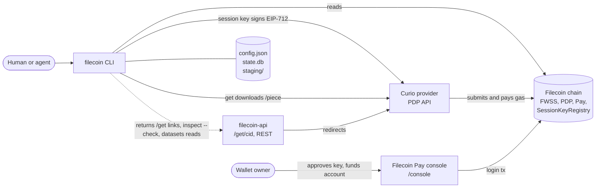
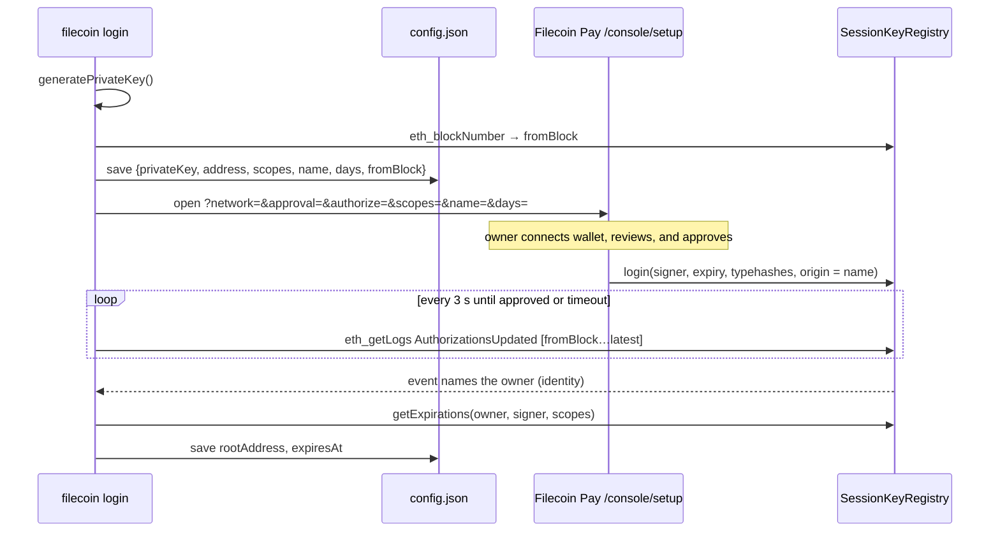
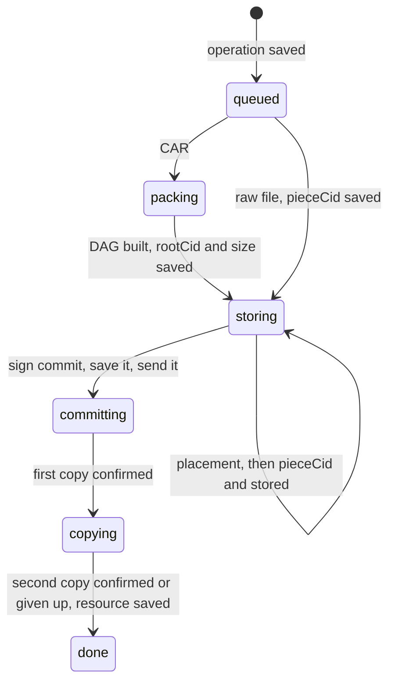

# filecoin CLI architecture

This document describes how the `filecoin` prototype in [`packages/filecoin-cli`](../../packages/filecoin-cli) works. It covers the modules, the login, put, get, and delete flows, local state, and recovery.

## Overview

`filecoin` stores one file or folder on Filecoin and returns filecoin-api retrieval URLs. They redirect to the provider or to a browser gateway.

- **One command for files and folders.** `filecoin put <path>` packs a file or a folder into a UnixFS CAR in an IPFS-indexed data set. `--raw` stores a file as its exact bytes instead.
- **Two copies.** Each upload has two copies on two providers, as in synapse-sdk. The second provider pulls the piece from the first, so the machine uploads it once. [Second copy](#second-copy) describes the flow and how to remove it.
- **synapse-core for the chain and providers.** The CLI calls [synapse-core](https://github.com/FilOzone/synapse-sdk/tree/master/packages/synapse-core) directly and does not use synapse-sdk. Only `datasets` reads filecoin-api instead, through `@filecoin-project/api-client`.
- **Delegated signing.** A session key signs uploads and removals. The wallet owner approves the key in the [Filecoin Pay console](https://pay.filecoin.cloud/console), and the owner's wallet pays for storage.
- **Recoverable operations.** `filecoin` saves each `put` and `delete` as an operation in SQLite before it changes anything outside the machine. `filecoin operations resume` never commits an interrupted operation twice.
- **Machine contract.** [clipact](https://github.com/hugomrdias/agents/blob/main/packages/clipact/README.md) implements the [CLI guidelines for agents](https://github.com/hugomrdias/agents/blob/main/docs/agent-cli/guidelines.md). It gives `filecoin` one JSON result on stdout, exit codes `0` and `1`, and errors with `retryable` and `next` steps marked `by: "agent"` or `by: "user"`. It also provides an offline `schema` command, confirmation prompts, signal handling, and lazily loaded handlers.



The CLI never sends a chain transaction itself. It signs typed data and reads chain state. Curio submits the data set and piece transactions, and the owner's wallet submits the session key approval from the Filecoin Pay console.

## Modules

```text
packages/filecoin-cli/
├── bin/filecoin.js            entry shim: enables the compile cache, imports dist/main.js
├── scripts/build.ts      esbuild bundle: one entry, one chunk per handler; copies plugins/filecoin/skills/
├── skills/               gitignored build copy of plugins/filecoin/skills/, installed by `filecoin skills install`
└── src/
    ├── main.ts           cli.run()
    ├── cli.ts            defineCli: name, version, globals, commands, skills, mapError
    ├── globals.ts        environment-only settings (defineGlobals); imports only zod and clipact
    ├── commands/         one definition per command; imports only zod and clipact
    │   ├── shared.ts     account input fragment, paging, output schemas
    │   ├── login.ts  logout.ts  status.ts  doctor.ts
    │   ├── put.ts  get.ts  ls.ts  inspect.ts  delete.ts
    │   ├── datasets/     ls.ts  inspect.ts
    │   ├── operations/   ls.ts  inspect.ts  resume.ts
    │   └── index.ts      the command tree and the datasets and operations groups
    ├── handlers/         one handler per command, loaded only when it runs
    │   ├── context.ts    appFor(ctx), account scope, jobContext, lookups
    │   └── …             same layout as commands/
    ├── map-error.ts      viem, synapse-core, and filecoin-api errors → service_unavailable, timeout
    ├── api.ts            filecoin-api client bound to the signal, and its data set and piece mappers
    ├── network.ts        network names, free of imports
    ├── app.ts            per-invocation context: network, chain, signal-bound clients, config, lazy DB
    ├── config.ts         clipact store (config.json) and network resolution
    ├── errors.ts         error codes, operationError()
    ├── usdfc.ts          USDFC amount formatting
    ├── runway.ts         account health and runway for `status`
    ├── auth/
    │   ├── scope-ids.ts  scope IDs and the default key name, free of imports
    │   ├── scopes.ts     scope IDs ↔ FWSS permission typehashes
    │   ├── login.ts      Filecoin Pay console links, on-chain approval discovery and polling
    │   ├── session.ts    credentials from input or config; permission check before mutations
    │   └── open-browser.ts
    ├── storage/
    │   ├── types.ts      StorageBackend interface, which tests replace with a fake
    │   ├── synapse.ts    StorageBackend built on synapse-core
    │   ├── secondary-copy.ts  the second copy of a put: pull, commit, resume, removal steps
    │   ├── jobs.ts       put and delete jobs, signed commits, resume, dry-run estimate
    │   ├── dfs-car.ts    file or folder → DFS-ordered UnixFS CAR stream, in two passes
    │   ├── pack.ts       file walk, importer candidates, block hash check
    │   ├── get.ts        streaming verified download, folder extraction
    │   └── urls.ts       filecoin-api /get URLs, and the Curio /piece URL for get
    └── state/
        ├── db.ts         node:sqlite, migrations, transactions
        ├── resources.ts  managed files and folders, paged
        ├── operations.ts operations, checkpoints, execution lock, paged
        ├── cursor.ts     opaque keyset cursors
        └── ids.ts        res_… and op_… identifiers
```

The code has three layers:

1. **`commands/`** declares each command once. A definition holds the input schema (flags, positionals, environment fallbacks, and secrets), the output schema, the error codes, and the side effects (`readOnly`, `idempotent`, `confirm`, and `dryRun`). clipact derives parsing, validation, help, `schema`, and completions from it. These modules and `globals.ts` import only zod, clipact, `commands/shared.ts`, and three local modules that need nothing else: `errors.ts`, `network.ts`, and `auth/scope-ids.ts`. So `--help`, `--version`, and `schema` never load synapse-core or viem.
2. **`handlers/`** resolve the session and the account scope through plain functions, `appFor` and `jobContext`, and then call into storage or auth. `appFor` reads the CLI's globals with `globals.get(ctx)` and passes them to `createApp`. clipact has no middleware, so shared setup is a function that each handler calls.
3. **`storage/`, `state/`, and `auth/`** hold the storage, state, and auth logic. `jobs.ts` depends only on the `StorageBackend` interface, so tests replace the provider and the chain with a fake.

`createApp` in `app.ts` builds one `App` per command from the command's account input. The `App` opens the database on first use, so `status` and `logout` never touch the state database.

We measured startup on Node 26 as the median of 20 runs after 5 warmups, with a warm compile cache. A bare `node -e ''` took 56 ms. `--version` took 70 ms, `--help` 71 ms, and `schema put` 73 ms. `ls` loads its handler with viem and synapse-core and took 98 ms. An earlier build on the incur framework imported synapse-core and viem in every command, and its `--version` took about 410 ms.

## Configuration

`filecoin` keeps its files in clipact's [folder](https://github.com/hugomrdias/agents/blob/main/packages/clipact/README.md#storage) for the CLI: `~/Library/Application Support/filecoin` on macOS, `%LOCALAPPDATA%\filecoin` on Windows, and `$XDG_DATA_HOME/filecoin` (default `~/.local/share/filecoin`) elsewhere. `FILECOIN_CONFIG_DIR`, a clipact framework variable since `envPrefix` is `FILECOIN`, replaces it with an absolute path. `appFor` gets the folder from `ctx.dir()`, which creates it with mode `0700`. `doctor` passes `create: false`, so it reports a folder it cannot create instead of failing. Folders used before clipact 0.6 (`~/Library/Preferences/filecoin`, `~/.config/filecoin`, and env-paths' data folder on Windows) are not read, so users log in again.

`config.ts` defines the clipact store, `defineStore({ schema: ConfigSchema })`, and `appFor` opens it with `store.get(ctx)`. It is `config.json` in the folder, read and written with [iso-conf](https://github.com/hugomrdias/iso-repo/tree/main/packages/iso-conf). Each write is atomic, holds a lock, and gives the file mode `0600`. A corrupt file is `config_invalid`, and a folder that refuses a write is `state_unwritable`, so every command that builds an app declares both codes. clipact also keeps its own `clipact.json` there.

```jsonc
{
  "network": "calibration",
  "sessions": {
    "calibration": {
      "privateKey": "0x…", // session key, never printed
      "address": "0x…", // session key address
      "rootAddress": "0x…", // owner; absent while approval is pending
      "scopes": ["createDataSet", "addPieces", "schedulePieceRemovals"],
      "name": "filecoin-cli", // key name requested as the on-chain origin
      "days": 30, // requested expiry; absent means the console's default
      "fromBlock": "4112865", // block when the key was created
      "expiresAt": "1793304656", // earliest granted scope expiry
      "createdAt": "…"
    }
  }
}
```

`filecoin` resolves the network from `--network`, then `FILECOIN_NETWORK`, then the config file, then `calibration`. clipact globals come only from the environment, and `network` also needs a flag, so it is a field of every command's input, in the `account` fragment of `commands/shared.ts`. The field has `FILECOIN_NETWORK` as its environment fallback and no schema default, so the config file still applies when neither is set. Each network has its own session.

`filecoin` takes credentials from `FILECOIN_SESSION_KEY` with `FILECOIN_ROOT_ADDRESS` first, then from the saved session. Both variables are also command input fields. `sessionKey` is a clipact secret. clipact reads it only from the environment, rejects it as a flag, and redacts it in `--debug` and `schema`. `filecoin` reports a pending session as `login_pending`, not as logged out. CI and cloud agents, whose disk does not outlive the session, use the variables with a key exported from the Filecoin Pay console's session keys page ([cloud agents](https://poc.filecoin.cloud/agents#cloud-agents)).

`FILECOIN_RPC_URL`, `FILECOIN_CONSOLE_URL`, and `FILECOIN_API_URL` are clipact [globals](https://github.com/hugomrdias/agents/blob/main/packages/clipact/README.md#globals), defined in `globals.ts`, not command input. clipact reads them from the environment of each run, validates them before the command's input, and applies the console and API defaults. Root help lists them under Environment, `schema --list` publishes them under `globals`, and `--debug` prints their sources. `filecoin doctor` shows each resolved value and its source. A console or API URL set to its default value reports `default`, because clipact applies schema defaults before the handler runs. For the folder, `doctor` reports what `ctx.storage()` resolved from the run's environment: `env` with the variable `FILECOIN_CONFIG_DIR`, or `default`, with `XDG_DATA_HOME` as the variable when it set the default on Linux.

## Login

`filecoin login` is one command with nothing to copy or paste. Filecoin Pin asks the user to copy a wallet address and a session key into environment variables, and it needs the root private key to create a key. `filecoin` needs neither.



The login code lives in `auth/login.ts` and `handlers/login.ts`. It behaves as follows:

- **`filecoin login` saves the key first.** Flags left out keep the saved key's scopes, name, and expiry, so running `filecoin login` again never changes the request. It resumes a pending login with the same key, and it reuses an approved session that already covers the requested scopes. An approved key that lacks some of its own scopes returns `permission_denied`.
- **Only `--fresh` replaces a live key.** `filecoin login` generates a new key on its own only when there is no saved key or the saved key has expired. When `--scopes` asks for more than a pending key, the CLI first checks the chain for the key's approval and saves it if found. If the key is still pending or valid, the CLI keeps it and returns `session_conflict`. The error's `next` steps are `filecoin login --check` to keep the key and `filecoin login --fresh --scopes …` to replace it. `--fresh` reuses the saved request for any flag left out.
- **`--check` never generates a key.** It confirms a pending key or reuses an approved one. Without a saved key it returns `auth_required`, and with an expired key, `session_expired`. It rejects `--scopes`, `--name`, `--days`, and `--fresh`.
- **The approval event names the owner.** In `AuthorizationsUpdated`, `identity` is indexed but `signer` is not. synapse-core's `findAuthorizers` scans events from `fromBlock` in windows of 300 blocks, below the 360-block `eth_getLogs` limit of the Glif RPC, and matches the signer locally. It skips revocations and lists each authorizing wallet once, most recent first. The CLI takes the first one as the owner, so the user never enters an address.
- **Only the address leaves the machine.** The private key stays in `config.json`. The setup link carries the key's address, and the console never sees or stores the private key.
- **The owner can change the request.** The console prefills the name, scopes, and expiry from the link, and the owner can change each one before signing. After the CLI finds the owner, it reads the expiry of each scope. If a requested scope is missing, the CLI still saves the session and returns `permission_denied`. The error lists the missing scopes in `error.details` and has a `by: "user"` step to log in again.
- **Only a human waits.** A human is present when clipact's `mode.interactive` is true and no agent is detected. In that case, login opens the browser and waits for up to 600 seconds, and `ctx.signal` stops the wait. Otherwise, login checks once and returns `login_pending` with two `next` steps. The first is the approval link, `by: "user"`. The second is `filecoin login --check`, `by: "agent"`, to check again. Login never opens a browser for an agent.
- **The console links have a fixed format.** The CLI follows the link contract of the [Filecoin Pay console](https://github.com/FilOzone/filecoin-pay-explorer/blob/staging/apps/explorer/src/utils/setupLink.ts), which filecoin-pin also uses. Login and funding links open `/console/setup`, which lists each requested step with its status read from the chain: the session key, the Warm Storage approval, and the deposit. The approval link is `/console/setup?network=<net>&approval=unlimited&authorize=<address>&scopes=<ids>&name=<name>&days=<n>`. `approval=unlimited` makes the console count Warm Storage as approved only without spending limits, as `getUploadCosts` requires, and offers to remove limits an account already has. `filecoin` lowercases the address, because the console rejects a bad mixed-case checksum. The scopes are comma-separated scope IDs. `--name` defaults to `filecoin-cli`, and the console uses 30 days when `--days` is not given. The funding link is `/console/setup?network=<net>&approval=unlimited&deposit=<decimal>&balance=<decimal>`. `balance` is the available USDFC the account reaches after the deposit, which is available funds plus the deposit minus debt, so the console checks the same target as the CLI. Without `deposit`, the link asks only for the approval. `filecoin status` adds the link only when the account is not ready. It always adds the console home, `/console`, as `account.consoleUrl`, the page filecoin-pin's `dashboard` opens. The home follows the connected wallet's network, so its link has no `network`. `filecoin logout` returns the revoke link, `/console/session-keys?revoke=<address>&network=<net>`, for an approved key. `FILECOIN_CONSOLE_URL` changes the origin.
- **The console links carry analytics tags.** Every console link ends with `utm_source=filecoin-cli&utm_medium=cli&utm_term=<flow>&utm_content=<driver>`, with the same values as filecoin-pin's [`withUtm`](https://github.com/filecoin-project/filecoin-pin/blob/master/src/core/session/console-url.ts), so the console's funnel analytics can compare the two CLIs ([FilOzone/filecoin-pay-explorer#576](https://github.com/FilOzone/filecoin-pay-explorer/issues/576)). The flow is `login` for an approval link, `fund` for a funding link, `revoke` for the revoke link, and `console` for the console home. filecoin-pin tags its link to the console home `dashboard`, after its command. The driver is the agent that clipact detects, `human` at an interactive terminal, or `automation` otherwise. `utm_campaign` is left for marketing campaigns. clipact's [telemetry opt-outs](https://github.com/hugomrdias/agents/blob/main/packages/clipact/README.md#telemetry), `DO_NOT_TRACK=1` or `FILECOIN_TELEMETRY=0`, drop the tags: `appFor` reads `ctx.telemetry()` and leaves the links untagged when `optedOut` is true. Nothing else is sent; the tags travel only in the link the user opens.
- **Only the owner can fund the account.** The session key cannot deposit or approve. `filecoin status` and the `put` funding check return a prefilled funding link instead.

The default scopes are `createDataSet`, `addPieces`, and `schedulePieceRemovals`. `filecoin` never requests `terminateService` by default.

Before each mutation, `requireSession` rebuilds the key with `fromSecp256k1` and syncs its expiries from the registry. synapse-core's signing helpers do not check permissions. Without this check, an expired or missing scope would fail as a contract revert. With it, the result is `session_expired` with a `by: "user"` step. The step is `filecoin login --fresh`, with `--scopes` flags when the command needs a scope the saved key never requested.

## The put flow

`put` packs files and folders into UnixFS CARs. `put --raw` stores a file as its exact bytes:

| Input             | Stored bytes     | Data set metadata                         | Piece metadata        | Browser URL                                       |
| ----------------- | ---------------- | ----------------------------------------- | --------------------- | ------------------------------------------------- |
| File              | UnixFS CAR       | `source=filecoin-cli`, `withIPFSIndexing` | `name`, `ipfsRootCID` | `<api>/get/<rootCid>?network=<net>&browser=true`  |
| Folder            | UnixFS CAR       | `source=filecoin-cli`, `withIPFSIndexing` | `name`, `ipfsRootCID` | `<api>/get/<rootCid>?network=<net>&browser=true`  |
| File with `--raw` | exact file bytes | `source=filecoin-cli`                     | `name`                | `<api>/get/<pieceCid>?network=<net>&browser=true` |

`filecoin-cli` comes from `APPLICATION_SOURCE` in `source.ts`, which is also the default session-key name. filecoin-pin uses its own name for both in the same way.

A file becomes a resource of kind `file`, and a folder becomes a resource of kind `folder`. A CAR's resource has a `rootCid`, and a raw file's resource has none. `put` and `ls` print the root CID. CARs and raw files go into separate data sets, because data sets match on their exact metadata keys and only CARs belong in an IPFS-indexed data set. Files stored raw by `filecoin` 0.7.0 and earlier stay in their data sets, and new CARs of files go into the IPFS-indexed one.

A file's CAR holds the file with no directory around it, so its root CID is the file's own CID. A file of one 1 MiB chunk or less has a raw block root (`bafkrei…`). A larger file has a UnixFS file node root (`bafybei…`). The operation saves `format` (`car` or `raw`) in its input. Operations saved by `filecoin` 0.7.0 and earlier have no `format`, so a resume treats their files as raw and their folders as CARs.

The CAR adds a few bytes per chunk. On 2026-11-16, a 4,096-byte file packed into a 4,193-byte CAR, and a 10 MiB file into a CAR 996 bytes larger than the file. The real cost is the `/piece` URL. For a raw file it serves the exact bytes, which a browser renders with a detected content type. For a CAR it serves the CAR, so the browser link goes through inbrowser.link. Use `--raw` when a download must be the exact file.

`put` returns two [filecoin-api retrieval URLs](retrieval.md), and `resource.url` holds the browser URL:

- **`urls.piece`** is `<api>/get/<pieceCid>?network=<net>`. filecoin-api redirects it to `/piece/<pieceCid>` on a provider that stores the piece, which serves the exact stored bytes: the CAR, or the raw file.
- **`urls.browser`** is the URL in the table. filecoin-api redirects a root CID to inbrowser.link, which fetches and verifies the blocks in the browser. It redirects a raw file to the same `/piece` URL, and a browser renders it.

filecoin-api finds an FWSS piece only in its indexer, because FWSS providers don't advertise PieceCIDs to IPNI yet ([what Curio announces](retrieval.md#what-curio-announces-for-fwss)). `urls.piece` and a raw file's `urls.browser` therefore return 404 until the indexer has the piece. A root CID's browser URL goes to inbrowser.link without a lookup.

Before the commit confirms, `put` reports early links as `link` progress, with `pieceCid` and `urls` in `data`. The early `/piece` links add `provider=<id>`, and filecoin-api redirects to that provider until its indexer has the piece. Curio serves `/piece/<pieceCid>` for a parked piece, so a raw file's early link works as soon as the upload finishes. The result's links carry no hint, so once the indexer has the piece, its ranking of the copies applies.

A root CID's browser URL carries no hint, because filecoin-api never looks it up. inbrowser.link finds the blocks through IPNI, and Curio advertises them shortly after it receives the commit, before the transaction confirms ([what Curio announces](retrieval.md#what-curio-announces-for-fwss)). `put` therefore reports a CAR's early link once the commit is sent.

`<api>` is `https://api.filecoin.io` unless `FILECOIN_API_URL` sets another origin. `inspect` rebuilds the URLs from the resource, or else from the PieceCID and root CID of its pieces. `ls` builds the browser URL from the piece. Both follow `FILECOIN_API_URL`.

### Phases and checkpoints



The phase is separate from the operation's execution status, which is `pending`, `running`, `failed`, or `completed`. A failure sets the status to `failed` and keeps the phase, so `filecoin operations resume` continues from that phase.

`storage/jobs.ts` saves each result to the operation checkpoint before the next step depends on it:

1. **Pack (CARs only).** Build the DAG in memory with `dfs-car.ts`, then save `rootCid` and the exact CAR `size`. Before it saves the operation, `put` adds up the bytes of the file or of the folder's files. A CAR holds every byte of its files, so content over 68,182,605,824 bytes fails with `invalid_input` before anything is read. Packing also stops with `invalid_input` once the blocks pass the limit, which covers content just under it. Packing writes nothing to disk. [CAR packing](#car-packing) describes the two passes.
2. **Identify (raw files only).** Stream the file through `Piece.calculate` and save `pieceCid` and `size`. A CAR gets its PieceCID from the upload in step 4. `put` rejects a file, or a planned CAR, outside synapse-core's `SIZE_CONSTANTS` limits of 127 to 68,182,605,824 bytes (63.5 GiB).
3. **Place.** Save `providerId`, `serviceURL`, and `payee`. If an existing data set matches, also save its `dataSetId` and `clientDataSetId`.
   - `--provider` calls `resolveProviderLocations({ providerIds: [id] })`, which reads only that provider from the registry and prefers its data set with matching metadata. At the same time, the CLI reads `isProviderApproved` from the FWSS view contract, because `resolveProviderLocations` does not check approval. The provider must be approved for Warm Storage, but it need not be endorsed. If it is not approved or has no active PDP product, the result is `not_found`. The CLI does not ping it.
   - Without `--provider`, the CLI calls `selectReachableProviders({ requireEndorsedPrimary: true })`. It ranks the endorsed providers, preferring one with an existing data set with matching metadata, pings them all at once, and takes the highest-ranked one that answers. If none answers, the result is `service_unavailable`.
   - Both return the matching data set's `clientDataSetId`, so the CLI does not read the data set.
   - The CLI then picks the [second copy](#second-copy)'s provider and saves it under `secondary`.
   - The CLI then checks the funding for both copies together. synapse-core's `getUploadCosts` prices one data set, so `synapse.ts` passes both data sets to `calculateUploadCosts` with the account's funds read once, as synapse-sdk's `calculateMultiContextCosts` does. Pricing each copy alone would count the same funds twice. It also returns the account's available funds and debt, which set the funding link's target `balance`. If the account is short, the result is `insufficient_funds` with the console funding link as a `by: "user"` step.
4. **Upload.**
   - For a raw file, call `SP.hasPiece` first. It returns `false` only when the provider answers 404. Any other failure stops the put, which a resume retries. If the provider does not have the piece yet, pass a file stream to `SP.uploadPieceStreaming` with `waitForParked: true`. It streams the file without holding the piece in memory, then polls `findPiece` until the provider has parked the piece. Save `stored`, and report the early links as `link` progress.
   - For a CAR, write the CAR in the second pass, in first-seen DFS order with each block once, and pass the stream to `SP.uploadPieceStreaming` without a `pieceCid`. synapse-core hashes the body with `Piece.transformStream` as it sends it, then finalizes the upload with the PieceCID it computed. Save `pieceCid` and `stored` together. The PieceCID is unknown before the upload, so `put` cannot ask `SP.hasPiece` first, and a CAR the provider already holds is uploaded again.
5. **Sign.** Call `SP.prepareAddPieces`, or `SP.prepareCreateDataSetAndAddPieces` for a new data set, with `payee = provider.payee` and `payer = rootAddress`. synapse-core chooses a random add-pieces `nonce`, and a `clientDataSetId` for a new data set. It returns the signed commit as JSON-safe data: the IDs, the pieces, and the signed `extraData`. Save the commit before sending it.
6. **Send.** Pass the saved commit to `SP.submitCommit`. Curio submits the transaction and pays gas. Save `transactionHash`. For a folder, report the early links as `link` progress. Then report the transaction hash as `committing` progress while waiting for confirmation, so the user can look it up. clipact repeats that line with the elapsed time. A delete reports its removal transaction hash the same way.
7. **Confirm.** Call `SP.waitForCreateDataSetAddPieces` or `SP.waitForAddPieces` with the transaction hash and the commit's `extraData` and piece count. Both wait for the receipt on chain and read `dataSetId` and the piece IDs from its FWSS events. If the receipt wait times out, they read the same IDs from `clientNonces` instead.
8. **Copy.** Store the [second copy](#second-copy). In one SQLite transaction, save the resource with every confirmed copy and mark the operation completed. Then try to delete the operation's staging directory, which only `filecoin` 0.7.0 and earlier wrote. A failure to delete it does not fail the put.

`filecoin` sets two synapse-core arguments explicitly:

- **`payer`** must be the root address. Without it, the signed payload uses the session key's address as the payer.
- **`payee`** must be `provider.payee`, because FWSS checks the signature against the payee in the registry. synapse-sdk passes `serviceProvider`, which works only when the two addresses are the same.

### Second copy

synapse-sdk 3.0 stores two copies by default, and `put` follows its flow. `storage/secondary-copy.ts` holds everything specific to the second copy, because client-side copies may go away once providers replicate on their own:

1. **Place.** During step 3, call `selectReachableProviders({ count: 1, excludeProviderIds })` without `requireEndorsedPrimary`, so any approved provider that answers can hold the copy. It prefers an existing data set with matching metadata. `--provider` names only the first copy's provider.
2. **Sign.** After the first copy confirms, sign a commit for the second provider's data set with the same `signCommit` as the first copy, and save it.
3. **Pull.** Call `SP.waitForPullPieces` with the commit's signed `extraData` and the first copy's `/piece/<pieceCid>` URL as the source. Curio's `/pdp/piece/pull` fetches the piece, checks the signature, and parks the piece. Nothing goes on chain. Save `pulled`.
4. **Send and confirm.** Send the commit with `SP.submitCommit`, save `transactionHash`, and wait for it as in steps 6 and 7.

A failure before step 4 sends anything moves the copy to another provider, up to three providers in all. The checkpoint records each failed provider in `secondary.failures`, and the next try excludes it. When no provider is left, the put completes with one copy. synapse-sdk also treats a failed secondary as partial success. It tries up to five providers, but each try here can wait for a whole pull. A `commit_rejected` used no nonce, so it also counts as a failed try. Any other failure after the commit is sent fails the operation. A resume then asks FWSS whether the commit landed, the same way as for the first copy, so a copy the payer pays for is never dropped from `copies`.

The result reports a partial put. `requestedCopies` is the number of copies the put asked for, 2. When `resource.copies` has fewer, `copyFailures` lists each provider that failed and its error. `copyFailures` also lists a provider that failed before another one took the copy. `operations resume` reports both fields for a completed put. A put saves the copies it asks for in its input as `copies`. Puts saved by `filecoin` 0.7.0 and earlier have none, so they report `requestedCopies: 1`, and an unfinished one resumes with one copy, because its funds check priced one.

To return to one copy, delete `secondary-copy.ts` and the code marked `secondary-copy` in `jobs.ts`, `synapse.ts`, `types.ts`, `operations.ts`, and `handlers/put.ts`. The multi-copy quote, `requestedCopies`, `copyFailures`, and the delete of every copy work for one copy too, so they can stay.

### CAR packing

`dfs-car.ts` packs files and folders with `ipfs-unixfs-importer` and the IPIP-499 `unixfs-v1-2025` profile: CIDv1, raw leaves, and 1 MiB chunks. Filecoin Pin uses the same profile. Packing walks entries in sorted order, skips dotfiles, and rejects symlinks, so packing the same folder twice gives the same root CID.

The importer derives parent directories from file paths. `pack.ts` passes only empty directories to the importer explicitly, because an explicit parent makes the importer emit an empty-directory block that nothing references.

The piece is a first-seen DFS CAR. It lists blocks in depth-first order from the root and holds each block once, the first time the walk reaches it (`dups=n`). The CARv1 spec calls this order "filecoin-deterministic". It is the layout that Kubo's `ipfs dag export` writes and that a boxo trustless gateway serves by default. We have not compared the bytes with Kubo's output. Curio's `/ipfs` endpoint serves its own CARs with repeated blocks (`dups=y`), whatever the layout of the piece. A reader can check each block against a CID it has already seen, so a CAR from `/piece` can be extracted as it streams. The root CID depends on every byte of the content, so the CAR takes two passes over the source:

1. **Build the DAG.** The importer runs with a blockstore that keeps the bytes of every dag-pb block: directories, HAMT shards, and file nodes. It keeps only the length of each raw leaf. A walk of the DAG from the root sizes the CAR exactly and skips any block the root does not reach.
2. **Write the CAR.** The second pass writes a CARv1 header with the root, then walks the DAG again. It writes UnixFS nodes from memory. It reads each raw leaf from its source file at the offset that the parent file nodes' `blocksizes` give, up to 64 leaves or 16 MiB ahead of the output. It checks each leaf against its CID with SHA-256. A short read or a mismatch means the source changed between the passes, and the put fails with `source_changed`. The pass ends with an error if it wrote a byte count other than the planned size.

The output is deterministic. The staged packer of `filecoin` 0.7.0 and earlier wrote blocks in the order the importer finished them, which `fileImportConcurrency` reorders, so two packs of the same folder gave the same root CID and different bytes. Two DFS packs of a folder are byte-identical, so a resume streams the same PieceCID.

We measured both packers on 2026-11-16 on an Apple M1 Pro with Node.js 26, each stage in its own process. The staged path packs the CAR to disk, then hashes it. The DFS path builds the DAG, then writes the CAR into `Piece.hasher()`, as the upload does:

| Input                          | Staged pack + CommP                     | DFS pass 1 + pass 2 with CommP | Peak heap, staged and DFS         |
| ------------------------------ | --------------------------------------- | ------------------------------ | --------------------------------- |
| 900 MiB random file            | 1.2 s + 5.2 s, and a 900 MiB staged CAR | 1.0 s + 5.6 s, nothing on disk | 32 MiB and 32 MiB                 |
| 53,000 files of 1 to 200 bytes | 3.9 s + 0.1 s                           | 4.0 s + 1.0 to 1.5 s           | 143 to 162 MiB and 205 to 286 MiB |

CommP dominates the large file, at about 175 MiB/s. In a real put, the upload sends the bytes while it hashes them. For small files, the second pass spends its time opening each file, and the read-ahead cut it from 3.6 s to about 0.8 s. The DFS path holds 1 to 2 KiB more heap per file, for the CID keys and source paths it keeps between the passes.

[ipfs-car](https://github.com/storacha/ipfs-car) 3.1.0 uses `@ipld/unixfs` with raw leaves, 1 MiB chunks, and a width of 1024. It switches to a sharded directory above 1,000 entries. We compared the two packers on 2026-09-29:

| Input                                   | filecoin                                       | ipfs-car           |
| --------------------------------------- | ---------------------------------------------- | ------------------ |
| 480 MB single file in a folder          | 0.6 s, with a CAR byte-identical to ipfs-car's | 0.8 s              |
| Nested folders of small files, no shard | Same root CID                                  | Same root CID      |
| Flat folder of 3,000 files              | Different root CID                             | Different root CID |

Large directories get different root CIDs, as expected. `unixfs-v1-2025` shards by encoded block size, which is the rule Kubo and Boxo use for this profile. ipfs-car shards by entry count. `filecoin` keeps the IPIP-499 profile so that its CIDs match other implementations of that profile. The comparison also found the unreferenced-block issue described above. That finding is why `filecoin` verifies every block on extraction.

### Resume

`runOperation` returns the saved result of a completed operation without running anything. For any other operation, it does the following:

1. Takes the operation lock.
2. Reports the operation to clipact with `ctx.checkpoint`. clipact prints the ID to stderr at once, so the ID survives a SIGKILL.
3. Runs the operation from its checkpoint.

A failure marks the operation `failed` and becomes an error with a `filecoin operations resume <id>` step. Errors with a `filecoin` code also carry `operationId` in `error.details`. Built-in codes, such as `invalid_input`, keep their own `details`. Put and delete errors are never `retryable`, because running the original command again starts a new paid operation.

`filecoin operations resume <id>` applies these rules:

- **The commit was signed.** When the checkpoint has a saved `commit`, the resume first calls `WarmStorage.getAddPiecesResult` or `getCreateDataSetAndAddPiecesResult`. Both decode the nonce from the signed `extraData` and read `clientNonces(payer, nonce)` from the FWSS view contract. FWSS stores `((firstAdded + count) << 128) | dataSetId` for every used add-pieces nonce, including the add half of create-and-add. A non-zero value means the commit landed and gives both IDs, so the operation completes without sending anything. A zero value means the commit did not land. The resume then sends the same commit again, or waits on its `transactionHash` if one was saved. FWSS rejects a second use of a nonce, so at most one commit takes effect, even if the first one lands late ([#1](https://github.com/filecoin-project/agents/issues/1)).
- **The commit did not apply.** When the transaction reverted or added no piece, synapse-core throws `TransactionNotAppliedError`, and `filecoin` returns `commit_rejected` and clears the saved `transactionHash`. The next resume checks the nonce and sends the same signature again.
- **The commit was saved by `filecoin` 0.7.0 or earlier.** Those versions saved only the signed `extraData`, the nonce, and the client data set ID, and they saved the provider's `statusUrl` after sending. The resume rebuilds the synapse-core commit from that record, the saved placement, and the piece, and saves it in the new form. It no longer reads `statusUrl`: a saved `transactionHash` marks a sent commit.
- **The piece is already uploaded.** When `stored` is set, the resume skips the upload and goes to the commit. It does not read the source, so a CAR put whose upload finished resumes even after the source is gone. A raw file resume also skips the upload when the provider already has the piece.
- **The upload of a CAR did not finish.** The resume builds the DAG again and checks that the root CID equals the saved `rootCid`. A mismatch fails with `source_changed`. The resume then writes and uploads the CAR again. The DFS bytes are deterministic, so the PieceCID matches the earlier attempt's. A `pieceCid` saved without `stored` comes from a staged CAR of `filecoin` 0.7.0 or earlier, whose bytes differ, so the resume replaces it with the PieceCID of the new upload.
- **The source changed.** A raw file resume recomputes the PieceCID from the file. A mismatch fails with `source_changed`, so `filecoin` never stores different bytes. A CAR put checks its source twice: the root CID on resume, and each raw leaf against its CID as the second pass reads it. Bytes appended to a file after the first pass are not in the CAR, which still matches the saved root CID.
- **The funds check stopped the put.** The second placement is saved before the check, and the first is saved only after it passes. If the resume picks the second copy's provider for the first copy, it forgets the second placement and picks another provider, so both copies never share a provider.
- **The second copy was interrupted.** The resume runs the first copy's steps, which find its commit on chain and send nothing, then continues the second copy from `secondary`. A saved second commit is checked with `findCommit` first, as for the first copy. A saved `pulled` skips the pull.
- **`staging_missing`.** `put` no longer returns it, because it stages no CAR. The code stays in the error registry for agents that branch on it.

The lock is a compare-and-swap `UPDATE` on `(execution_status, pid)`. If an operation is `running` but its process is gone, because `process.kill(pid, 0)` fails, another process can take it over. If a live process holds the lock, the result is `operation_running`. The process also tracks its own locks in memory, so `filecoin` refuses a second call for the same operation in the same process. `filecoin` also takes over a `running` row whose PID the system has since reused ([#3](https://github.com/filecoin-project/agents/issues/3)).

`filecoin` saves the completed operation in the same transaction as the resource. A stop after the commit therefore leaves a completed operation, never one that looks unfinished but cannot resume ([#4](https://github.com/filecoin-project/agents/issues/4)).

### Dry run

`put --dry-run` stores nothing and signs nothing. It lists the input files and runs the first pass of [CAR packing](#car-packing) to measure the CAR and compute its `rootCid`. It writes nothing to disk and reads no file twice. When a session key is available, it also selects both providers and prices both copies together. The result reports these fields:

- `authorization`: `ready`, `login_required`, `login_pending`, or `scopes_missing`.
- The provider and any existing data set, and the same for the second copy in `secondaryProvider`. `secondaryProvider` is absent when no other provider answers.
- The monthly rate, the lockup, and any deposit needed, for both copies.
- A timestamp.

### Cancellation

clipact aborts `ctx.signal` on the first SIGINT, SIGTERM, or SIGHUP. Handlers pass the signal to `createApp`, which binds it to the RPC transport with synapse-core's `getTransport(chain, { signal })`, or `withSignal` for `FILECOIN_RPC_URL`. After the abort, every chain read through synapse-core or viem rejects at once, and no new request starts. A request already in flight keeps running, because passing the signal to viem's HTTP transport would replace the transport's own timeout.

`storage/synapse.ts` passes `app.signal` to every provider call: ping, upload, piece polling, commit submission, the wait for a commit, and removal. The abort cancels the HTTP request in flight. synapse-core checks the signal before it sends a commit or a removal, so neither starts after an abort. A resume then looks up the commit by its nonce before it sends the saved signature again. synapse-core's receipt waits race viem's receipt wait, which takes no signal, against the signal, so the handler returns without waiting. [#12](https://github.com/filecoin-project/agents/issues/12) tracks the viem support that would remove the transport workaround.

`runOperation` marks the operation `failed` with the error `Interrupted`. clipact then writes an `interrupted` result with the resume step from the latest checkpoint and re-raises the signal, so the shell sees `130`, `143`, or `129`.

## The get flow

What the target names decides what `get` returns and how it checks it:

| Target                                                     | Returns                                                                                 | Checked against                            | Source                    |
| ---------------------------------------------------------- | --------------------------------------------------------------------------------------- | ------------------------------------------ | ------------------------- |
| A ref of a file or folder stored as a CAR, or its root CID | The extracted file or folder                                                            | Each block's CID, walked from the root CID | Curio `/ipfs/<rootCid>`   |
| A ref of a file stored with `--raw`                        | The file                                                                                | The PieceCID                               | Curio `/piece/<pieceCid>` |
| A PieceCID                                                 | The stored bytes as one file. For a CAR, that is the CAR, named `<name>.car` by default | The PieceCID                               | Curio `/piece/<pieceCid>` |

For a ref, or a CID found in `state.db`, `get` uses the `serviceURL` of the first saved copy and skips filecoin-api. A CID lookup in `state.db` needs credentials, because local state is per account. Without them, or when the CID is not in local state, `get` requests filecoin-api `/get/<cid>?network=<network>`. That route redirects a PieceCID to a provider's `/piece` and any other CID to a provider's `/ipfs`, through the indexer and then cid.contact ([retrieval](retrieval.md)). `fetch` follows the redirect and keeps the `Accept` header, and the result's `url` is the URL the bytes came from. `get` no longer calls synapse-core's `resolvePieceUrl`, which tried FilBeam first.

- **Pieces.** `get.ts` streams the response through `Piece.hasher()` into `<output>.filecoin-partial`. It renames the file to its final name only if the computed PieceCID matches. synapse-core's `Piece.downloadStream` validates a stream the same way, but its `DownloadPieceError` drops the HTTP status, so `get` could no longer return `not_found` for a 404.
- **Roots.** `dag.ts` requests the root with `Accept: application/vnd.ipld.car;version=1;order=dfs;dups=y`, the order [Curio's `/ipfs` endpoint](retrieval.md#what-curios-ipfs-endpoint-returns) always sends. `downloadDag` keeps a stack of the blocks it expects next, starting with the root. Each block must be the one on top of the stack, and its bytes must hash to its CID. It then decodes the block and pushes its links, so the walk follows only links of blocks it already checked. It writes file bytes as they arrive into `<output>.filecoin-partial` and renames that into place, so no CAR touches the disk. A stream in another order, such as a CAR that `filecoin` 0.7.0 and earlier stored with the root last, fails with `verification_failed` at its first block.
- **Repeats sent once.** A depth-first CAR can also send each block only once, where the walk first meets it (`dups=n`). Kubo's `ipfs dag export` and boxo's gateway write CARs that way by default. Unless the response declares `dups=y`, `downloadDag` remembers where each block went: the path, offset, and length of a raw block, the bytes of a dag-pb node, and the path of a finished file. When the block on top of the stack is one it already wrote and the stream sends something else, it rebuilds that block from the output. It copies a whole file with `copyFile`, reads a raw block back from its file, and walks a dag-pb node again from memory. Repeats can be whole files, whole directories, or single chunks inside the same file. A 900 MiB file of zeros arrives as a 1 MiB `dups=n` CAR and extracts in 0.6 s. A response that declares `dups=y` and leaves a repeat out fails with `verification_failed`.

`downloadDag` reads UnixFS files, directories, and HAMT-sharded directories, made of dag-pb and raw blocks. It checks each file's length against its UnixFS size. It rejects a symlink, an empty entry name, `.`, `..`, a name with a path separator, and a path outside the output, with `unsafe_path`. `--force` replaces an existing file with a file, but never replaces a directory, and a folder never replaces a file. When the walk fails, it aborts the request and deletes the partial output.

The `size` that `get` returns is the number of bytes it wrote to the output. For an extracted root, `size` is the total of the files' sizes, with each copy of a repeated file counted, so it matches the source folder. It doesn't count the CAR bytes received, because those depend on the provider: a `dups=y` stream sends every repeat again. For a piece, `size` is the bytes of the piece.

Curio answers `/ipfs/<rootCid>` only after it indexes the CAR, a few minutes after the commit ([retrieval](retrieval.md#what-curios-ipfs-endpoint-returns)). Until then, `get <ref>` fails with a retryable `not_found` and `retryAfterSeconds: 60`. Its next steps are to retry, or to run `get <pieceCid>` for the CAR itself. `get` doesn't fall back to `/piece` yet. A CAR that `put` writes now is root first in DFS order, which `downloadDag` reads, but `downloadDag` accepts only a response with a CAR content type. A CAR from `filecoin` 0.7.0 and earlier has the root last, so extracting it needs the whole CAR on disk first.

We measured `get` on 2026-11-16 against a local server that sends a CAR depth-first, on an Apple silicon Mac. Node alone used 139 MiB of RSS with the modules loaded.

| Content                                                                                   | Streaming from `/ipfs`                   | The previous path: `/piece` to disk, then `CarIndexedReader` |
| ----------------------------------------------------------------------------------------- | ---------------------------------------- | ------------------------------------------------------------ |
| One 900 MiB file                                                                          | 1.6 s, 277 MiB peak RSS, 900 MiB on disk | 6.9 s, 399 MiB peak RSS, 1.8 GiB on disk                     |
| 10,000 files of 10 KB in 50 directories, and 6,000 files of 1 KB in one sharded directory | 2.7 s, 227 MiB peak RSS                  | 3.7 s, 412 MiB peak RSS                                      |

The previous path computed the PieceCID, at about 6 seconds per GiB. The streaming path computes one SHA-256 per block instead.

## The delete flow

`delete <target>` takes a ref, a PieceCID, a root CID, or the `<dataSetId>/<pieceId>` that `ls` prints, and tells them apart the way [`inspect`](#piece-and-data-set-reads) does. It first finds the copies that the target names:

- A ref names the copies of its resource in `state.db`. `delete` reads nothing from filecoin-api for a ref. A resource that is already `removal_pending` is `invalid_input`.
- A PieceCID or root CID names the payer's pieces that filecoin-api has for it and doesn't show as removed. `delete` follows `nextCursor` and reads every page, unlike `inspect`. It also names the copies of every resource in `state.db` with that PieceCID or root CID, which covers a put newer than filecoin-api's index. A root CID that matches more than one PieceCID is `invalid_input`, with one `filecoin delete <pieceCid>` step for each.
- A pair names that one copy, from filecoin-api or from a resource in `state.db`.

For a copy that only filecoin-api has, `delete` reads the provider's service URL from `GET /{network}/providers/{id}` and the data set's `source` from `GET /{network}/data-sets/{id}`. A copy from `state.db` is in a data set that `filecoin` created, so its `source` is `filecoin-cli`. `--provider <id>` keeps only the copies on that provider, before `delete` looks up any provider, so another provider's missing registry entry can't block it. A target with no copy is `not_found`. A target whose pieces filecoin-api shows only as removed is `invalid_input`.

filecoin-api lags the chain, so `delete` then checks each copy on chain before it signs anything. It reads the data set with the FWSS view's `getDataSet`, and the piece with PDPVerifier's `pieceLive` and `getScheduledRemovals`:

- A data set that another wallet pays for is `invalid_input`.
- A piece that is already scheduled for removal is skipped as `already_scheduled`. A piece that is gone is skipped as `removed`.
- When no live copy is left, the delete is `invalid_input` and saves no operation.

`delete` needs confirmation. clipact asks a human at a terminal. Everyone else, including agents, gets `confirmation_required` until they pass `--yes`. clipact builds the reason from the input before the handler runs, so the reason depends on the target's form and can't list the copies. For a PieceCID or root CID, it says that the copies can be in data sets that other tools created. `--dry-run` skips the confirmation, runs the lookups and checks above, and returns the copies with their state. It signs nothing and saves no operation.

`delete` then creates an operation. The operation saves the target in `input.target` and every copy in `removals`, with the copy's `resourceRef` and `source` when they are known. The operation's own `resourceRef` is set only when all the copies that have a resource belong to the same one. The delete runs these steps for each live copy in turn:

1. Read `clientDataSetId` from the data set and call `SP.schedulePieceDeletions`.
2. Save the transaction hash.
3. Call `SP.waitForDeletePieces`, which waits for the receipt and checks that its `PiecesScheduledForRemoval` event names the piece. It skips Filecoin's null rounds while it waits. Save `scheduled`.

When every copy is scheduled or skipped, `delete` updates each resource with a copy among them and completes the operation, in one transaction. A resource with no copy left becomes `removal_pending` and keeps its copies. A resource with copies left stays `active` and keeps only those. The result lists each copy with its `state`: `scheduled`, `already_scheduled`, or `removed`. In a dry run, a copy that the delete would remove is `live`.

If a transaction reverts or schedules no removal of the piece, synapse-core throws `TransactionNotAppliedError`. The resources stay as they were and the delete fails with `removal_reverted`. `filecoin` clears that copy's saved hash, so a resume signs a new removal for it and skips the copies already scheduled ([#2](https://github.com/filecoin-project/agents/issues/2)). Before a resume signs for a copy, it checks the chain again and skips a copy that is no longer live. A delete saved by `filecoin` 0.7.0 and earlier names its one copy in flat checkpoint fields, and a resume reads them.

The session key's `schedulePieceRemovals` scope covers every data set that the payer pays for. FWSS checks the signer against the session key registry by payer, key, and operation. The signed message names only the client data set ID and the piece IDs. So `delete` can remove copies in data sets that another session key or another tool, such as filecoin-pin, created.

The provider removes the piece later, at a proving boundary. Until then, `ls` still lists the piece. After that, `ls` hides it unless you pass `--all`.

## Piece and data set reads

`filecoin ls`, `filecoin inspect <target>`, `filecoin datasets ls`, and `filecoin datasets inspect <id>` read the wallet's pieces and data sets from filecoin-api through `@filecoin-project/api-client`, not from the chain. They need credentials: a saved session, or both `FILECOIN_SESSION_KEY` and `FILECOIN_ROOT_ADDRESS`. They use only the wallet address and sign nothing, so the session key needs no scopes.

- `ls` calls `GET /{network}/pieces` with `owner` set to the payer, so it lists the pieces of every data set the wallet pays for, newest data set and piece first. It sends `removed=false` unless you pass `--all`, and `provider_id` for `--provider`. It reads `name` and `rootCid` from the `name` and `ipfsRootCID` piece metadata that `put` writes, and builds `url`, the browser URL, from the root CID or else the PieceCID. It adds a `resourceRef` to each piece that a managed resource has a copy at, matching the copy's `dataSetId` and `pieceId` in `state.db`. A resource with two copies shows up as two pieces.
- `inspect` tells a ref, a `<dataSetId>/<pieceId>` pair, a PieceCID, and a root CID apart, in that order. A root CID is converted to CIDv1 first.
  - A ref reads the resource from `state.db`, then calls `GET /{network}/pieces` with `owner` and `cid` set to the resource's PieceCID. `pieces` is empty until the indexer has the put, and the result is not an error.
  - A PieceCID calls `GET /{network}/pieces` with `owner` and `cid`. A root CID sends `ipfs_cid` instead, which matches the `ipfsRootCID` piece metadata.
  - A pair calls `GET /{network}/data-sets/{id}/pieces/{pieceId}` and `GET /{network}/data-sets/{id}` in parallel. The single-piece route returns no owner or provider, so `inspect` takes both from the data set.
  - `inspect` sends no `removed` filter, so removed pieces show with `removed: true`. It reads one page of up to 200 pieces. Each piece gets a `resourceRef` the same way as in `ls`.
  - A target other than a ref gets `resource` when exactly one managed resource has a copy at its pieces.
  - A target that matches no piece of the payer is `not_found`. When `state.db` has a resource for it, the next step is `filecoin inspect <ref>`.
  - A root CID that matches pieces with different PieceCIDs is `invalid_input`, with one `filecoin inspect <pieceCid>` step for each.
- `datasets ls` calls `GET /{network}/data-sets` with `owner` set to the payer. It sends `deleted=false` unless you pass `--all`, and `provider_id` for `--provider`.
- In both list commands, the `--cursor` value is filecoin-api's own cursor, passed through unchanged.
- `datasets inspect` calls `GET /{network}/data-sets/{id}` and `GET /{network}/data-sets/{id}/pieces` in parallel, then `GET /{network}/providers/{providerId}`. It sends `removed=false` unless you pass `--removed`. It adds a `resourceRef` to each piece that a managed resource has a copy at, matching the copy's `dataSetId` and `pieceId` in `state.db`. A data set that filecoin-api doesn't have, or that another wallet pays for, is `not_found`.

The output keeps filecoin-api's fields and drops the ones it reports as `null`. A `pdpEndEpoch` of `0` means the service is not terminated, so the CLI omits it too.

`api.ts` builds the client from `FILECOIN_API_URL`. Each request aborts with the handler's signal or after 30 seconds. `map-error.ts` maps a 429 response to `rate_limited`, a 5xx response or a failed `fetch` to `service_unavailable`, and the timeout to `timeout`. clipact marks all three retryable for these read-only commands.

filecoin-api reads the chain through its indexer, so a data set or piece added in the last few minutes can be missing. `put` reads the chain. `delete` finds the copies of a CID or pair through filecoin-api, then checks each copy on chain before it signs ([the delete flow](#the-delete-flow)).

## Local state

```text
<FILECOIN_CONFIG_DIR or clipact's platform folder>/
├── config.json        clipact store: network and sessions (mode 0600)
├── clipact.json       clipact's telemetry state
├── state.db           SQLite (node:sqlite), WAL, migrations via PRAGMA user_version
└── staging/<op_id>/   staged CARs of unfinished puts from filecoin 0.7.0 and earlier
```

| Table        | Key   | Contents                                                                                                                        |
| ------------ | ----- | ------------------------------------------------------------------------------------------------------------------------------- |
| `resources`  | `ref` | kind, name, chain ID, payer, PieceCID, root CID, size, `copies` (JSON: providerId, dataSetId, pieceId, serviceURL), URL, status |
| `operations` | `id`  | action, resource ref, chain ID, payer, execution status, phase, `input` (JSON), `checkpoint` (JSON), pid, error, timestamps     |

Every query filters on `(chainId, payer)`, so one database can hold several networks and accounts. Neither table holds file bytes or keys.

## Output and errors

clipact writes the results. In machine mode, stdout carries one compact JSON object. Machine mode applies with `--json`, with `FILECOIN_OUTPUT=json`, under a detected agent, or when stdout is not a terminal. In every other case, each command's `human()` formatter writes text.

The JSON object has `data` on success or `error` on failure, then optional `next` steps. The exit code is `0` when the result has `data` and `1` when it has `error`. On-chain IDs and amounts are decimal strings. Progress goes to stderr. A human sees a status line that `filecoin` rewrites in place. An agent sees a plain line for every event. When nothing new happens for 15 seconds, such as during the commit wait, clipact repeats the latest event with its elapsed time, then every 30 seconds.

Errors are clipact `CliError`s with a stable snake_case `code`, a `retryable` flag, optional `details`, and `next` steps. Each command lists its codes in its definition, and `schema` and help show them. An error from viem or synapse-core that is not a `CliError` goes through the lazily loaded `map-error.ts`. That module maps RPC and HTTP failures to `service_unavailable` or `timeout`, and a filecoin-api 429 to `rate_limited`. clipact marks those codes retryable only for read-only and idempotent commands. Any other error becomes `internal_error`.

| Code                                                                                                                        | Next step                                                                                                    | Raised by             |
| --------------------------------------------------------------------------------------------------------------------------- | ------------------------------------------------------------------------------------------------------------ | --------------------- |
| `auth_required`, `login_pending`, `session_expired`, `permission_denied`                                                    | The user logs in or approves scopes                                                                          | Session checks, login |
| `session_conflict`                                                                                                          | The agent keeps the saved key with `filecoin login --check`, or the user agrees to replace it with `--fresh` | login                 |
| `insufficient_funds`                                                                                                        | The user funds the account or approves Warm Storage at the console funding link                              | The put funding check |
| `not_found`                                                                                                                 | The agent lists resources, operations, or data sets                                                          | Lookups               |
| `output_exists`                                                                                                             | The agent chooses another path or passes `--force`                                                           | get                   |
| `operation_failed`, `commit_rejected`, `removal_reverted`, `source_changed`, `staging_missing`, `operation_running`         | The agent resumes or inspects the operation                                                                  | put, delete, resume   |
| `verification_failed`, `unsafe_path`                                                                                        | None                                                                                                         | get                   |
| `invalid_input`, `confirmation_required`, `interrupted`, `internal_error`, `rate_limited`, `service_unavailable`, `timeout` | Built into clipact                                                                                           | clipact               |

## Testing

The tests use the Node test runner and need no network. msw replaces `fetch` for the filecoin-api tests. `pnpm --filter filecoin test` runs them, and `pnpm check` runs them with the other checks.

| Test                 | Covers                                                                                                                                                                                                                                                                                                                                                                                                                                                                                                                                                             |
| -------------------- | ------------------------------------------------------------------------------------------------------------------------------------------------------------------------------------------------------------------------------------------------------------------------------------------------------------------------------------------------------------------------------------------------------------------------------------------------------------------------------------------------------------------------------------------------------------------ |
| `state.test.ts`      | Migrations, including `rm` → `delete`, `artifact` → `folder`, and an operation without a resource, account-scoped queries, cursor paging, checkpoint merging, the lock against a live child process, a second caller in the same process, and a reused PID                                                                                                                                                                                                                                                                                                         |
| `login.test.ts`      | The console link formats and their analytics tags, scope classification, and the windowed event scan against a fake viem transport                                                                                                                                                                                                                                                                                                                                                                                                                                 |
| `login-flow.test.ts` | `filecoin login` in process against a fake JSON-RPC registry. It covers confirming a custom-scope key with bare `filecoin login` and `--check`, saving an approval found before a conflicting request, `session_conflict` for pending and approved keys, subsets, `--fresh` and expired-key renewal keeping the saved request, and partial grants                                                                                                                                                                                                                  |
| `pack.test.ts`       | A deterministic root CID, byte-exact extraction, no unreferenced blocks, empty directories, rejection of a tampered block, the dotfile and symlink rules, and the canonical encoding of a 3 GiB file root built from fake leaves                                                                                                                                                                                                                                                                                                                                   |
| `jobs.test.ts`       | A fake `StorageBackend` that simulates FWSS nonces. It covers new and existing data sets, a lost commit response, a commit that never landed, a rejected commit, a resume of a completed job, insufficient funds, an approval-only funding error, a reverted removal, a delete of copies with no resource, copies the chain shows scheduled or removed, another wallet's data set, a delete of some of a resource's copies, a resumed delete that checks the chain again, interruption, dry-run estimates, and the operation ID and resume step on every job error |
| `urls.test.ts`       | The filecoin-api piece and browser URLs for files and folders, an API base path, an unknown chain ID, and the provider URL for `get`                                                                                                                                                                                                                                                                                                                                                                                                                               |
| `cli.test.ts`        | The whole CLI in process through `clipact/testing` in strict mode. It covers definitions, schemas, auth and pending-login errors, the logout revoke link, confirmation, a dry run without a session, secrets kept out of flags and output, and the globals in root help, `schema --list`, validation, and `doctor` sources, including the folder from `FILECOIN_CONFIG_DIR` or the platform default. Globals and the folder come from the env passed to `invoke`, not from `process.env`                                                                           |
| `contract.test.ts`   | The built binary without a TTY. It covers one JSON line on stdout, exit codes, no leaked session key, and a SIGTERM during a hanging RPC call that gives an `interrupted` result and exit 143                                                                                                                                                                                                                                                                                                                                                                      |
| `app.test.ts`        | The signal-bound RPC transport: it rejects requests once the signal aborts and keeps its request timeout                                                                                                                                                                                                                                                                                                                                                                                                                                                           |
| `datasets.test.ts`   | `datasets ls` and `datasets inspect` in process against filecoin-api responses mocked with [msw](https://mswjs.io/), which fails on any request without a handler. It covers the query each flag sends, the mapping of `null` fields and a zero `pdpEndEpoch`, pieces linked to local resources, `not_found` for an unknown data set and another wallet's data set, `rate_limited` for 429, and `service_unavailable` for 503 and a network failure                                                                                                                |
| `delete.test.ts`     | `delete` in process against filecoin-api and chain RPC responses mocked with msw. It covers how each target form finds its copies, with `--dry-run` and `--provider`, a local copy newer than the index, a root CID of several PieceCIDs, copies already removed or scheduled, `not_found`, and the confirmation for each target form                                                                                                                                                                                                                              |
| `config.test.ts`     | Network resolution, the `0700` folder clipact creates, a relative `FILECOIN_CONFIG_DIR`, and a corrupt `config.json`                                                                                                                                                                                                                                                                                                                                                                                                                                               |

### Calibration run on 2026-09-29

- `login` took about 1 minute 40 seconds through the production pay.filecoin.cloud console. The CLI found all three scopes on chain, with nothing copied.
- `put ./docs` used provider 9 (`calib.ezpdpz.net`) and created data set 39723 with piece 0, in about 1 minute 20 seconds.
- `get` matched the PieceCID, and the extracted tree was byte-identical to the source.
- `/ipfs/<rootCid>/` answered HTTP 200 seconds after the commit. Curio returns a CAR for `Accept: */*` and a raw block for any block CID. A raw request with a path gets HTTP 400. A recheck on 2026-10-06 gave the same results.

## Known limits

- `filecoin` rejects content smaller than 127 bytes or larger than 68,182,605,824 bytes (63.5 GiB).
- A CAR put reads its source twice, and a resume reads it twice more. `put` cannot ask the provider whether it already holds a CAR's piece before it uploads it, because the PieceCID is known only after the upload.
- A CAR put keeps every UnixFS node of its DAG in memory between the passes: 1 to 2 KiB of heap per file in a folder of small files, and about 200 bytes per MiB of a large file.
- Nothing removes the staging folder that `filecoin` 0.7.0 and earlier left for a put that is never resumed.
- A put that fails before any external change, such as with `insufficient_funds`, stays listed as an incomplete operation.
- `inspect --check` sends a HEAD request to `urls.piece` and follows filecoin-api's redirect. It does not check each file of a folder or the inbrowser.link page.
- `urls.piece` and a raw file's `urls.browser` return 404 until filecoin-api's indexer has the piece.
- `datasets ls` and `datasets inspect` show only what filecoin-api's indexer has. A new data set or piece can be missing for a few minutes.
- `logout` deletes the local key but does not revoke it on chain. It returns the console's revoke link, which the owner signs.
- A pending login that resumes much later scans every block since `fromBlock`. `--fresh` starts over with a new key.
- `status` reads every rail and every data set of the wallet from the chain. `Pay.getAccountSummary` sums the fixed lockup of each rail, and `getAccountTotalStorageSize` reads each data set's size. On calibration's dealbot wallet, with 362 live data sets, `status` took 51 seconds through the Glif RPC on 2026-10-20, and the rail read took 48 of them.
