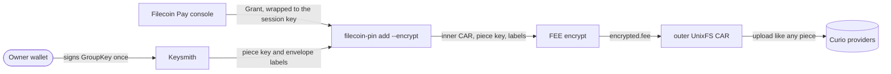
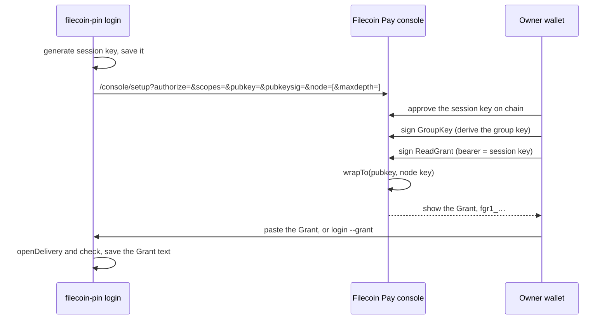
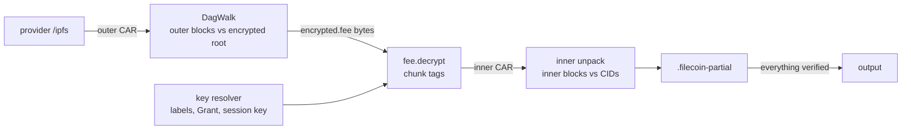

# Encryption with FEE and Keysmith

This page explains how encrypted uploads work on Filecoin Onchain Cloud, as background for CLI encryption ([#168](https://github.com/filecoin-project/agents/issues/168), part of [#156](https://github.com/filecoin-project/agents/issues/156)). Three projects split the work:

- **Filecoin Encryption Envelope (FEE)** encrypts bytes. It takes a 32-byte key and a stream, and writes a public header followed by ciphertext.
- **Keysmith** derives and shares keys. It roots every key in one wallet signature, so nothing needs a key store, and it wraps keys to session keys.
- **filecoin-pin** combines the two in a CLI. It packs a file or folder, encrypts it, uploads the ciphertext like any other piece, and gets a session key its key through the Filecoin Pay console.

`filecoin` has no encryption yet. [What the CLI has to match](#what-the-cli-has-to-match) maps filecoin-pin's design onto the CLI's login, put, and get flows, and [The encryption package](#the-encryption-package) describes `@filecoin-project/encryption`, which implements the format for the CLI to call.

The page describes these versions, read on 2026-11-27:

| Project                                                                                                                     | Version                                                                                                                                                                                    | Format                                                                    |
| --------------------------------------------------------------------------------------------------------------------------- | ------------------------------------------------------------------------------------------------------------------------------------------------------------------------------------------ | ------------------------------------------------------------------------- |
| [`filecoin-encryption-envelope`](https://github.com/FilOzone/synapse-sdk/tree/master/packages/filecoin-encryption-envelope) | 0.1.1                                                                                                                                                                                      | Draft FRC [FIPs#1294](https://github.com/filecoin-project/FIPs/pull/1294) |
| [`@filoz/keysmith`](https://github.com/FilOzone/synapse-sdk/tree/master/packages/keysmith)                                  | 0.2.0                                                                                                                                                                                      | Format 2                                                                  |
| [filecoin-pin](https://github.com/filecoin-project/filecoin-pin)                                                            | The `feat/encryption-v2` branch, after [filecoin-pin#839](https://github.com/filecoin-project/filecoin-pin/pull/839) and [#840](https://github.com/filecoin-project/filecoin-pin/pull/840) | Keysmith format 2                                                         |
| [Filecoin Pay console](https://github.com/FilOzone/filecoin-pay-explorer)                                                   | `staging`, after [filecoin-pay-explorer#635](https://github.com/FilOzone/filecoin-pay-explorer/pull/635)                                                                                   | Issues format 2 Grants                                                    |

filecoin-pin 2.4.0, the latest release, still writes Keysmith format 1. Format 2 reaches a release when [filecoin-pin#837](https://github.com/filecoin-project/filecoin-pin/pull/837) merges `feat/encryption-v2` into `master`. Keysmith 0.2.0 refuses format 1 uploads, Grants, and share links. filecoin-pin's own [encryption guide](https://github.com/filecoin-project/filecoin-pin/blob/master/documentation/encryption.md) still describes format 1, so this page follows the format 2 code instead.

## How the parts fit together



The owner wallet signs once for a group key. Keysmith derives a fresh key for each upload from that group key and a random salt. FEE encrypts the upload with that key and writes Keysmith's labels into its public header. A reader later reads the labels, derives the same key, and decrypts. A session key can't sign for the owner, so it receives the key wrapped to it, as a Grant from the console.

No step writes a secret to the chain or to a server. The chain holds a public group key id and a public commitment to the key, and the envelope holds the owner, the group key id, and the salt.

## FEE encrypts the bytes

An FEE object is a COSE envelope in CBOR, followed by the ciphertext. CBOR is self-delimiting, so a reader decodes the envelope off the front of the stream, and every byte after it is ciphertext. FEE has two schemes:

| Scheme   | `alg`    | How it encrypts                                  | Limit                         | Range reads |
| -------- | -------- | ------------------------------------------------ | ----------------------------- | ----------- |
| Scheme 1 | `3`      | AES-256-GCM over the whole object, in one call   | 64 MiB of plaintext           | No          |
| Scheme 2 | `-65793` | Chunked AES-256-GCM with the STREAM construction | 64 GiB for the encoded object | Yes         |

filecoin-pin uses scheme 2 at the default chunk size of 256 KiB. The rest of this section describes scheme 2.

### Chunks and nonces

Every chunk on the wire is `chunk_size` bytes of ciphertext followed by a 16-byte tag. Only the last chunk may be shorter, so chunk `i` starts at `envelope_len + i × (chunk_size + 16)`. A range read finds its chunks with arithmetic and no index.

The library draws a random 7-byte base nonce for each encryption and never accepts one from the caller. Each chunk's 12-byte nonce is the base nonce, the 4-byte chunk index, and a 1-byte flag that is `0x01` only on the final chunk. The nonce is the only thing that binds a chunk to its position, so a reordered, inserted, or dropped chunk fails its tag. Every chunk uses the same additional authenticated data, the COSE `Enc_structure` over the protected header.

Because the nonce is random, encrypting the same bytes twice with the same key gives different ciphertext. FEE also recommends a fresh key for every encryption, because it can't track how often a caller reuses one.

### The protected header

Every chunk tag authenticates the protected header. filecoin-pin sets these fields:

| Label  | Field              | filecoin-pin's value                                                         |
| ------ | ------------------ | ---------------------------------------------------------------------------- |
| 1      | `alg`              | `-65793`, scheme 2                                                           |
| 16     | `typ`              | `application/vnd.filecoin-encryption+cose`                                   |
| 3      | `content_type`     | `application/vnd.ipld.car`. A reader refuses any other value                 |
| 5      | `iv`               | The 7-byte base nonce                                                        |
| -1     | `chunk_size`       | 262,144                                                                      |
| -65789 | `plaintext_length` | The exact length of the inner CAR                                            |
| -65792 | `app_metadata`     | Keysmith's piece labels, described in [Keysmith's labels](#keysmiths-labels) |

`plaintext_length` lets a reader detect truncation. The reader derives the chunk layout from the size of the object and compares it with the committed length. A cut of a single byte changes the expected total, even when the chunk count stays the same. The field is optional in FEE, for streams whose length isn't known up front, but filecoin-pin always knows the length and always writes it.

FEE also supports recipient records that wrap the key for other holders, with A256KW. filecoin-pin doesn't use them. Keysmith shares keys outside the envelope instead.

### What FEE guarantees and what it leaves to the caller

The library releases each plaintext chunk only after its tag verifies, and it treats a chunk as final only at the end of the input. A stream that fails partway has already released the chunks before the failure. The caller must discard that partial output, because no earlier chunk proves where the object ends.

The header is readable without a key. Its values, including `app_metadata`, stay unauthenticated until the first tag verifies. A key resolver runs on that unauthenticated header, so it must check the labels before it derives or fetches a key.

A wrong key and a modified object fail with the same `AuthenticationError`. Successful decryption proves only that the writer held the key. It doesn't identify the writer, and a CID inside the plaintext is only a claim until the reader hashes the bytes.

## Keysmith derives the keys

Keysmith turns one wallet signature into a tree of keys. Every key is 32 bytes of HKDF-SHA256 output:

```text
sig         = signTypedData(GroupKey { owner, groupKeyId })   EIP-712 domain "Filecoin Encryption", version "2"
groupKey    = HKDF(r ‖ s, "foc/acl/group-key/v2")
keyForGroup = HKDF(parentKey, "foc/acl/group/v2" ‖ segment)   one step per path segment
pieceKey    = HKDF(nodeKey, "foc/acl/piece/v2" ‖ salt)        nodeKey: the group key or a group's key
```

- **The group key** is the root of one tree. Anyone who holds it can derive every key beneath it. A 16-byte group key id, chosen by the client, names it. The id is public and is not a key.
- **A group** is a named subtree, such as `agent-memory` or `finance/clerks`. A group's key opens that group and every group beneath it, and nothing above or beside it. Group names travel in the clear in every envelope.
- **A piece key** opens one upload. Every upload gets a fresh 16-byte salt, and so its own key. A piece key must never encrypt a second object.

The scheme depends on deterministic signatures (RFC 6979), because the same signature must come back on every derivation. Without a recorded commitment, `deriveGroupKey` asks the wallet to sign twice and refuses a wallet whose two signatures differ. With a recorded commitment it signs once and checks the derived key against the commitment. A `password` option stretches a password with Argon2id into the HKDF salt, so the signature alone no longer derives the key. filecoin-pin doesn't use it.

### Keysmith's labels

Keysmith writes public labels in two places:

| Where                  | Labels                                                  | Written                    | Needed to decrypt                                       |
| ---------------------- | ------------------------------------------------------- | -------------------------- | ------------------------------------------------------- |
| FEE `app_metadata`     | `foc/v`, `foc/own`, `foc/gkid`, `foc/group`, `foc/salt` | Once per piece             | Yes. The envelope is the source of truth                |
| FWSS data set metadata | `foc/gkid`, `foc/kc`                                    | Once, at data set creation | No. It names the group key for writers and for recovery |

In format 2, `foc/v` is `2`, `foc/own` is the owner address in lowercase, `foc/gkid` is `0x` and 32 lowercase hex digits, `foc/group` is the canonical group path or absent, and `foc/salt` is the piece's salt. `foc/kc` is `v2.` and 32 hex digits, a one-way commitment to the group key. `readPieceMetadata` parses the envelope labels and refuses any other `foc/v`.

Format 1, from Keysmith 0.1.0, called the group key a keyspace (`foc/ks`) and a group a scope (`foc/scope`), and wrote a `v1.` commitment. Keysmith 0.2.0 refuses format 1 data with an error that names it.

Because every envelope names its own owner, group key, and salt, a copy of a piece opens the same way in any data set and on any provider. A piece moved or repaired into another data set still opens.

### Grants share a key

A Grant gives another key holder a node of the tree. `wrapTo` wraps the node's key to the recipient's secp256k1 public key with ECDH-ES and A256GCM. The Grant is about 190 bytes of canonical CBOR:

```text
grant = {
  0 => 2,                 ; v
  1 => tstr,              ; node: "groupKey", "group:<path>", or "piece:<salt>"
  2 => bstr .size 20,     ; owner
  3 => bstr .size 16,     ; group key id
  4 => bstr .size 65,     ; ephemeral public key
  5 => bstr .size 12,     ; iv
  6 => bstr .size 48,     ; the wrapped key and its tag
}
```

The node, owner, and group key id are authenticated. The recipient needs the private key in hand to unwrap, so a session key can receive a Grant, but a browser wallet or hardware wallet can't.

Keys are symmetric, so a Grant for a group lets its holder write under that group as well as read. Write access to FWSS is a separate session-key scope (`addPieces`), and FWSS doesn't keep the two in step.

### Claim chains prove who holds a Grant

A Grant alone proves nothing about who issued it. A claim chain adds signatures:

1. The owner signs an EIP-712 `ReadGrant`, the root claim. It names the bearer, the chain id, the node, an expiry, and `maxDepth`, the number of further links the bearer may add.
2. Each later link is signed by the previous bearer, and can only keep or narrow the node.
3. The final bearer signs a `ReadRequest` for one piece, for a provider that gates retrieval.

`encodeDelivery(chain, grant)` packs a claim chain and its Grant into one blob. `openDelivery` checks the signatures, the expiry, that the caller's key is the bearer, and the unwrapped key against the commitment the owner signed. It doesn't know which owner, group key, or network the caller expects, so the caller must check those itself. Otherwise someone could hand the CLI a Grant for a key they control, and the CLI would write data that the real owner can't read.

### What Keysmith can't undo

- **A Grant is permanent.** Expiry stops a gating provider from serving the bearer, and it stops filecoin-pin from using the Grant. It doesn't take back the key. Revoking the session key ends its writes, not its reads.
- **Re-keying means a new group key.** To exclude a recipient from future uploads, create a new group key and write under it. Data already shared stays readable to them.
- **Moving or renaming a group changes its keys.** Existing pieces keep their old labels and keys.
- **Recovery needs the wallet and the data.** The owner's wallet, a deterministic signer, and the encrypted pieces are enough to rebuild every key. A lost wallet or a lost piece can't be recovered.

## How filecoin-pin uses them

`filecoin-pin add <path> --encrypt` encrypts before anything leaves the machine. The code is in [`src/common/encryption.ts`](https://github.com/filecoin-project/filecoin-pin/blob/feat/encryption-v2/src/common/encryption.ts), [`group-key.ts`](https://github.com/filecoin-project/filecoin-pin/blob/feat/encryption-v2/src/common/group-key.ts), and [`group-key-grant.ts`](https://github.com/filecoin-project/filecoin-pin/blob/feat/encryption-v2/src/common/group-key-grant.ts).

### An encrypted upload is a CAR inside a CAR

```text
input file or folder
  inner CAR      CARv1, unixfs-v1-2025, an anonymous wrapping directory, metadata first
    envelope     FEE scheme 2, named encrypted.fee
      outer CAR  CARv1, the envelope as one UnixFS file: the piece
```

1. **The inner CAR.** filecoin-pin imports the input with the `unixfs-v1-2025` profile, under an anonymous directory that holds the input under its own name. The inner root is therefore always a directory, even for one file. The CAR lists every dag-pb node first, breadth-first from the root, then every raw leaf in file order, each CID once. A reader learns the whole tree before the first data byte, so `decrypt` unpacks in one streaming pass and the share link viewer maps a file offset to a byte range. The layout is in [`unixfs-car-layout.ts`](https://github.com/filecoin-project/filecoin-pin/blob/feat/encryption-v2/src/common/unixfs-car-layout.ts). The inner root is the plaintext root CID, which filecoin-pin never prints or logs.
2. **The envelope.** FEE encrypts the inner CAR into `encrypted.fee` in a private temporary directory, with the header fields in [The protected header](#the-protected-header). No plaintext touches the disk.
3. **The outer CAR.** filecoin-pin packs `encrypted.fee` as a single UnixFS file, uploads it, and prints its root, the encrypted root CID. The piece's `name` metadata is `encrypted.fee`.

filecoin-pin caps an encrypted upload at about 1 GiB and refuses larger input before it encrypts. The envelope and the outer CAR add about 155 bytes per MiB of inner CAR, plus a few hundred bytes of headers. The header also carries the group name, which Keysmith doesn't limit. `wrapOverhead(carBytes, group)` budgets `4096 + ceil(carBytes / 1 MiB) × 256` bytes, plus the group's UTF-8 bytes.

### Encrypted uploads get their own data sets

| Key                | Value                                                         |
| ------------------ | ------------------------------------------------------------- |
| `foc/enc`          | `"1"`. Marks the data set as encrypted and versions its rules |
| `foc/gkid`         | The group key id                                              |
| `foc/kc`           | The `v2.` commitment to the group key                         |
| `source`           | `filecoin-pin`                                                |
| `withIPFSIndexing` | Present unless `--no-ipfs`                                    |

An encrypted upload reuses a data set only when `foc/enc`, `foc/gkid`, and `foc/kc` all match. A plain upload never reuses a data set that carries any of them, or the format 1 `foc/ks`.

The owner's first group key id comes from the owner address: the first 16 bytes of `keccak256(utf8("filecoin/default-group-key") ‖ owner)`, with the owner as 20 raw bytes. Every client that sets up encryption before the first upload picks the same id. After that, filecoin-pin picks the oldest valid group key on chain. It groups the live data sets by `foc/gkid`, skips a group key whose data sets disagree on `foc/kc` or aren't all `foc/enc` `"1"`, and takes the one with the lowest data set id. filecoin-pin and the console don't check the format of `foc/kc`. If the oldest group key records one that isn't `v2.` and 32 lowercase hex, every owner-mode write to it fails when Keysmith checks the key against it.

### The owner wallet signs, and a session key opens a Grant

filecoin-pin holds the key in one of two ways:

- **Owner mode.** With `PRIVATE_KEY`, filecoin-pin derives the group key itself. For a group key already on chain the wallet signs once, and the key is checked against `foc/kc`. A new group key needs two signatures. `get` and `decrypt` sign twice, because they check no commitment offline. Owner mode works on every network.
- **Session-key mode.** A session key can't sign for the owner, so the owner issues it a Grant through the console. Session-key mode works only where the console does, on mainnet and calibration.

`filecoin-pin login --scopes createDataSet,addPieces,encrypt` runs the session-key flow. `encrypt` isn't an on-chain scope. It asks for a Grant:



The console link carries the setup parameters and these four Grant parameters, from the console's [`setupLink.ts`](https://github.com/FilOzone/filecoin-pay-explorer/blob/staging/apps/explorer/src/utils/setupLink.ts):

| Parameter   | Value                                                                                                                                                               |
| ----------- | ------------------------------------------------------------------------------------------------------------------------------------------------------------------- |
| `pubkey`    | The session key's uncompressed secp256k1 public key, `0x04` and 128 hex digits                                                                                      |
| `pubkeysig` | The session key's EIP-191 signature over `Keysmith key agreement key: <pubkey>`, which binds the public key to the session address                                  |
| `node`      | `groupKey` for the whole group key, or `group:<path>` for one group                                                                                                 |
| `maxdepth`  | Optional, `0` to `7`: how many onward links the session key may add. The console defaults to 7, Keysmith's chain limit, and the owner can switch onward sharing off |

The console refuses a Grant link without `addPieces` in `scopes`, because a key that can't add pieces has nothing to encrypt. It refuses `node=keyspace` and `node=scope:<path>` from filecoin-pin 2.3.0 and 2.4.0 as `old-cli`. It picks the group key the way owner-mode `add --encrypt` does, and by its convention a Grant expires with the session key's authorization. The owner can narrow a requested group to a group beneath it.

The Grant is one line of text, `fgr1_` and the base64url of `encodeDelivery(chain, grant)`. It opens only with the session key it was made for, so it isn't a secret on its own, but it shows the owner, the session address, the group key id, and the expiry. filecoin-pin saves it in `session.env` as `GROUP_KEY_ID` and `GROUP_KEY_GRANT`. It never saves the key the Grant opens.

On import and on every use, filecoin-pin opens the Grant with `openDelivery` and then checks that it is for this session key, from the wallet that authorized it (`WALLET_ADDRESS`), for this network's chain id, for the saved group key id, for a group key or a group and not a piece, and not expired. A session key can hold several Grants of one group key, comma-separated in `GROUP_KEY_GRANT`. Keysmith's `pickGrant` chooses the narrowest one that reaches the piece or group. `login --group <path>` asks for a group Grant, and `add --group <path>` writes under it.

### Reading an encrypted upload back

`filecoin-pin get <cid>` downloads the CAR of the encrypted root CID from up to four providers, checks every block against its CID, and saves the CAR to a temporary file. It then looks at the root. A UnixFS file whose first bytes parse as an FEE header with `content_type` `application/vnd.ipld.car` is an encrypted upload. Anything else is plain content and needs no key.

For an encrypted upload, FEE's key resolver reads the envelope labels and derives the piece key from the owner wallet, or from the Grant that `pickGrant` chooses. An upload owned by another wallet, or under another group key, fails with a message that names both. filecoin-pin then unpacks the inner CAR into the output directory under the original name. On any failure, including Ctrl-C, it removes only the entry it created. Its errors never print a name or CID from inside the envelope. `filecoin-pin decrypt <file> <dir>` does the same, offline, from a downloaded `encrypted.fee` or outer CAR.

### Share links open one upload

`get-share-link <cid>` shares one upload with someone who has no key pair. filecoin-pin reads the envelope labels from the upload's first blocks over the trustless gateway API, checking each block against its CID, because a dishonest gateway could otherwise return another upload's header. It derives that upload's piece key, generates a throwaway key pair, and wraps the piece key to it as a piece Grant. The link is `https://viewer.filecoin.cloud/#v1/<encrypted root CID>&d=<grant>[&k=fak1_<private key>]`. Everything is in the fragment, so no server sees the key. A restricted link leaves out `k`, and the recipient gets the Access key, `fak1_…`, by another channel. A share link can't be revoked.

### Private data sets gate the ciphertext too

By default the ciphertext of an encrypted upload is public. Anyone can fetch it by its encrypted root CID or its PieceCID, and anyone can see the owner, the group key id, the upload's rough size, and which providers hold it. `add --private` ([filecoin-pin#827](https://github.com/filecoin-project/filecoin-pin/pull/827)) also sets `read=restricted` on the data set. Providers then serve those pieces only on `/download/<cid>`, to a request with `Authorization: FOC-Grant <presentation>`, a claim chain and a signed `ReadRequest` that Keysmith's `verifyPresentation` checks against the envelope labels. Private uploads aren't indexed anywhere, so `get` ([filecoin-pin#840](https://github.com/filecoin-project/filecoin-pin/pull/840)) finds them among the owner's own restricted data sets.

## What the CLI has to match

[#168](https://github.com/filecoin-project/agents/issues/168) plans opt-in `filecoin put --encrypt`, decryption in `filecoin get`, and `filecoin share`, with Keysmith format 2 and public ciphertext. [#183](https://github.com/filecoin-project/agents/issues/183) holds the four-PR implementation plan, and [#169](https://github.com/filecoin-project/agents/issues/169) tracks the shared input walk and metadata rules. Envelopes the CLI writes must open in filecoin-pin and in the share link viewer, and the reverse. Groups (`--group`), share links, and opening share links in `filecoin get` are in the first release. Owner mode with a wallet private key and provider-gated data sets stay out of it. These differences between filecoin-pin and the [CLI architecture](architecture.md) shape the work:

- **Login gains a paste step.** `filecoin login` has nothing to copy or paste today, and the console has no way to send the Grant back. `filecoin login --encrypt` (with `--group <path>` implying `--encrypt`) appends `grantLinkParams` with `maxdepth=0` to the `/console/setup` link and keeps `--scopes` strictly on-chain. An already-approved session can request a Grant or another group without `--fresh`. The owner copies the `fgr1_…` text from the console: an interactive human pastes it at a prompt, and an agent gets a `by: "user"` step followed by `filecoin login --grant <fgr1_…>`. The CLI checks the owner, network, session key, group key, and expiry, and saves the Grant texts next to the session key in `config.json`, never the unwrapped key. Cloud agents and CI pass one or comma-separated `fgr1_…` Grants in `FILECOIN_GRANT`, with `groupKeyId` inferred from the opened Grant. When `put --encrypt` lacks a matching Grant, it fails fast with a `by: "user"` next step running `filecoin login --encrypt` instead of starting login inline.
- **The default scopes already include `addPieces`,** which the console requires for a Grant link.
- **An encrypted put can't repack on resume.** `put` builds a deterministic DFS CAR, so a resume packs the same bytes again and gets the same PieceCID. Encryption isn't deterministic. A new salt gives a new key, and FEE draws a new nonce on every call. Reusing a saved salt would encrypt a second object with one piece key, which Keysmith forbids. The CLI must therefore write `encrypted.fee` to disk and checkpoint it before the first upload, so `operations resume` uploads the same bytes. `put` stopped staging CARs after `filecoin` 0.7.0, so this brings staging back for encrypted puts only.
- **The inner CAR needs a second writer.** `dfs-car.ts` writes blocks in a different order from filecoin-pin's inner CAR, and without the wrapping directory that carries the name. [The inner CAR's block order and wrapper](#the-inner-cars-block-order-and-wrapper) explains both differences. `@filecoin-project/encryption` has that writer, `planInnerCar` and `emitInnerCar`.
- **Prices follow the outer CAR.** The funds check must price the outer CAR's size, and both copies must carry the same `foc/enc`, `foc/gkid`, and `foc/kc`. With `source=filecoin-cli`, encrypted data sets stay apart from filecoin-pin's, as plain ones do today.
- **Public metadata and `state.db` must not leak the plaintext.** The piece `name` is `encrypted.fee` unless the user passes `--name`, which is public, and `ipfsRootCID` is the encrypted root CID. Managed resources in `state.db` follow the same rule: they store `encrypted: true`, `group` when set, `rootCid` as the encrypted root CID, and `name` as `--name` or `encrypted.fee`. The plaintext name and the plaintext root CID stay out of piece and data set metadata, `state.db`, stdout, logs, and errors.
- **`get` must verify before it writes.** FEE can only confirm the end of the object at the final chunk, so a failed decryption must leave no plaintext behind. [How `get` would decrypt](#how-get-would-decrypt) describes the flow.
- **The size limit drops.** `put` accepts up to 63.5 GiB today. Because `put --encrypt` stages `encrypted.fee` on disk, it caps encrypted input at 1 GiB (matching filecoin-pin), checks free disk space on the staging directory with `statfs` before encrypting, and rejects `--encrypt` combined with `--raw`.
- **Browser links show ciphertext.** `urls.browser` for an encrypted root CID would open `encrypted.fee` in inbrowser.link. `urls.browser` becomes optional in the schema, and encrypted uploads omit both `urls.browser` and `resource.url`, keeping `urls.piece` for the raw ciphertext. Only a share link opens the content in a browser, and an open share link carries the key, so `put` never prints one. A separate command, `filecoin share <target>`, creates open `#v1/` share links by default, with `--restricted` to return the `fak1_…` Access key separately. `filecoin get <share-url>` (with `--access-key` or `FILECOIN_ACCESS_KEY` for restricted links) decrypts share links locally without a wallet or session key.

### The inner CAR's block order and wrapper

A plain `put` and filecoin-pin's inner CAR hold the same kinds of blocks, with the same `unixfs-v1-2025` CIDs, but they differ in two ways.

**The block order differs.** `dfs-car.ts` writes a depth-first CAR. Each directory or file node comes right before its children, so file data and nodes alternate. filecoin-pin writes every dag-pb node first, breadth-first from the root, and then every raw leaf in file order. Each CID appears once in both layouts. For a folder `photos` that holds two files of two chunks each, the two layouts list the blocks in this order:

```text
dfs-car.ts      photos  a.jpg  a#1  a#2  b.jpg  b#1  b#2
filecoin-pin    (wrapper)  photos  a.jpg  b.jpg  a#1  a#2  b#1  b#2
```

The metadata-first order puts the whole tree, with every name and size, ahead of the first data byte. A reader can then compute where each leaf sits in the CAR from the nodes alone, before it reads any leaf. filecoin-pin depends on that in two places:

- `decrypt` and `get` unpack the inner CAR in one streaming pass. filecoin-pin's [`unixfs-car-unpack.ts`](https://github.com/filecoin-project/filecoin-pin/blob/feat/encryption-v2/src/common/unixfs-car-unpack.ts) refuses a dag-pb block that arrives after the first leaf, and a leaf that arrives out of the expected order. A depth-first inner CAR fails at the first file node that follows a leaf.
- The share link viewer maps a file and an offset to a byte range of the inner CAR. With FEE's range reads, it can then decrypt only the chunks that hold one file. The nodes give every leaf's position in either order, from their links and the file nodes' `blocksizes`. In the metadata-first order the nodes come first, so one read of that prefix places every leaf. In a depth-first CAR the nodes are spread between the leaves. A reader then has to decrypt everything ahead of the file, or hop from node to node with one range read per hop. The `Tsize` in a dag-pb link can't size the skip, because it is the writer's unchecked claim and leaves out each section's varint and CID.

**The wrapper carries the name.** A plain `put` of a file has no directory around it. The file's own CID is the root, and its name is in the piece's `name` metadata. An encrypted piece's `name` is `encrypted.fee`, so the original name has to live inside the ciphertext. filecoin-pin puts the input in an anonymous directory with one entry, the input under its own name. The plaintext root CID is that wrapper's CID, so it differs from the root CID a plain `put` of the same input returns. The wrapper's one link is the input's own CID, which does match.

Most of the change is in the second pass of packing. Pass 1 of `dfs-car.ts` already builds the DAG with the importer, keeps dag-pb nodes in memory, and keeps only the lengths of raw leaves. filecoin-pin's [`unixfs-car-payload.ts`](https://github.com/filecoin-project/filecoin-pin/blob/feat/encryption-v2/src/common/unixfs-car-payload.ts) does the same, and it gets the wrapper from the importer: it sets `wrapWithDirectory: true` and prefixes every path with `basename(input)/`. An encrypted put's pass 1 would set the same option. The new pass 2 writes the nodes breadth-first, and then reads each leaf from its source file in file order, checking it against its CID as the current pass 2 does.

`filecoin` uses filecoin-pin's inner layout, a metadata-first CARv1 under the wrapping directory, so that envelopes open in both tools and in the share link viewer. We considered a CARv2 inner CAR, with the current depth-first data and an index after it. It would let `put` and `get` reuse `dfs-car.ts` and `DagWalk`, and it streams as well in both directions. But filecoin-pin refuses its block order, filecoin-pin and the viewer require `content_type` `application/vnd.ipld.car`, and the viewer would need more sequential reads to open one file: the header, then the index, then one read per path level, instead of the node prefix and then the leaves. The index grows with the number of blocks, so it saves no bytes over the node prefix.

The outer CAR needs no new writer. It is one UnixFS file, `encrypted.fee`, with no wrapper, so its root is the envelope file's own CID. That is the shape `put` already writes for a single file. filecoin-pin's reader indexes the outer CAR before it walks it, so the outer CAR's block order doesn't matter to it.

### How `get` would decrypt

`get` would decrypt in one streaming pass, with no CAR and no ciphertext on disk, and check the data three times before anything reaches its final path. `get <PieceCID>` doesn't change. It still returns the exact stored bytes, which for an encrypted upload is the outer CAR.



`get` would take these steps:

1. **Find the target.** A ref goes to its provider's `/ipfs/<encrypted root CID>`, and a bare root CID or `#v1/` share link goes through filecoin-api `/get`, as bare CIDs do today.
2. **Check the outer DAG.** `downloadDag`'s walk in `storage/dag.ts` checks every block against the encrypted root CID, as it does now. The outer DAG is one UnixFS file, `encrypted.fee`. Today `DagWalk` writes a file's bytes into `.filecoin-partial`. For an encrypted upload it would hand them on as a stream instead.
3. **Detect the envelope.** For a ref, the resource in `state.db` would record that it is encrypted. For a bare CID, `get` reads the first bytes of a root file and runs `fee.parse`, as filecoin-pin's `isEnvelope` does. An FEE header with `content_type` `application/vnd.ipld.car` marks an encrypted upload. Anything else is a plain file and is written as today. The probe holds at most the envelope, which FEE caps at 1 MiB.
4. **Resolve the key.** FEE hands the key resolver the envelope labels, which aren't authenticated yet. For a ref or bare CID, the resolver checks that `foc/own` is the session's owner and that `foc/gkid` is the saved Grant's group key. A mismatch fails with a message that names both values. The resolver then picks the Grant with `pickGrant`, opens it with the session key, and derives the piece key with `keyForEnvelope`. A missing or expired Grant fails with a `by: "user"` step to log in for a new one. For a `#v1/` share link, `shareKeyResolver` opens the link's piece Grant with its Access key (from the link fragment, `--access-key`, or `FILECOIN_ACCESS_KEY`) and needs no session key.
5. **Decrypt.** `fee.decrypt` releases each 256 KiB chunk only after its tag verifies. It confirms the end of the object only at the final chunk, where it checks the final-chunk flag and `plaintext_length`.
6. **Unpack the inner CAR.** The inner CAR lists every dag-pb node before any leaf. The unpacker reads the nodes first, checks each against its CID, and keeps them in memory. From them it learns the name of the wrapping directory's one entry and the whole tree, and it rejects symlinks and unsafe names before it writes a byte. When `--output` is omitted, `get` targets `./<original name>` and checks `outputExists` before writing any leaf. It then checks each raw leaf against its CID and writes it at its offsets in `<output>.filecoin-partial`. A leaf that repeats in the input has several targets, and the unpacker writes each one.
7. **Publish.** `get` renames the partial output into place only after FEE ends without an error and the inner CAR has delivered every block its nodes name. The JSON result reports `encrypted: true` and `rootCid` as the encrypted root CID, with no plaintext root CID or separate `name` field. On any failure, `get` deletes the partial output. Failures include a wrong key, a tampered or truncated envelope, a bad inner block, and Ctrl-C.

Each check proves something the others don't:

| Check                                       | What it proves                                                                                                |
| ------------------------------------------- | ------------------------------------------------------------------------------------------------------------- |
| Outer blocks against the encrypted root CID | The provider sent the bytes that were uploaded                                                                |
| FEE chunk tags                              | A key holder wrote the ciphertext, and no chunk was cut, reordered, or changed                                |
| Inner blocks against their CIDs             | The plaintext matches its own CIDs. FEE authenticates a CID inside the plaintext only as a key holder's claim |

filecoin-pin's `get` downloads the whole CAR to a temporary file, checks it, and only then detects and decrypts the envelope. The streaming flow skips that copy, so `get` needs disk space for the plaintext only. The cost is that a failure partway through starts the download again from the beginning, which is how a plain `get` behaves today.

## The encryption package

[`@filecoin-project/encryption`](../../packages/encryption/README.md) implements filecoin-pin's format, so the CLI calls it instead of copying the rules. It follows [FilOzone/synapse-sdk#1040](https://github.com/FilOzone/synapse-sdk/issues/1040), which proposes one such package for filecoin-pin, the console, and the viewer. It runs in browsers and Node.js, with Web Streams and WebCrypto only, and depends on `filecoin-encryption-envelope` 0.1.1 and `@filoz/keysmith` 0.2.0.

| Part         | What it holds                                                                                                                |
| ------------ | ---------------------------------------------------------------------------------------------------------------------------- |
| `/group-key` | `foc/enc` and the encrypted data set keys, the default group key id, and the oldest-valid-group-key choice                   |
| `/grant`     | The `fgr1_` codec, the checks after `openDelivery`, the console link's Grant parameters and their parser, and Grant issuance |
| `/envelope`  | FEE encryption and decryption with the content type and labels above, envelope detection, and the key resolvers              |
| `/car`       | The metadata-first inner CAR writer, its streaming unpacker, and its layout, with work and size limits                       |
| `/archive`   | Random-access reads: list an upload's tree and decrypt one file, over HTTP range requests or bytes                           |
| `/share`     | `#v1/` share links, with plain piece Grant or Delivery payloads, and `fak1_` Access keys                                     |
| `/errors`    | `EncryptionError` and its subclasses, each with a stable `code`                                                              |

It covers what the console and the viewer need too, so either can switch to it. The package settles these questions for the CLI:

- **The CLI keeps its walk.** `planInnerCar` takes the entries from the caller and reads bytes through an interface. Encrypted put uses the same walk as a plain put, `listEntries`: it refuses symlinks (the input too), names with `\`, FIFOs, sockets, and devices, and skips dotfiles unless `--include-hidden` is passed. A root folder whose name starts with `.` gets no special treatment, unlike in filecoin-pin. The package checks only names and paths. It also refuses a name that starts with U+FEFF or holds an unpaired surrogate, because `@ipld/dag-pb` would read either back as another name.
- **The wrapper's name is explicit.** The CLI passes `basename(resolve(input))` as the name of the wrapper's one entry, never `--name`. The piece's public `name` stays `encrypted.fee`, unless the user passes `--name`.
- **No key outlives its call, except in an archive.** `openGrant` checks a pasted Grant and returns what it covers, with the key zeroed. Writes and reads open the Grants again when they need a key. `decrypt` keeps a piece key inside the FEE stream, which zeroes it when it ends. A key resolver called directly hands a piece key out, and its caller zeroes it. `openArchive` keeps the piece key for its range reads until `close()`. The package zeroes the keys it receives. Keysmith 0.2.0 zeroes none of the buffers inside its own calls, and leaves a key unzeroed on three failures, in `deriveGroupKey`, `openDelivery`, and `rootClaim`, in buffers the package never sees.
- **A Grant link asks for depth 0.** `grantLinkParams` always writes `maxdepth`, 0 unless the caller asks for more, and `parseGrantLinkParams` reads a missing `maxdepth` as 0. Neither the CLI nor the package delegates onward, so a session key needs no depth, and a stolen one can't issue another Grant. Depth 0 limits only onward Grants. A session key that opens a group can still make a share link for any piece in that group with `createShare`. The console still reads a missing `maxdepth` as 7, a difference for the console to settle.
- **Layouts have limits.** A small crafted inner CAR that links one child many times has exponentially many paths. `layout` stops after a million visits by default, and refuses names over 1,024 bytes and paths over 4,096 bytes, as the viewer does. A tree can link one directory many times and stay under the visit budget while its paths add up to gigabytes, all held by the reader. So `layout` also refuses a tree whose paths add up to more than 128 MiB by default, `maxTotalPathBytes`. It also refuses a tree that nests more than 1,024 directories, shards, and file nodes deep, because a deep chain of file nodes would overflow the call stack. Both readers hold at most 16 MiB of metadata by default, the CAR header and every dag-pb section, and `planInnerCar` refuses a tree whose metadata is larger as `too-large`, so every upload it writes with its default opens in both readers with their defaults. A caller that raises `maxMetadataBytes` on the write must raise it on every read. The share link viewer also refuses an archive of more than 10,000 entries, which the writer doesn't check, so a bigger folder opens with `get` but not in the viewer. The unpacker checks each section's declared length before it reads the section. Deduplication lets a small tree describe a huge one, so the unpacker also refuses a tree that restores more than 64 GiB by default, and `get` passes its free disk space as `maxOutputBytes`. `planInnerCar` refuses an input over the same 64 GiB, so an upload written with the defaults restores with them. An upload over the default restores with `unpackInnerCar` or `decryptToSink` only when they get a `maxOutputBytes` at least as large as its files' total size, which can stay at the sink's free space. `openArchive` reads one file at a time and has no such limit. The entry count can be capped too. Breaking a limit fails as `layout-limit`. Anyone with a Grant for the group key can write an envelope, so `get` needs these limits as much as the viewer does.
- **Share links follow the viewer's grammar.** `parseShareLink` accepts exactly what `formatShareLink` writes, in the viewer's order and encodings, so a link opens in both or in neither. It reads a Delivery payload, which can expire, as well as a plain piece Grant, and makes plain ones only. A Delivery that a group's Grant narrowed to the piece verifies only with the envelope's labels, so `shareKeyResolver` checks its whole chain, and `shareOwner` checks only its bearer and expiry. The viewer calls `openDelivery` before it fetches the envelope, so it can't open such a Delivery yet, and the CLI shouldn't write one until it can. Format 1 links fail as `format-1`, and the viewer keeps opening them itself.
- **Every error is safe to print.** Errors carry a `code` and never name a plaintext path or CID. A packing error names an entry by its position. The CLI's own walk errors for an encrypted put give counts by kind and a fix for each, and point to `filecoin put <your folder> --dry-run`, without encryption, to list the names.
- **Both readers refuse the same headers.** They read a CAR header of at most 128 bytes, where the profile's is 59, so neither decodes a large one. They refuse one that isn't the profile's, byte for byte, with the same codes.
- **The unpacker checks the dag-pb nodes too.** filecoin-pin's unpacker checks every raw leaf against its CID. The package also checks every dag-pb node, so a node that doesn't match its CID fails before the tree is read. It refuses a dag-pb node that appears twice or that the tree doesn't use.
- **The package skips a malformed `foc/kc`.** `chooseGroupKey` skips a group key whose `foc/kc` isn't `v2.` and 32 lowercase hex, as `bad-commitment`, and picks the next valid one. filecoin-pin and the console pick that group key, and then fail to write to it or to issue a Grant for it. Only the owner writes data set metadata, so only the owner's own client can record a malformed one.
- **A file that changes during a put fails it.** Pass 1 compares each file's size with the walk's, and stops reading a file at the first chunk past its size. Pass 2 reads every leaf again and hashes it, compares every other place a repeated leaf is used, and reads one byte past each file's planned size. A changed, shrunk, or grown file fails as `changed` before the envelope stream ends, so nothing changed is uploaded.

Its tests decrypt filecoin-pin's golden envelopes, rebuild their inner CARs byte for byte with `ipfs-unixfs-importer` 17, open its golden Grant, and open its pinned share links. Owner mode and group Grants work in the package. The CLI uses session-key Grants only and supports `--group` in the first release ([#168](https://github.com/filecoin-project/agents/issues/168), [#183](https://github.com/filecoin-project/agents/issues/183)).

## Open questions

- When do filecoin-pin and the console skip a malformed `foc/kc`, as the package does? Until then, an owner whose oldest group key records one writes under another group key with the package than with filecoin-pin, and the console issues no working Grant.
- When does the console's format 2 Grant flow reach the production console? filecoin-pay-explorer#635 merged into `staging` on 2026-11-24, and its notes hold promotion until filecoin-pin releases format 2.
