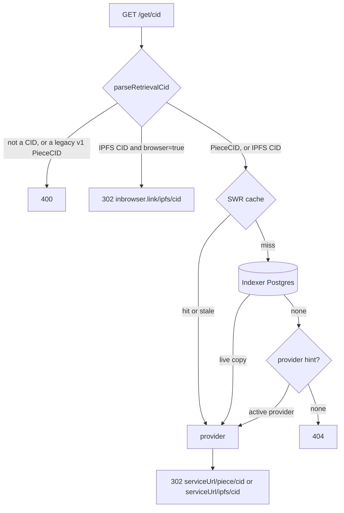

# Retrieval through `/get/{cid}`

filecoin-api's `GET /get/{cid}` route turns a CID into a redirect to a server that has the content. This page explains how the route finds that server today, what the [InterPlanetary Network Indexer](https://docs.ipfs.tech/concepts/ipni/) (IPNI) knows about the same content, and how to add [cid.contact](https://cid.contact), the public IPNI instance, as a second source. With IPNI, `/get` stops being limited to content stored through Filecoin Warm Storage Service (FWSS).

The measurements ran on 2026-11-10 against mainnet, with `curl` from Lisbon against `api.filecoin.io`, `cid.contact`, and `fetch.cid.contact`. The [filecoin-api README](../../apps/filecoin-api/README.md#retrieval) is the reference for the route as it ships today.

## How `/get/{cid}` works today

The route is in [`routes/retrieval.ts`](../../apps/filecoin-api/src/routes/retrieval.ts). It never proxies bytes. It answers with a `302` to a provider or to inbrowser.link, a `400` for an input that is not a supported CID, or a `404`.

The route takes these steps:

1. [`parseRetrievalCid`](../../apps/filecoin-api/src/cid.ts) classifies the CID. A CID with the `fr32-sha2-256-trunc254-padded-binary-tree` multihash is a PieceCID v2. Any other CID is IPFS content, normalized to base32 CIDv1. Legacy v1 PieceCIDs (`baga…`) return `400`.
2. An IPFS CID with `browser=true` goes to `https://inbrowser.link/ipfs/{cid}` with no lookup. inbrowser.link finds the blocks itself, through IPNI, and verifies them in the browser.
3. Otherwise the route looks up a provider in the indexer database of the `network` query parameter, through the stale-while-revalidate cache. `findPieceProvider` matches `pieces.cid`. `findIpfsRootProvider` matches `pieces.ipfs_root_cid` in data sets with `with_ipfs_indexing`. Both keep only live copies on active providers with an HTTP service URL. They rank endorsed providers first, then approved ones, then the oldest copy.
4. If the database has no copy, `provider={id}` names a provider to use instead. The hint covers the time between a provider parking a piece and the indexer seeing the commit. The route never caches a hinted provider.
5. The route redirects to `{serviceUrl}/piece/{cid}` or `{serviceUrl}/ipfs/{cid}`, the paths Curio serves. With `browser=true`, a PieceCID whose copy has an `ipfsRootCID` goes to inbrowser.link instead. The route forwards every query parameter except `network`, `browser`, and `provider`.

The cache key is `/__cache/v2/{network}/{kind}/{cid}`. An entry is fresh for 10 minutes and served stale for up to 24 hours. `X-Cache` reports `hit`, `stale`, `miss`, or `none`.

Two clients build `/get` links:

- The CLI's [`retrievalUrls`](../../packages/filecoin-cli/src/storage/urls.ts) returns `urls.piece`, which is `/get/{pieceCid}`, and `urls.browser`, which is `/get/{rootCid}?browser=true` for a folder and `/get/{pieceCid}?browser=true` for a file.
- The app's [`retrievalUrl`](../../apps/filecoin-app/src/lib/retrieval.ts) builds `/get/{cid}?browser=true` for explorer links.

### What the database cannot answer

The database knows only what FWSS contracts record on chain, so the route has four gaps:

- **Only the root of a folder resolves.** The indexer stores the `ipfsRootCID` piece metadata, not the CIDs of the files and blocks inside the CAR. A link to a file inside a folder returns `404`.
- **New content waits for the indexer.** The indexer sees a piece after the add-pieces transaction confirms. A folder's root returns `404` from `/get` until then, even though Curio already serves it.
- **Content stored outside FWSS never resolves.** A CID served by any other Filecoin or IPFS provider returns `404`.
- **A network without a database returns `503`,** even for content that a provider serves.

## What IPNI knows

Content providers publish signed advertisements to IPNI. Each advertisement lists multihashes, a context ID that groups them, metadata that names the retrieval protocol, and the provider's peer ID and addresses. cid.contact ingests them and answers lookups:

| Endpoint | Returns |
| --- | --- |
| `GET /cid/{cid}`, `GET /multihash/{mh}` | `MultihashResults` with each provider's `ContextID`, `Metadata`, peer ID, and multiaddrs. `Accept: application/x-ndjson` streams one provider per line. |
| `GET /routing/v1/providers/{cid}` | The same providers in the [delegated routing](https://specs.ipfs.tech/routing/http-routing-v1/) format, with protocol names such as `transport-ipfs-gateway-http` instead of raw metadata |
| `GET /providers` | Every provider's peer ID, addresses, and last advertisement time |

The metadata starts with a multicodec that names the transport. `0x0920` is `transport-ipfs-gateway-http`, a trustless gateway that serves `/ipfs/{cid}`. `0x0930` is `transport-filecoin-piece-http`, which serves `/piece/{cid}` ([FRC-0066](https://github.com/filecoin-project/FIPs/blob/master/FRCs/frc-0066.md)).

### What Curio announces for FWSS

FWSS data sets go through Curio's PDP v0 path, [`task_pdp_v0_ipni.go`](https://github.com/filecoin-project/curio/blob/main/tasks/indexing/task_pdp_v0_ipni.go). For a piece in a data set with `withIPFSIndexing`, Curio advertises every block multihash in the CAR with `0x0920` metadata. The context ID is one flags byte followed by the PieceCID v2 bytes ([`PdpIpniContext`](https://github.com/filecoin-project/curio/blob/main/market/ipni/types/types.go)). One record from cid.contact decodes to flags `0x01`, the payload flag, and `bafkzcibftt4poaqteiv5gzoutzi4lmy727flqa2dlp6c6vzct2m7cpdhsiqmi4k3vqha`, the same piece the indexer stores for that root.

Curio does not advertise FWSS PieceCIDs. Its newer pipeline, [`task_pdp_ipni.go`](https://github.com/filecoin-project/curio/blob/main/tasks/indexing/task_pdp_ipni.go), can advertise the PieceCID multihash itself with `0x0930` metadata, but FWSS pieces do not go through that pipeline. Every provider in the sample of roots below had content in cid.contact. The seven mainnet provider hosts we looked up in `GET /providers` had each published an advertisement in the 15 minutes before the check.

The FWSS service provider registry has `ipniPiece`, `ipniIpfs`, and `ipniPeerId` capabilities in each PDP offering. synapse-core reads them as `PDP_OFFERING_KEYS`. The indexer does not store them, so the API's provider records have no peer ID.

### What fetch.cid.contact does

`https://fetch.cid.contact/retrieve/{cid}` is a redirect service like `/get`, backed by cid.contact instead of a database:

- A PieceCID v2 redirects to `{provider}/piece/{cid}`.
- Any other CID redirects to `{provider}/ipfs/{cid}?format=car`.
- It takes the first provider that advertises the matching transport with an https address. It does not rank providers.
- It returns `404` when no provider is indexed and `502` when cid.contact is unavailable.

We found no public source for it. Redirecting `/get` misses to it would add a hop to a service we don't run, ignore our ranking, and force `format=car` on every IPFS redirect. Querying cid.contact directly costs about the same code and has none of those problems.

## What the measurements show

Each row compares cid.contact with `/get` on the same CIDs:

| CIDs | cid.contact | `/get` today |
| --- | --- | --- |
| 4 PieceCIDs, with and without an IPFS root | 0 found | 4 found |
| 78 IPFS roots, one from each of the newest IPFS-indexed data sets | 73 found | 76 found |
| 4 child blocks inside one indexed root | 4 found | 0 found |

- **Five roots are missing from cid.contact.** Two return `404` from `/get` too, most likely because their pieces were removed. The other three are one 418 MB `ipfs2fil` root stored on providers 1, 5, and 32. It was added at block 6531147, about 21 hours before the check, and none of the three providers had it in cid.contact. We did not find out why.
- **Lookups are fast.** cid.contact answered in 350 to 490 ms on a cold lookup and 50 to 90 ms on a repeat, because Cloudflare caches its answers. A cached `/get` answered in about 120 ms.
- **delegated-ipfs.dev returned the same record** as cid.contact for the same root, in 800 ms. It queries the Amino DHT as well as IPNI.
- **cid.contact mixes networks.** Calibration providers, such as `calib.ezpdpz.net`, advertise to the same instance as mainnet providers.

## Add cid.contact to `/get`

The database stays the preferred source, because it knows which copies are live on chain and how to rank them. cid.contact becomes the fallback for any CID the database misses, for both kinds, and for any provider that advertises a usable transport. The route is not limited to FWSS providers.

### Race cid.contact with the database, and prefer the database

On a cache miss without a `provider` hint, the route starts the database query and the cid.contact lookup at the same time. It does not take whichever answers first:

1. **The database has a copy.** Redirect to it, and abort the cid.contact request.
2. **The database has no copy.** Wait for cid.contact, keep the usable providers, rank them, and redirect to the first one.
3. **cid.contact has no usable provider.** Return `404`.
4. **cid.contact fails or times out.** Return `502`.

A database miss then costs the slower of the two lookups instead of their sum. cid.contact took 350 to 490 ms on a cold lookup, so the saving is the length of the database step. A database hit is as fast as today.

The database still wins over a faster cid.contact answer for two reasons:

- **cid.contact can list a provider that dropped the piece.** Curio withdraws a PDP advertisement only when it garbage-collects the piece ([`task_piece_gc.go`](https://github.com/filecoin-project/curio/blob/main/tasks/pdpv0/task_piece_gc.go)). The withdrawal reaches cid.contact after that.
- **cid.contact does not rank.** Its order is not the route's order of endorsed, then approved, then oldest copy.

The race runs only when the route loads an entry into the cache. The background revalidation of a stale entry has no caller waiting, so it queries the database first and calls cid.contact only on a miss.

An IPFS CID with `browser=true` still goes to inbrowser.link with no lookup. inbrowser.link already routes through IPNI and verifies the blocks. Legacy v1 PieceCIDs still return `400` before any lookup, even though other Filecoin deals may advertise them to cid.contact.

### Check the hint after the database and before cid.contact

`filecoin put` adds `provider={id}` only to the links it reports before the commit confirms. In that window the database has no copy, and cid.contact has no FWSS PieceCID. The caller knows where the piece is, so the hint is the fastest correct answer. With a hint, the route resolves in this order:

1. **The database has a copy.** Redirect to it, as today. An indexed copy always wins over the hint, so a link that keeps its hint follows the ranking once the indexer has the piece.
2. **The hint names an active provider** in the [cached list of active providers](#cache-the-active-providers). Redirect to it, and don't cache the answer.
3. **The hint names no active provider.** Look up cid.contact, and continue as a request without a hint.

A request with a hint does not race. It starts only the database query, and calls cid.contact only if both the database and the hint miss. Every early link then gets its answer without waiting for cid.contact, and does not spend a cid.contact request that the hint makes useless. A cached answer, from the database or from cid.contact, still wins over the hint, as an indexed copy does today.

The hint stays after the database. A hint ahead of the database would skip one query, only for early links, and the redirect would then never move to the ranked copy, even after the provider removes the piece.

### Look up providers with delegated routing

Call `GET {IPNI_URL}/routing/v1/providers/{cid}` with `Accept: application/json`. Make `IPNI_URL` a Worker variable that defaults to `https://cid.contact`. The delegated routing format is a published spec that cid.contact, delegated-ipfs.dev, and self-hosted routers all serve, so the source can change without code changes. cid.contact is the only router the route calls. It does not also query delegated-ipfs.dev or the Amino DHT. `/cid/{cid}` also returns the context ID, but only Curio's context IDs contain a PieceCID, and the route does not need the PieceCID to redirect.

Set a timeout of 2 seconds with `AbortSignal.timeout`. Read only the first 20 providers.

### Keep providers the route can redirect to

A provider is usable if it has the transport for the CID's kind and an https address:

| CID kind | Protocol | Redirect |
| --- | --- | --- |
| IPFS | `transport-ipfs-gateway-http` | `https://{host}[:{port}]/ipfs/{cid}` |
| PieceCID v2 | `transport-filecoin-piece-http` | `https://{host}[:{port}]/piece/{cid}` |

Accept multiaddrs of the form `/dns/{host}/tcp/{port}/https`, `/dns4/…`, `/dns6/…`, and the same forms ending in `/tls/http`. Skip `/ip4` and `/ip6` addresses, plain `http`, and libp2p-only providers. A certificate rarely matches an IP address, and a browser blocks an https page from loading plain http.

FWSS providers don't advertise PieceCIDs yet, so a PieceCID lookup in cid.contact finds only pieces stored through other Curio pipelines. Curio is expected to advertise FWSS PieceCIDs with `transport-filecoin-piece-http` soon. The route then resolves a new FWSS piece through cid.contact before the indexer sees the commit, with no code change, and the `provider` hint matters less.

### Rank known providers first

Match each IPNI provider to a provider in the [cached list of active providers](#cache-the-active-providers) of the requested `network`, by the host of its address and the host of `service_url`. Compare `URL.host` values, which drop the default port 443. The indexer does not store the registry's `ipniPeerId` capability, so the route cannot match by peer ID.

Order the matched providers as the database does, endorsed first and approved next, and put unmatched providers after them in cid.contact's order. Unmatched providers are still valid answers. They are how the route serves content stored outside FWSS.

IPNI does not know which network a provider is on. For an IPNI answer, `network` only decides which providers to rank against. A network without a database binding can then still resolve through cid.contact, in cid.contact's order, instead of returning `503`.

### Cache the active providers

Ranking needs each provider's host, `endorsed`, and `approved`. A query for them after cid.contact answers would add a database round trip back to the path the race shortens. The route keeps the list in the same stale-while-revalidate cache instead:

- **Key.** `/__cache/v3/{network}/providers`.
- **Entries.** Every provider that is active, has an active PDP product, and has an `http` or `https` service URL. Each entry has `providerId`, `serviceUrl`, the `URL.host` of the service URL, `endorsed`, and `approved`. Mainnet had 49 such providers and calibration 56 on 2026-11-10.
- **Freshness.** Fresh for 10 minutes and served stale for up to 24 hours, the same limits as resolved providers. The registry changes far less often than pieces do.
- **Load.** The route starts reading the list together with the database query and the cid.contact lookup, so a cache miss on the list costs no extra wait.

The list also answers the `provider` hint. `findHintedProvider` checks the same conditions as the list, so the hint needs no query of its own. A provider registered in the last 10 minutes can be missing from a fresh list. Its hint then fails until the list is revalidated.

### Cache and report the source

- **Cache hits in the same SWR cache.** Bump the key to `/__cache/v3/{network}/{kind}/{cid}` and store the source with the provider. The 10-minute freshness and 24-hour stale limit stay.
- **Don't cache misses,** as today, not even for a few seconds. A folder then resolves as soon as Curio's advertisement lands. The per-IP rate limit of 120 requests a minute caps how often one client can make the route call cid.contact.
- **Add an `X-Source` header** with `index`, `hint`, or `ipni`, and a `filecoin.retrieval.source` span attribute. `X-Cache` keeps its meaning.
- **Return `502` with the code `ipni_unavailable`** when the database misses, no hint applies, and cid.contact times out or fails. A `404` would claim that no one serves the CID.

### What changes for callers

- A link to any file or block inside a stored folder resolves. Today it returns `404`.
- `/get/{rootCid}` without `browser=true` resolves once Curio advertises the CAR, which happens before the commit confirms. `put` could then report a folder's early link on `/get` instead of only through inbrowser.link.
- A CID stored by any provider with an https trustless gateway or piece endpoint resolves, on Filecoin or not.
- An unmatched provider is a server nobody vetted. A client that verifies the bytes, such as one that fetches `?format=car` or `?format=raw` and checks the hashes, is safe. A browser that renders `/ipfs/{cid}` from that server trusts it. `browser=true` already sends IPFS CIDs to inbrowser.link, which verifies.

### Code and docs to change

- `apps/filecoin-api/src/ipni.ts`: a new client that calls delegated routing, parses multiaddrs, and filters providers by protocol.
- [`routes/retrieval.ts`](../../apps/filecoin-api/src/routes/retrieval.ts): the race between the database and cid.contact, the ranking against the cached providers, the hint between the database and cid.contact, the `v3` cache keys, `X-Source`, and the `502`. The OpenAPI description of the route changes, so `openapi.json` and the API client's types change with it.
- [`queries/providers.ts`](../../apps/filecoin-api/src/queries/providers.ts): a query that lists the active providers with their service URLs, `endorsed`, and `approved`. It replaces `findHintedProvider` in [`queries/pieces.ts`](../../apps/filecoin-api/src/queries/pieces.ts).
- [`errors.ts`](../../apps/filecoin-api/src/errors.ts): `ipniUnavailable`.
- [`wrangler.jsonc`](../../apps/filecoin-api/wrangler.jsonc): the `IPNI_URL` variable.
- [`test/retrieval.test.ts`](../../apps/filecoin-api/test/retrieval.test.ts): cases for an IPNI hit, a child CID, a ranked match, an unmatched provider, an unusable address, a timeout, a database hit that aborts the cid.contact request, a slow database that still wins over a fast cid.contact, a hint that skips cid.contact, an indexed copy that wins over the hint, and an unknown hint that falls through to cid.contact.
- The [filecoin-api README](../../apps/filecoin-api/README.md#retrieval) retrieval section, and the [README](README.md) and [architecture](architecture.md) pages, which say that folder links wait for the indexer and that `/get` uses only the indexer.

## Decisions

These questions came up during the research, and each has an answer:

- **Race cid.contact with the database?** Yes, and the database answer wins whenever it has a copy.
- **Where does the `provider` hint go?** After the database and before cid.contact. A request with a hint calls cid.contact only if the hint names no active provider.
- **Query the registry for ranking after cid.contact answers?** No. The route caches the active providers per network, and the same list answers the `provider` hint.
- **Cache cid.contact misses?** No. Misses are never cached.
- **Resolve legacy v1 PieceCIDs through cid.contact?** No. They keep returning `400`.
- **Find out why the 418 MB `ipfs2fil` root is missing from cid.contact?** No. The fallback does not depend on the answer.
- **Have FWSS providers advertise PieceCIDs?** Curio is expected to enable it for FWSS soon. The route already looks up PieceCIDs in cid.contact, so it needs no change when Curio does.
- **Store the registry's `ipniPeerId`, `ipniPiece`, and `ipniIpfs` capabilities in the indexer?** Not for now. Ranking matches providers by host.
- **Use delegated-ipfs.dev as a second router?** No. cid.contact is the only router.
