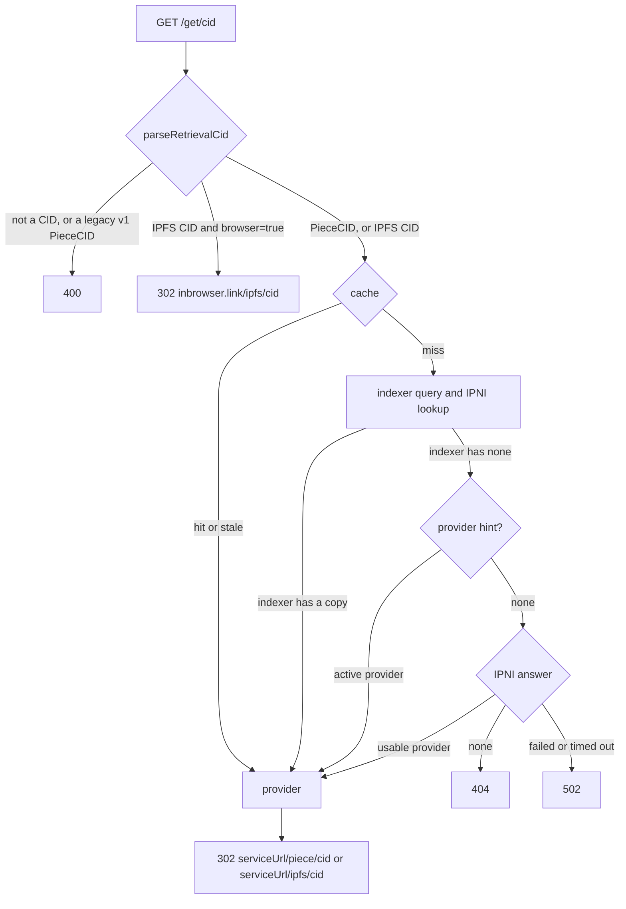

# Retrieval through `/get/{cid}`

filecoin-api's `GET /get/{cid}` route turns a CID into a redirect to a server that has the content. This page explains how the route finds that server. It asks the indexer database first, then the `provider` hint, and then [cid.contact](https://cid.contact), the public instance of the [InterPlanetary Network Indexer](https://docs.ipfs.tech/concepts/ipni/) (IPNI). With IPNI, `/get` is not limited to content stored through Filecoin Warm Storage Service (FWSS).

This page describes the route's parameters, responses, lookup order, and cache, and the IPNI research behind them. Other docs link here instead of repeating them. The measurements on this page ran on 2026-11-10 against mainnet, with `curl` from Lisbon against `api.filecoin.io`, `cid.contact`, and `fetch.cid.contact`, before the route used IPNI.

## Request and responses

`GET /get/{cid}?network=mainnet&browser=false` redirects with a `302` to a server that has the content. The route never proxies the bytes.

| Parameter | Meaning |
| --- | --- |
| `cid` | A PieceCID v2 or any IPFS CID, such as a folder root or a file or block inside it |
| `network` | `mainnet` or `calibration`. Default: `mainnet`. It picks the indexer database, and the registry providers that the route ranks IPNI answers against |
| `browser` | `true` sends IPFS content to inbrowser.link, as the next table shows |
| `provider` | A provider ID to redirect to when the indexer has no copy (see [the hint](#the-hint-comes-after-the-indexer-and-before-cidcontact)) |
| Any other | Forwarded to the target, such as `format=car` |

The CID's codec and multihash decide where the redirect goes:

| CID | `browser` | Redirect |
| --- | --- | --- |
| PieceCID v2 (`bafkzcib…`) | `false` or absent | `{serviceUrl}/piece/{cid}` on a provider that stores the piece |
| PieceCID v2 (`bafkzcib…`) | `true` | `https://inbrowser.link/ipfs/{root}` when the chosen copy has `ipfsRootCID` metadata in an IPFS-indexed data set, otherwise `{serviceUrl}/piece/{cid}` |
| Other CID (IPFS content) | `false` or absent | `{serviceUrl}/ipfs/{cid}` on a provider whose piece has a matching `ipfsRootCID`, or on a provider that IPNI lists for the CID |
| Other CID (IPFS content) | `true` | `https://inbrowser.link/ipfs/{cid}`, without a lookup |

The route answers with these statuses:

| Status | Code | When |
| --- | --- | --- |
| `302` | | A source has the CID |
| `400` | `invalid_request` | The input is not a CID, or it is a legacy v1 PieceCID (`baga…`) |
| `404` | `not_found` | No source has the CID |
| `429` | `rate_limited` | The client IP sent more than 120 requests in a minute |
| `502` | `ipni_unavailable` | The indexer has no copy, no hint applies, and IPNI fails or times out |

A redirect has these headers:

- **`X-Source`** reports where the answer came from: `index`, `hint`, or `ipni`.
- **`X-Cache`** reports `hit`, `stale`, `miss`, or `none`. It is `none` for a redirect to inbrowser.link that needs no lookup.
- **`Cache-Control`** is `public, max-age=60` for a redirect to a provider, because the route already serves it from [its own cache](#what-the-route-caches). It is `public, max-age=86400` for a redirect to inbrowser.link that the route builds from the request alone.

The route's trace span gets `filecoin.cid.kind`, `filecoin.cache`, `filecoin.provider_id`, and `filecoin.retrieval.source`. Workers tracing records the IPNI request as a `fetch` span.

## How `/get/{cid}` resolves a CID

The route is in [`routes/retrieval.ts`](../../apps/filecoin-api/src/routes/retrieval.ts), and its IPNI client is in [`ipni.ts`](../../apps/filecoin-api/src/ipni.ts).

The route takes these steps:

1. [`parseRetrievalCid`](../../apps/filecoin-api/src/cid.ts) classifies the CID. A CID with the `fr32-sha2-256-trunc254-padded-binary-tree` multihash is a PieceCID v2. Any other CID is IPFS content, normalized to base32 CIDv1. Legacy v1 PieceCIDs (`baga…`) return `400`.
2. An IPFS CID with `browser=true` goes to `https://inbrowser.link/ipfs/{cid}` with no lookup. inbrowser.link finds the blocks itself, through IPNI, and verifies them in the browser.
3. The route reads the stale-while-revalidate cache, under `/__cache/v3/{network}/{kind}/{cid}`. A cached answer wins, whether it came from the indexer or from IPNI.
4. On a miss, the route asks the indexer database of the `network` query parameter. `findPieceProvider` matches `pieces.cid`. `findIpfsRootProvider` matches `pieces.ipfs_root_cid` in data sets with `with_ipfs_indexing`. Both keep only live copies on active providers with an HTTP service URL. They rank endorsed providers first, then approved ones, then the oldest copy.
5. If the indexer has no copy, a `provider={id}` hint that names an active provider is the answer.
6. Otherwise the route uses cid.contact's answer, ranked against the registry.
7. The route redirects to `{serviceUrl}/piece/{cid}` or `{serviceUrl}/ipfs/{cid}`, the paths Curio serves. With `browser=true`, a PieceCID whose indexed copy has an `ipfsRootCID` goes to inbrowser.link instead. The route forwards every query parameter except `network`, `browser`, and `provider`.

Two clients build `/get` links:

- The CLI's `put` returns `urls.piece` and `urls.browser`. [The put flow](architecture.md#the-put-flow) lists the link for a file and for a folder, and when `put` reports early links with a hint.
- The app's [`retrievalUrl`](../../apps/filecoin-app/src/lib/retrieval.ts) builds `/get/{cid}?browser=true` for explorer links.

### Why the indexer is not enough

The indexer knows only what FWSS contracts record on chain. Before the route used IPNI, it had four gaps:

- **Only the root of a folder resolved.** The indexer stores the `ipfsRootCID` piece metadata, not the CIDs of the files and blocks inside the CAR. A link to a file inside a folder returned `404`.
- **New content waited for the indexer.** The indexer sees a piece after the add-pieces transaction confirms. A folder's root returned `404` from `/get` until then, even though Curio already served it.
- **Content stored outside FWSS never resolved.** A CID served by any other Filecoin or IPFS provider returned `404`.
- **A network without a database returned `503`,** even for content that a provider serves.

IPNI closes the first three gaps for IPFS CIDs. A network without a database binding now resolves through IPNI alone, in IPNI's order. The route ignores its `provider` hint, because it has no provider list to check the hint against.

## What IPNI knows

Content providers publish signed advertisements to IPNI. Each advertisement lists multihashes, a context ID that groups them, metadata that names the retrieval protocol, and the provider's peer ID and addresses. cid.contact ingests them and answers lookups:

| Endpoint | Returns |
| --- | --- |
| `GET /cid/{cid}`, `GET /multihash/{mh}` | `MultihashResults` with each provider's `ContextID`, `Metadata`, peer ID, and multiaddrs. `Accept: application/x-ndjson` streams one provider per line. |
| `GET /routing/v1/providers/{cid}` | The same providers in the [delegated routing](https://specs.ipfs.tech/routing/http-routing-v1/) format, with protocol names such as `transport-ipfs-gateway-http` instead of raw metadata. `Accept: application/x-ndjson` streams one provider per line. |
| `GET /providers` | Every provider's peer ID, addresses, and last advertisement time |

The metadata starts with a multicodec that names the transport. `0x0920` is `transport-ipfs-gateway-http`, a trustless gateway that serves `/ipfs/{cid}`. `0x0930` is `transport-filecoin-piece-http`, which serves `/piece/{cid}` ([FRC-0066](https://github.com/filecoin-project/FIPs/blob/master/FRCs/frc-0066.md)).

cid.contact answers an unknown CID with `404`. Its CDN caches that `404` for up to 20 minutes (`s-maxage=1200`), so a CID that someone looked up before Curio advertised it can take that long to resolve.

### What Curio announces for FWSS

FWSS data sets go through Curio's PDP v0 path, [`task_pdp_v0_ipni.go`](https://github.com/filecoin-project/curio/blob/main/tasks/indexing/task_pdp_v0_ipni.go). For a piece in a data set with `withIPFSIndexing`, Curio advertises every block multihash in the CAR with `0x0920` metadata. The context ID is one flags byte followed by the PieceCID v2 bytes ([`PdpIpniContext`](https://github.com/filecoin-project/curio/blob/main/market/ipni/types/types.go)). One record from cid.contact decodes to flags `0x01`, the payload flag, and `bafkzcibftt4poaqteiv5gzoutzi4lmy727flqa2dlp6c6vzct2m7cpdhsiqmi4k3vqha`, the same piece the indexer stores for that root.

Curio advertises a CAR before the add-pieces transaction confirms. It sets `needs_indexing` when it receives the add-pieces request ([`handlers_add.go`](https://github.com/filecoin-project/curio/blob/e00c24bdbb347dcec7ea0bf289d06985f0738023/pdp/handlers_add.go#L432-L470)). Its indexing task runs about every 3 seconds, and its IPNI task about every 30 seconds. Curio's `/ipfs` endpoint answers only after indexing. A folder's blocks therefore resolve through IPNI, and through inbrowser.link, shortly after the client sends the commit.

Curio does not advertise FWSS PieceCIDs yet. Its newer pipeline, [`task_pdp_ipni.go`](https://github.com/filecoin-project/curio/blob/main/tasks/indexing/task_pdp_ipni.go), can advertise the PieceCID multihash itself with `0x0930` metadata. Curio will probably enable it for FWSS soon. Until then, a new FWSS piece resolves only through the indexer or the hint. Every provider in the sample of roots below had content in cid.contact. The seven mainnet provider hosts we looked up in `GET /providers` had each published an advertisement in the 15 minutes before the check.

Curio withdraws a PDP advertisement only when it garbage-collects the piece ([`task_piece_gc.go`](https://github.com/filecoin-project/curio/blob/main/tasks/pdpv0/task_piece_gc.go)). Until cid.contact processes the withdrawal, it still lists a provider that dropped the piece.

The FWSS service provider registry has `ipniPiece`, `ipniIpfs`, and `ipniPeerId` capabilities in each PDP offering. synapse-core reads them as `PDP_OFFERING_KEYS`. The indexer does not store them, so the API's provider records have no peer ID.

### What fetch.cid.contact does

`https://fetch.cid.contact/retrieve/{cid}` is a redirect service like `/get`, backed by cid.contact instead of a database:

- A PieceCID v2 redirects to `{provider}/piece/{cid}`.
- Any other CID redirects to `{provider}/ipfs/{cid}?format=car`.
- It takes the first provider that advertises the matching transport with an https address. It does not rank providers.
- It returns `404` when cid.contact lists no provider, and `502` when cid.contact is unavailable.

We found no public source for it. Redirecting `/get` misses to it would add a hop to a service we don't run, ignore our ranking, and force `format=car` on every IPFS redirect. The route queries cid.contact directly instead.

## What the measurements show

Each row compares cid.contact with `/get`, before the route used IPNI, on the same CIDs:

| CIDs | cid.contact | `/get` with the indexer only |
| --- | --- | --- |
| 4 PieceCIDs, with and without an IPFS root | 0 found | 4 found |
| 78 IPFS roots, one from each of the newest IPFS-indexed data sets | 73 found | 76 found |
| 4 child blocks inside one indexed root | 4 found | 0 found |

- **Five roots are missing from cid.contact.** Two return `404` from `/get` too, most likely because their providers removed the pieces. The other three are one 418 MB `ipfs2fil` root stored on providers 1, 5, and 32. It was added at block 6531147, about 21 hours before the check, and none of the three providers had it in cid.contact. We did not find out why.
- **Lookups are fast.** cid.contact answered in 350 to 490 ms on a cold lookup and 50 to 90 ms on a repeat, because a CDN caches its answers. A cached `/get` answered in about 120 ms.
- **delegated-ipfs.dev returned the same record** as cid.contact for the same root, in 800 ms. It queries the Amino DHT as well as IPNI.
- **cid.contact mixes networks.** Calibration providers, such as `calib.ezpdpz.net`, advertise to the same instance as mainnet providers.

## How the route uses cid.contact

The indexer stays the preferred source, because it knows which copies are live on chain and how to rank them. cid.contact is the fallback for any CID the indexer misses, for both kinds, and for any provider that advertises a usable transport.

### The route races cid.contact with the indexer, and prefers the indexer

On a cache miss without a `provider` hint, the route starts the indexer query and the cid.contact lookup at the same time. It does not take whichever answers first:

1. **The indexer has a copy.** The route redirects to it, and aborts the cid.contact request.
2. **The indexer has no copy.** The route waits for cid.contact, keeps the usable providers, ranks them, and redirects to the first one.
3. **cid.contact has no usable provider.** The route returns `404`.
4. **cid.contact fails or times out.** The route returns `502` with the code `ipni_unavailable`. A `404` would claim that no one serves the CID.

An indexer miss costs the slower of the two lookups instead of their sum. cid.contact took 350 to 490 ms on a cold lookup, so the saving is the length of the indexer step. An indexer hit is as fast as before.

The indexer wins over a faster cid.contact answer for two reasons:

- **cid.contact can list a provider that dropped the piece,** until it processes Curio's withdrawal.
- **cid.contact does not rank.** Its order is not the route's order of endorsed, then approved, then oldest copy.

Only a cache miss races. The background revalidation of a stale entry has no caller waiting, so it asks the indexer first and calls cid.contact only on a miss.

### The hint comes after the indexer and before cid.contact

Curio serves `/piece/{cid}` for a piece as soon as the provider parks it, before the indexer sees the commit. `filecoin put` adds `provider={id}` only to the links it reports in that window, before the commit confirms. The indexer has no copy then, and cid.contact has no FWSS PieceCID. The caller knows where the piece is, so the hint is the fastest correct answer. With a hint, the route resolves in this order:

1. **The indexer has a copy.** The route redirects to it. An indexed copy always wins over the hint, so a link that keeps its hint follows the ranking once the indexer has the piece.
2. **The hint names an active provider** in the [cached list of active providers](#the-route-caches-the-active-providers). The route redirects to it, and does not cache the answer.
3. **The hint names no active provider.** The route looks up cid.contact and continues as a request without a hint.

A request with a hint does not race. It runs only the indexer query, and calls cid.contact only if both the indexer and the hint miss. Every early link gets its answer without waiting for cid.contact, and does not spend a cid.contact request that the hint makes useless.

The hint stays after the indexer. A hint ahead of the indexer would skip one query, only for early links, and the redirect would then never move to the ranked copy, even after the provider removes the piece.

### The route looks up providers with delegated routing

[`findIpniProviders`](../../apps/filecoin-api/src/ipni.ts) sends `GET {IPNI_URL}/routing/v1/providers/{cid}` with `Accept: application/x-ndjson`. `IPNI_URL` is a Worker variable in [`wrangler.jsonc`](../../apps/filecoin-api/wrangler.jsonc), set to `https://cid.contact`. The delegated routing format is a published spec that cid.contact, delegated-ipfs.dev, and self-hosted routers all serve, so the route can switch routers through `IPNI_URL` alone. cid.contact is the only router the route calls.

The lookup times out after 2 seconds. It reads the NDJSON body line by line and cancels it after 20 records, so the Worker never buffers the whole answer for a CID with many providers. `/cid/{cid}` also returns the context ID, but only Curio's context IDs contain a PieceCID, and the route does not need the PieceCID to redirect.

### The route keeps providers it can redirect to

A provider is usable if it has the transport for the CID's kind and an https address:

| CID kind | Protocol | Redirect |
| --- | --- | --- |
| IPFS | `transport-ipfs-gateway-http` | `https://{host}[:{port}]/ipfs/{cid}` |
| PieceCID v2 | `transport-filecoin-piece-http` | `https://{host}[:{port}]/piece/{cid}` |

[`httpsOrigin`](../../apps/filecoin-api/src/ipni.ts) accepts multiaddrs of the form `/dns/{host}/tcp/{port}/https`, `/dns4/…`, `/dns6/…`, and the same forms ending in `/tls/http` or `/tls/sni/{name}/http`. It skips `/ip4` and `/ip6` addresses, plain `http`, and libp2p-only providers. A certificate rarely matches an IP address, and a browser blocks an https page from loading plain http.

Because FWSS providers don't advertise PieceCIDs yet, a PieceCID lookup in cid.contact finds only pieces stored through other Curio pipelines. Once Curio advertises FWSS PieceCIDs, the route resolves a new FWSS piece through cid.contact before the indexer sees the commit, with no code change.

### The route ranks registry providers first

[`rankIpniProviders`](../../apps/filecoin-api/src/routes/retrieval.ts) matches each IPNI provider to a provider in the [cached list of active providers](#the-route-caches-the-active-providers) of the requested `network`, by the `URL.host` of its address and of `service_url`. `URL.host` drops the default port 443. The route cannot match by peer ID, because the indexer does not store the registry's `ipniPeerId` capability.

Matched providers come first, endorsed and then approved, and the route redirects to the registry's `service_url`, which keeps any path it has. Unmatched providers follow in cid.contact's order, at the origin they advertise. They are still valid answers, and they are how the route serves content stored outside FWSS.

IPNI does not know which network a provider is on. For an IPNI answer, `network` only decides which providers to rank against.

### What changed for callers

- A link to any file or block inside a stored folder resolves.
- `/get/{rootCid}` without `browser=true` resolves once Curio advertises the CAR, which happens before the commit confirms. `put` could then report a folder's early link on `/get` instead of only through inbrowser.link.
- A CID stored by any provider with an https trustless gateway or piece endpoint resolves, on Filecoin or not.
- An unmatched provider is a server nobody vetted. A client that verifies the bytes, such as one that fetches `?format=car` or `?format=raw` and checks the hashes, is safe. A browser that renders `/ipfs/{cid}` from that server trusts it. `browser=true` already sends IPFS CIDs to inbrowser.link, which verifies.

## What the route caches

The route keeps its entries in the [Workers Cache API](https://developers.cloudflare.com/workers/runtime-apis/cache/), with stale-while-revalidate. The cache is per datacenter. It also works on `workers.dev` preview URLs. Only the dashboard editor and the Playground ignore Cache API calls.

### The route caches answers, not misses

- **Answers.** The route caches each answer under `/__cache/v3/{network}/{kind}/{cid}`, with its source, whether it came from the indexer or from cid.contact. An answer is fresh for 10 minutes. After that, the route still serves it at once for up to 24 hours, and refreshes it in the background after the response.
- **Misses.** The route never caches a miss, not even for a few seconds, so a folder resolves as soon as Curio's advertisement reaches cid.contact. The per-IP rate limit of 120 requests a minute caps how often one client can make the route call cid.contact. cid.contact's own CDN can still cache its `404` for up to 20 minutes.
- **Hinted answers.** The route never caches them, so the indexer's ranking takes over once it has the piece.

### The route caches the active providers

Ranking needs each provider's host, `endorsed`, and `approved`. A query for them after cid.contact answers would add a database round trip back to the path the race shortens. The route keeps the list in the same cache instead:

- **Key.** `/__cache/v3/{network}/providers`.
- **Entries.** [`listActiveProviders`](../../apps/filecoin-api/src/queries/providers.ts) returns every provider that is active, has an active PDP product, and has an `http` or `https` service URL. Each entry has `providerId`, `serviceUrl`, the `URL.host` of the service URL, `endorsed`, and `approved`. Mainnet had 49 such providers and calibration 56 on 2026-11-10.
- **Freshness.** The list is fresh for 10 minutes, and the route serves it stale for up to 24 hours, the same limits as answers.
- **Load.** The route reads the list only after the indexer misses. cid.contact is still answering then, so a cache miss on the list rarely adds to the wait, and an indexer hit never reads it.

The list also answers the `provider` hint. A hint counts only if it names a provider in the list. A provider that registered in the last 10 minutes can be missing from a fresh list. Its hint then falls through to cid.contact until the route revalidates the list.

## Decisions

The research raised these questions:

- **Race cid.contact with the indexer?** Yes, and the indexer's answer wins whenever it has a copy.
- **Where does the `provider` hint go?** After the indexer and before cid.contact. A request with a hint calls cid.contact only if the hint names no active provider.
- **Query the registry for ranking after cid.contact answers?** No. The route caches the active providers per network, and the same list answers the `provider` hint.
- **Cache cid.contact misses?** No. Misses are never cached.
- **Resolve legacy v1 PieceCIDs through cid.contact?** No. They keep returning `400`.
- **Find out why the 418 MB `ipfs2fil` root is missing from cid.contact?** No. The fallback does not depend on the answer.
- **Have FWSS providers advertise PieceCIDs?** Curio will probably enable it for FWSS soon. The route already looks up PieceCIDs in cid.contact, so it needs no change when Curio does.
- **Store the registry's `ipniPeerId`, `ipniPiece`, and `ipniIpfs` capabilities in the indexer?** Not for now. Ranking matches providers by host.
- **Use delegated-ipfs.dev as a second router?** No. cid.contact is the only router.
